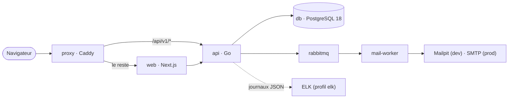

# Heros-SOS

Plateforme web qui rapproche les **citoyens** et les **super-héros** pour signaler et traiter les incidents causés par des super-vilains, sous la surveillance de **modérateurs**.

[](https://github.com/ashandcompany/heros-sos/actions/workflows/backend-ci.yml)
[](https://github.com/ashandcompany/heros-sos/actions/workflows/frontend-ci.yml)
[](https://github.com/ashandcompany/heros-sos/actions/workflows/docs-ci.yml)

**Sommaire** : [Présentation](#présentation) · [Architecture et stack](#architecture-et-stack) · [Démarrage rapide](#démarrage-rapide) · [Ports et adresses](#ports-et-adresses-des-services) · [Commandes](#commandes-utiles) · [Autres façons de lancer le projet](#autres-façons-de-lancer-le-projet) · [Tests et CI](#tests-et-intégration-continue) · [Documentation](#documentation) · [Dépannage](#dépannage) · [Contribuer](#contribuer)

---

## Présentation

### Le scénario

1. Un **citoyen** s'inscrit, active son compte par e-mail et se connecte.
2. Il consulte les incidents en cours pour éviter un doublon, puis **déclare un incident**.
3. Un **modérateur** valide les comptes de héros et surveille les incidents (priorité, doublons, corrections).
4. Un **héros** reçoit l'alerte, voit les incidents par priorité, **prend l'incident en charge** puis le clôture (réussi ou échoué).
5. Les incidents réussis apparaissent sur la page d'accueil.

### Les trois rôles

| Rôle | Ce qu'il peut faire |
|---|---|
| **Citoyen** | S'inscrire, déclarer un incident (même sans réseau : l'action est envoyée au retour de la connexion), suivre « mes incidents », gérer son profil et sa photo, demander à devenir super-héros, s'abonner à la newsletter |
| **Héros** | Voir les incidents, en prendre un en charge, rejoindre ou inviter d'autres héros, proposer et voter le résultat, consulter son tableau de bord |
| **Modérateur** | Valider les demandes de super-héros, modérer et corriger les incidents, désactiver un compte, gérer les super-vilains, les films, les articles du blog et la newsletter (back-office `/admin`) |

La **double authentification (TOTP)** est obligatoire pour les modérateurs en production, et facultative pour les autres comptes.

### Ce que voit tout visiteur

Page d'accueil (derniers incidents résolus), **carte des incidents**, annuaire des héros, encyclopédie, vidéothèque, blog, FAQ, contact, à propos et pages légales.

### Ce qui distingue le projet

- **Performance** : conçu pour **5 millions d'incidents** en base avec un temps de réponse (p95) sous **350 ms** : index ciblés, compteurs tenus par triggers, pagination par curseur. Mesures et méthode : [performance et synchronisation](backend/stack/performance-et-synchronisation.md).
- **Hors ligne et temps réel** : les actions faites sans réseau sont rangées dans une file chiffrée du navigateur, puis rejouées sans doublon (clé d'idempotence) ; les écrans se mettent à jour en direct (SSE). Ce parcours n'a pas encore été essayé dans un vrai navigateur : voir les limites dans la doc.
- **Journal d'événements** (event sourcing limité aux incidents et aux interventions) et **monitoring ELK** optionnel : p95 par route, erreurs, délai de synchronisation.
- **Sécurité** : mots de passe argon2id, cookie de session, CSRF, limitation de débit, contrôle d'accès à chaque route, données personnelles chiffrées, liens signés, journal d'audit.
- **Mails** : une file RabbitMQ et un service dédié (`mail-worker`) envoient les e-mails ; Mailpit les capture en développement. En production, ce mode durable est à activer (`COMPOSE_PROFILES=rabbitmq` et `HEROS_MAIL_QUEUE=rabbitmq`) : sinon la file reste en mémoire et les mails en attente sont perdus si l'API est tuée brutalement (voir [le README du backend](backend/README.md)).

---

## Architecture et stack



| Brique | Technologie |
|---|---|
| **Frontend** | Next.js 16 (App Router), React 19, TypeScript strict, Tailwind CSS v4, Leaflet (carte) |
| **Backend** | API REST en Go 1.26 (GORM), contrat OpenAPI « spec d'abord » dans `backend/openapi/` |
| **Base de données** | PostgreSQL 18 |
| **Reverse proxy** | Caddy : une seule origine pour le navigateur, TLS en production |
| **Mails** | RabbitMQ + `mail-worker` ; Mailpit en développement |
| **Monitoring** (optionnel) | Elasticsearch, Logstash, Kibana, Filebeat (Elastic 9.3.1) |
| **Documentation** | Docusaurus (`docs-site/`) |
| **Outillage** | Docker Compose, Make, GitHub Actions |

Détail et schémas : [architecture](docs-site/docs/architecture.md) et [choix techniques du backend](backend/STACK.md).

---

## Démarrage rapide

**Prérequis** : **Docker** et **make** (sans make : [`./make`](#sans-make-installé)). Docker Desktop : prévoir **16 Go de disque** pour sa machine virtuelle (Settings → Resources), car la pile, ses images et le cache de build dépassent 8 Go ; avec un disque plein, les builds échouent et PostgreSQL ne peut plus écrire.

```bash
git clone git@github.com:ashandcompany/heros-sos.git
cd heros-sos

make up     # proxy, front, API, PostgreSQL, Mailpit, RabbitMQ, documentation
make seed   # (une fois) des données de démonstration : héros, vilains, incidents…
```

Puis ouvrir **<http://localhost:8088>**.

- Le premier `make up` **crée `backend/.env`** avec des secrets aléatoires et **construit les images** (plus long que les lancements suivants). Il vérifie d'abord l'espace libre de Docker (1,5 Go minimum, `FORCE=1` pour passer outre) et qu'aucun port n'est déjà pris.
- Les mails (activation, mot de passe oublié…) ne quittent pas votre machine : lisez-les dans **Mailpit**, <http://localhost:8025>.
- Le code du front et celui de la documentation sont montés dans leurs conteneurs et **rechargés à chaud**.
- `make down` arrête la pile en gardant les données ; `make reset` les **supprime** (après confirmation).

> **Sauvegardez `HEROS_CRYPTO_KEYS`** (dans `backend/.env`) : sans cette clé, les données personnelles chiffrées en base sont définitivement illisibles.

### Comptes de démonstration

Après `make seed`, **tous les comptes ont le mot de passe `Avengers2026!`** (démonstration uniquement : `make seed` est refusé en production).

| Compte | Rôle |
|---|---|
| `admin@heros-sos.local` (Nick Fury) | Modérateur |
| `tony.stark@heros-sos.local`, `peter.parker@heros-sos.local` | Héros |
| `jane.foster@heros-sos.local`, `mary.jane.watson@heros-sos.local` | Citoyens |

`make seed` est refusé sur une base déjà remplie ; `make seed RESET=1` **efface d'abord toutes les données**. Pour créer un modérateur à part :

```bash
make moderator EMAIL=modo@example.org FIRST=Nick LAST=Fury BIRTH=1950-12-04   # le mot de passe est demandé, jamais passé en argument
```

---

## Ports et adresses des services

Tous les ports sont liés à **`127.0.0.1`** : rien n'est exposé sur le réseau. Ils se changent dans `backend/.env` avec la variable indiquée.

| Service | Adresse | Variable | Disponible avec |
|---|---|---|---|
| **Application** (front + API, via le proxy) | <http://localhost:8088> | `PROXY_PORT` | `make up` |
| Documentation de l'API (Swagger) | <http://localhost:8088/api/v1/docs> | `PROXY_PORT` | `make up` |
| API directe | <http://localhost:8081/api/v1> | `API_PORT` | `make up` |
| Documentation technique (Docusaurus) | <http://localhost:3001/heros-sos/> | `DOCS_PORT` | `make up` ou `make docs` |
| Mails reçus (Mailpit) | <http://localhost:8025> | `MAILPIT_PORT` | `make up` |
| RabbitMQ, interface de gestion | <http://localhost:15672> | `RABBITMQ_UI_PORT` | `make up` |
| RabbitMQ, AMQP | `localhost:5672` | `RABBITMQ_PORT` | `make up` |
| PostgreSQL | `localhost:5432` | `POSTGRES_PORT` | `make up` |
| Adminer (client SQL) | <http://localhost:8082> | `ADMINER_PORT` | `make adminer` |
| Kibana (monitoring) | <http://localhost:5601> | `KIBANA_PORT` | `make elk` |
| Elasticsearch | <http://localhost:9200> | `ELASTICSEARCH_PORT` | `make elk` |

Hors de la pile Docker complète :

| Quoi | Adresse | Comment |
|---|---|---|
| Frontend seul | <http://localhost:3000> | `cd frontend && npm run dev` |
| API seule | <http://localhost:8080/api/v1> | `cd backend && make run` |
| API des mesures de performance | <http://127.0.0.1:8090/api/v1> | `make perf-run` |

**En production**, seul le proxy publie des ports : **80** et **443** (HTTP/3 compris, en UDP), réglables par `HTTP_PORT` et `HTTPS_PORT`. La base, RabbitMQ et le reste restent sur un réseau fermé.

Connexion à la base avec un client SQL (DBeaver, Adminer…) : hôte `localhost`, port `5432`, base `herossos`, utilisateur `heros`, mot de passe `heros` en développement (valeur par défaut de `POSTGRES_PASSWORD`).

---

## Commandes utiles

`make help` liste toutes les cibles. Elles délèguent à `backend/Makefile`, qui reste utilisable directement (`cd backend && make help`). L'environnement (`.env`, `.env.production`) et les secrets restent dans `backend/`.

| Commande | Effet |
|---|---|
| `make up` / `make down` | Démarre / arrête la pile de développement (les données sont conservées) |
| `make logs`, `make ps` | Suit les journaux de tous les conteneurs ; liste les conteneurs, leur état et leurs ports |
| `make docs` | Démarre seulement la documentation |
| `make adminer` | Ajoute Adminer, un client SQL |
| `make seed` | Données de démonstration Marvel (modérateurs, héros, citoyens, vilains, incidents, interventions, avis, films, articles) ; `RESET=1` **efface d'abord toutes les données** |
| `make moderator EMAIL=… FIRST=… LAST=… BIRTH=AAAA-MM-JJ` | Crée un modérateur |
| `make resetmfa EMAIL=…` | Réinitialise la double authentification d'un compte qui a perdu son appareil, **en développement** (vérifier son identité d'abord). En production : `make resetmfa-prod EMAIL=…` depuis `backend/` |
| `make reset` | Arrête la pile **et supprime ses données** (base, photos, RabbitMQ), après confirmation |
| `make elk`, `make elk-down` | Monitoring ELK (profil Compose `elk`) : journaux JSON de l'API, p95 par route, chronologie des événements, délai de synchronisation. Mesuré : 3,3 Go de mémoire (5,7 Go avec toute la pile, donc **8 Go pour Docker**) et environ 6 Go d'images. Voir [Monitoring ELK](backend/stack/elk.md) |
| `make perf-prepare`, `make seed-perf`, `make perf-run`, `make perf`, `make perf-indexes-off` / `-on` | Mesures sur 5 millions d'incidents, dans une base dédiée `herossos_perf` : `seed-perf` ajoute les incidents (`PERF_MAX_SIZE_GB=10`, 8,2 Go mesurés, **11 Go libres** à prévoir), `perf` échoue si le p95 dépasse 350 ms, `perf-indexes-off` / `-on` rejouent l'avant/après. Voir [la doc](backend/stack/performance-et-synchronisation.md) |
| `make slow-queries` | Classe les requêtes de la base de développement par temps total (`pg_stat_statements`) : ce qui désigne les requêtes à optimiser. `DB_NAME=herossos_perf` pour la base des mesures. À relancer après `make reset`. Développement seulement |
| `make check` | Valide la syntaxe des fichiers Compose (développement et production) |
| `make secrets`, `make up-prod`, `make down-prod`, `make logs-prod` | Production : voir [le README du backend](backend/README.md#environnements-docker) |

---

## Autres façons de lancer le projet

### Sans make installé

Seul Docker est nécessaire : `./make` lance `make` dans un conteneur, avec les mêmes cibles et les mêmes arguments.

```bash
./make                                  # liste les cibles (make help)
./make up                               # comme make up
./make moderator EMAIL=modo@example.org FIRST=Nick LAST=Fury BIRTH=1950-12-04
FORCE=1 ./make up                       # les variables d'environnement lues par les Makefile sont transmises
```

Au premier appel, le script construit une image d'environ 250 Mo (`docker/make/` : make, bash, openssl, client Docker et Compose) : il faut internet cette fois-là, puis plus rien à télécharger. Ce n'est pas un Docker imbriqué : `./make` pilote le Docker de la machine (son socket est monté), donc `./make up` et `make up` donnent la même pile, et l'un peut arrêter ce que l'autre a démarré. Le dépôt est monté au même chemin que sur la machine, et `make` tourne avec votre utilisateur : `backend/.env` et `backend/secrets/` vous appartiennent. Depuis un sous-dossier, `../make` lance le Makefile de ce dossier.

Limites :

- Les cibles qui lancent Go sur la machine (`perf-prepare`, `seed-perf`, `perf-run`, `perf`, et `run`, `test`, `lint`… de `backend/Makefile`) exigent Go installé et ne passent pas par `./make`.
- `make up` contrôle d'abord (avec `lsof`) qu'aucun port n'est déjà pris ; `./make up` laisse Docker annoncer le conflit.
- Prévu pour macOS, Linux et WSL2 (Docker Desktop ou Docker Engine). Sous Windows, lancez `./make` depuis WSL2 : Git Bash n'est pas pris en charge.

### Frontend seul

Prérequis : **Node.js ≥ 22** (version de la CI) et **npm ≥ 10**.

```bash
cd frontend
cp .env.example .env.local
npm install
npm run dev
```

L'application est disponible sur <http://localhost:3000>. Sans `API_URL`, toutes les données proviennent de `frontend/src/mocks/` (comptes de test dans `src/mocks/users.ts`, ex. `citoyen@heros-sos.fr` / `Citoyen123!`).

Variables (à copier de `frontend/.env.example`, puis redémarrer `npm run dev` après chaque modification) :

| Variable | Rôle |
|---|---|
| `API_URL` | URL de base de l'API REST, préfixe compris : `http://localhost:8081/api/v1` avec `make up`, `http://localhost:8080/api/v1` avec `make run`. Lue par le serveur Next uniquement. Vide : tout le frontend tourne sur les mocks |
| `MAP_TILE_URL` | Fond de la carte des incidents. Vide : tuiles publiques OpenStreetMap, réservées au développement |
| `MAP_TILE_ATTRIBUTION` | Mention de la source des tuiles, affichée sur la carte |
| `MAP_TILE_MAX_ZOOM` | Zoom maximal des tuiles |

Quand `API_URL` est renseignée, la majorité des domaines passent par l'API (identité, incidents et interventions, héros, vilains, blog, vidéothèque, compte, newsletter, double authentification…) ; le reste fonctionne encore sur des mocks. L'état exact, domaine par domaine, est tenu à jour dans [frontend/docs/backend-contract.md](frontend/docs/backend-contract.md).

### Backend seul

Prérequis : **Go** (version fixée par `backend/go.mod`, 1.26).

```bash
cd backend
make db-start   # PostgreSQL 18 dans Docker
make env
make migrate
make run        # API sur http://localhost:8080/api/v1
```

Les commandes, les tests et la configuration sont détaillés dans [le README du backend](backend/README.md). Les variables du backend sont décrites dans `backend/.env.example`.

---

## Tests et intégration continue

| Où | Commande | Rôle |
|---|---|---|
| `frontend/` | `npm test` | Tests unitaires (Vitest) |
| `frontend/` | `npm run test:e2e` | Parcours de bout en bout (Playwright) |
| `frontend/` | `npm run lint`, `npm run format:check` | ESLint, Prettier (`npm run format` pour corriger) |
| `frontend/` | `npm run api:types:check` | Vérifie que les types générés suivent le contrat OpenAPI |
| `frontend/` | `npm run build`, `npm run start` | Build et serveur de production |
| `backend/` | `make test` (après `make db-start`) | Tests Go avec PostgreSQL ; les tests d'intégration sont **ignorés sans base** (`HEROS_TEST_DATABASE_URL`) |
| `backend/` | `make check` | Tout ce que vérifie la CI : format et `go vet`, tests, vulnérabilités |
| racine | `make check` | Syntaxe des fichiers Compose (la CI ne la vérifie pas encore : à lancer avant de pousser un changement de `docker-compose*.yml`) |

La CI (GitHub Actions, `.github/workflows/`) :

- **Frontend** (`frontend-ci.yml`) : installation, audit des dépendances, Prettier, ESLint, tests unitaires, types de l'API, build, puis tests de bout en bout.
- **Backend** (`backend-ci.yml`) : `go.mod`/`go.sum`, `golangci-lint` (uniquement sur le code nouveau de la PR), `govulncheck`, tests avec PostgreSQL, build.
- **Documentation** (`docs-ci.yml`) : build du site `docs-site/` ; un lien cassé ou un OpenAPI illisible fait échouer le job.
- **Publication de la documentation** (`docs-deploy.yml`) : déploiement sur GitHub Pages à chaque push sur `develop`. Inactif tant que Pages n'est pas activé dans les réglages du dépôt : voir [docs-site/README.md](docs-site/README.md#intégration-continue-et-déploiement).
- **Relecteurs** : `.github/CODEOWNERS` désigne qui relire selon les fichiers touchés.

---

## Documentation

Le site `docs-site/` (Docusaurus) rassemble la documentation technique : l'architecture en schémas, le MVP, les choix techniques, le schéma de la base de données et le contrat d'API (une page par route, générée depuis `backend/openapi/openapi.yaml`). Il tourne dans Docker : <http://localhost:3001/heros-sos/>, démarré par `make up` (ou seul, par `make docs`) et rechargé à chaud. Rien n'est copié : les documents de `backend/` sont lus tels quels, donc le site ne dérive pas de ce qui est livré. Il n'est pas encore publié en ligne.

| Pour savoir… | Lire |
|---|---|
| Le périmètre de la première version | [backend/MVP.md](backend/MVP.md) |
| Les choix techniques du backend (une page par sujet) | [backend/STACK.md](backend/STACK.md), `backend/stack/` |
| Le schéma de la base (une page par domaine) | [backend/TABLES.md](backend/TABLES.md), `backend/tables/` |
| Le contrat de l'API | [backend/openapi/openapi.yaml](backend/openapi/openapi.yaml) |
| Les performances, la synchronisation hors ligne, le journal d'événements | [backend/stack/performance-et-synchronisation.md](backend/stack/performance-et-synchronisation.md) |
| Le monitoring ELK | [backend/stack/elk.md](backend/stack/elk.md) |
| Docker, le déploiement en production | [backend/stack/docker.md](backend/stack/docker.md), [backend/README.md](backend/README.md#environnements-docker) |
| Le frontend : architecture, conventions, interface, contrat avec le backend | [frontend/docs/](frontend/docs/) : [architecture](frontend/docs/architecture.md), [conventions](frontend/docs/conventions.md), [interface](frontend/docs/ui.md), [contrat](frontend/docs/backend-contract.md) |
| Le site de documentation (ajouter une page) | [docs-site/README.md](docs-site/README.md) |

**Maquettes Figma** : à compléter · **Environnement de recette** : à compléter

---

## Structure du dépôt

| Dossier | Contenu |
|---|---|
| `frontend/` | Application Next.js 16 : routes dans `src/app/` (accueil, carte, héros, encyclopédie, vidéothèque, blog, FAQ, contact, à propos, pages légales, authentification, profil, back-office `admin/`), composants par domaine dans `src/components/`, couche d'accès aux données dans `src/lib/api/` (seule à connaître l'API et les mocks), validation des formulaires dans `src/lib/validation/`, données fictives dans `src/mocks/`, types métier dans `src/types/`, styles et design tokens Tailwind dans `src/app/globals.css` (bloc `@theme`) |
| `backend/` | API REST en Go : `cmd/` (l'API, `mailworker`, `createmoderator`, `resetmfa`, `seed`, et les outils de mesure `loadtest`, `replay`, `seedperf`), `internal/` (un paquet par domaine), `migrations/` (SQL versionné), `openapi/` (le contrat) |
| `docs-site/` | Site de documentation Docusaurus (son propre `package.json`, tourne dans Docker) |
| `docker-compose*.yml`, `Makefile`, `make` | Piles Docker de développement et de production et leurs raccourcis (`make help`), et le lanceur `./make` |
| `docker/make/` | Image de `./make` |
| `.github/` | CI du frontend, du backend et de la documentation, et `CODEOWNERS` |

---

## Dépannage

| Symptôme | Cause probable | Que faire |
|---|---|---|
| `make up` refuse de démarrer : disque de Docker presque plein | Pas assez de place dans le disque virtuel de Docker (1,5 Go minimum) | `docker builder prune -a -f` (cache de build), ou agrandir le disque (Docker Desktop, Settings → Resources) ; `FORCE=1 make up` pour passer outre |
| « port déjà utilisé » | Un autre programme occupe 8088, 5432, 8025… | Changer la variable du port dans `backend/.env` (voir [Ports](#ports-et-adresses-des-services)) |
| Les mails n'arrivent pas | Ils ne sortent pas de la machine en développement | Les lire dans Mailpit, <http://localhost:8025> |
| Kibana vide, ou Elasticsearch qui redémarre | Mémoire de Docker insuffisante, ou l'API écrit encore en texte | Donner 8 Go à Docker, relancer `make elk` (voir [Monitoring ELK](backend/stack/elk.md#dépannage)) |
| `make slow-queries` ne montre rien après `make reset` | `make reset` a effacé l'extension avec la base | Relancer `make slow-queries` : il la recrée |
| Des tests d'intégration du backend sont ignorés | `HEROS_TEST_DATABASE_URL` n'est pas définie | `make db-start` puis `make test` ; la CI échoue au lieu d'ignorer |
| Une donnée chiffrée est illisible | La clé `HEROS_CRYPTO_KEYS` a changé ou a été perdue | Restaurer la clé sauvegardée |

### Journaux

`make logs` suit tous les conteneurs (`make logs-prod` en production). L'API écrit en texte en développement et en JSON en production, au niveau `HEROS_LOG_LEVEL` (`debug`, `info`, `warn` ou `error`). Chaque conteneur garde au plus `LOG_MAX_FILE` fichiers de `LOG_MAX_SIZE` (3 × 10 Mo par défaut), réglables dans `backend/.env` : sans cette limite, Docker les garderait indéfiniment.

---

## Contribuer

- Le travail se fait sur des **branches** (`feat/…`, `fix/…`, `docs/…`, `ci/…`) fusionnées dans **`develop`** par pull request, relue selon `.github/CODEOWNERS`.
- Messages de commit au format `type(portée): résumé` (par exemple `feat(dev): enable pg_stat_statements and add make slow-queries`).
- Avant de pousser : `make check` à la racine si vous touchez aux fichiers Compose, `make check` dans `backend/` pour le Go, `npm run lint && npm test` dans `frontend/`.
- Le backend suit `Controller → Service → Repository` ; le contrat d'API est « spec d'abord » : les tests du backend échouent si une route diverge de `backend/openapi/openapi.yaml`.
