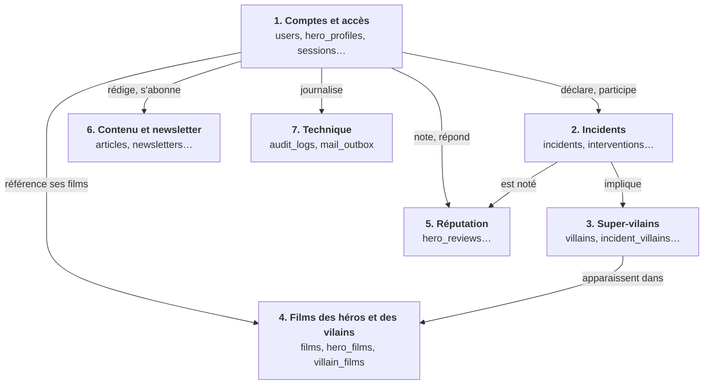

# Tables de la base de données

Schéma PostgreSQL de Heros-SOS, déduit du cahier des charges et des choix de [STACK.md](STACK.md) (GORM, migrations `golang-migrate`, sessions en base, chiffrement des champs sensibles).

## Conventions

- Noms en `snake_case`, tables au pluriel.
- Clés primaires `uuid` (v7) générées côté Go, sauf `incident_types` (`smallint`), `sessions` (hash du jeton), les tables de liaison (clé composite) et les tables dont la clé primaire est aussi une clé étrangère (`hero_profiles`, `user_mfa`, `hero_review_replies`). L'identifiant sert d'AAD au chiffrement des champs.
- Dates en `timestamptz`, avec `created_at` et `updated_at` sur les tables modifiables.
- Valeurs fixes en `text` avec une contrainte `CHECK`, plus simple à faire évoluer qu'un type `ENUM`.
- Emails en `citext` (insensible à la casse).
- 🔒 = champ chiffré par la cascade AES-256-GCM puis XChaCha20-Poly1305, stocké en `bytea`.
- Pas de suppression logique (`deleted_at`) sur les données personnelles : suppression réelle ou anonymisation (droit à l'effacement).

## Vue d'ensemble

Les tables sont rangées en sept domaines, qui ont chacun leur page. La carte ci-dessous montre comment les domaines se parlent ; chaque page détaille les relations de son domaine dans un schéma, une table de l'extérieur apparaissant quand elle est le point de rattachement.

### Carte des domaines

### Légende des schémas

`||` exactement un, `o|` zéro ou un, `o{` zéro ou plusieurs, `|{` un ou plusieurs.

## Les domaines

- **[1. Comptes et accès](tables/comptes.md)** : Les utilisateurs, les profils de héros, les sessions, les jetons à usage unique, les changements d'email et la double authentification.  
  Tables : [`users`](tables/comptes.md#users), [`hero_profiles`](tables/comptes.md#hero_profiles), [`hero_locations`](tables/comptes.md#hero_locations), [`sessions`](tables/comptes.md#sessions), [`user_tokens`](tables/comptes.md#user_tokens), [`email_change_requests`](tables/comptes.md#email_change_requests), [`user_mfa`](tables/comptes.md#user_mfa-et-mfa_recovery_codes), [`mfa_recovery_codes`](tables/comptes.md#user_mfa-et-mfa_recovery_codes)
- **[2. Incidents](tables/incidents.md)** : Les incidents signalés, leurs types et les interventions des héros.  
  Tables : [`incident_types`](tables/incidents.md#incident_types), [`incidents`](tables/incidents.md#incidents), [`interventions`](tables/incidents.md#interventions), [`intervention_heroes`](tables/incidents.md#intervention_heroes)
- **[3. Super-vilains](tables/vilains.md)** : L'encyclopédie des super-vilains, leurs spécialités et leur lien avec les incidents. 
  Tables : [`villains`](tables/vilains.md#villains), [`villain_specialties`](tables/vilains.md#villain_specialties), [`incident_villains`](tables/vilains.md#incident_villains)
- **[4. Films des héros et des vilains](tables/films.md)** : Le cache des films OMDb, la vidéothèque des héros et les films des vilains.  
  Tables : [`films`](tables/films.md#films), [`hero_films`](tables/films.md#hero_films), [`villain_films`](tables/films.md#villain_films)
- **[5. Réputation](tables/reputation.md)** : Les notes des citoyens après une intervention et les réponses des héros.  
  Tables : [`hero_reviews`](tables/reputation.md#hero_reviews), [`hero_review_replies`](tables/reputation.md#hero_review_replies)
- **[6. Contenu et newsletter](tables/contenu.md)** : Les articles du blog, les abonnements à la newsletter et les newsletters envoyées.  
  Tables : [`articles`](tables/contenu.md#articles), [`newsletter_subscriptions`](tables/contenu.md#newsletter_subscriptions), [`newsletters`](tables/contenu.md#newsletters)
- **[7. Technique](tables/technique.md)** : La file d'envoi des mails (repli) et le journal d'audit des actions de modération.  
  Tables : [`mail_outbox`](tables/technique.md#mail_outbox), [`audit_logs`](tables/technique.md#audit_logs)

## Annexes

- [Schéma complet](tables/schema-complet.md) : toutes les relations en un seul schéma, pour retrouver une relation précise.
- [Champs chiffrés](tables/champs-chiffres.md) : les colonnes 🔒 par table, et ce qui reste en clair.
- [Statistiques](tables/statistiques.md) : d'où viennent les chiffres du tableau de bord, calculés à la demande en SQL.
- [Points ouverts](tables/points-ouverts.md) : ce qui reste à décider avec le client.
