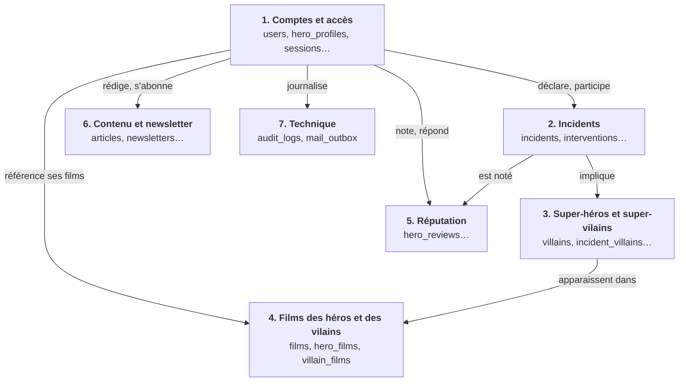
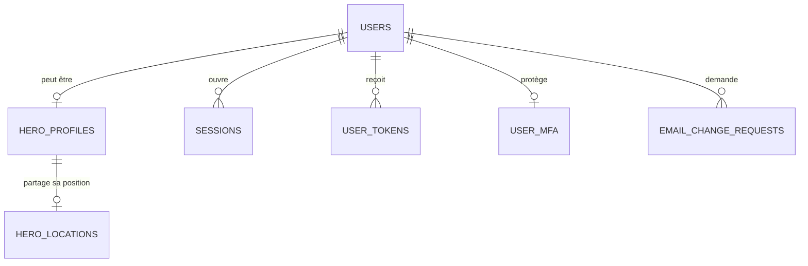
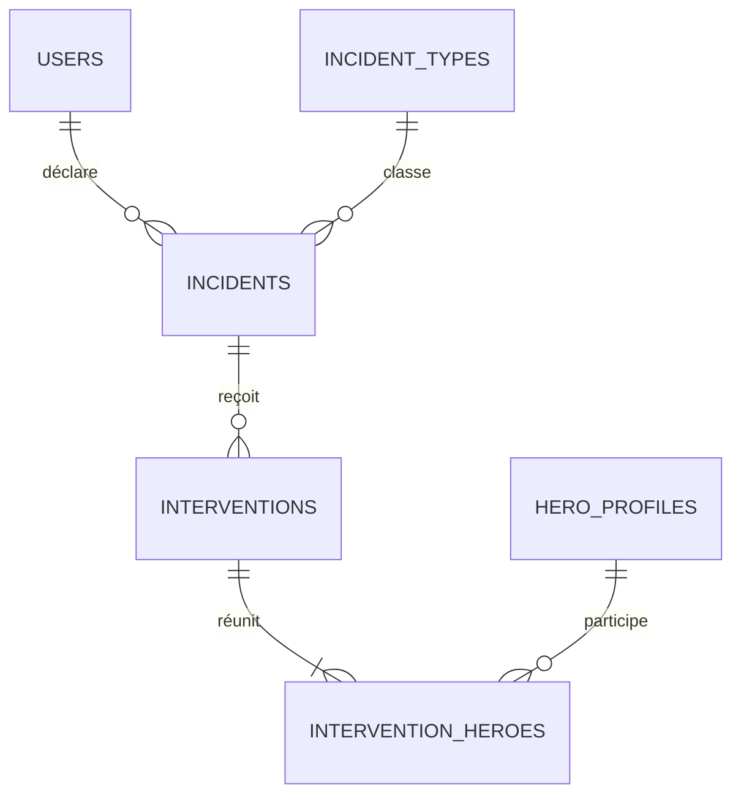
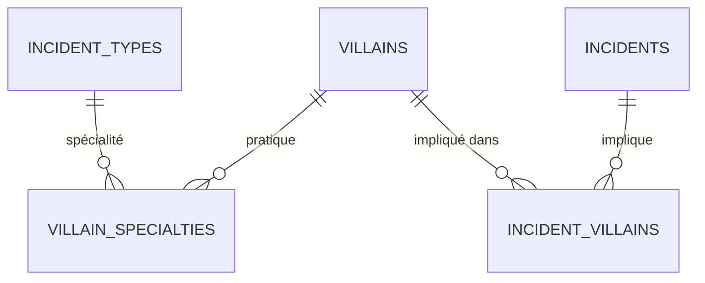
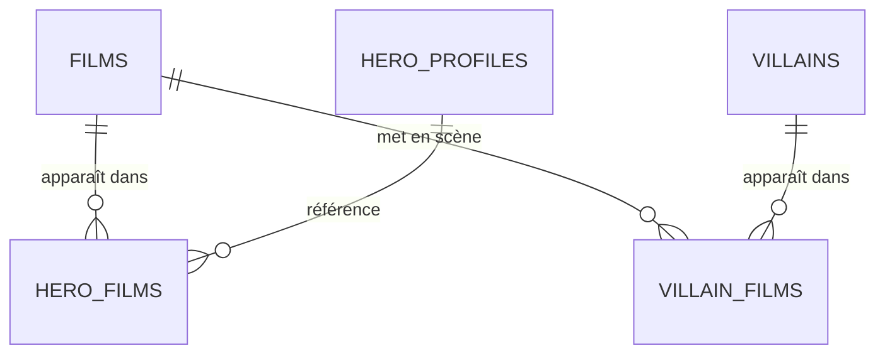
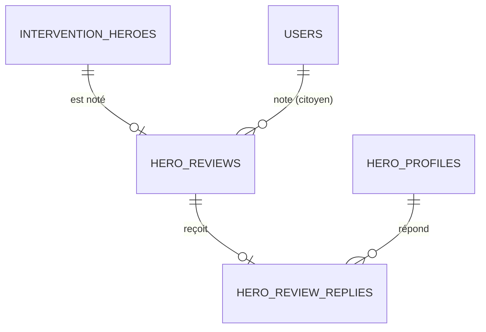
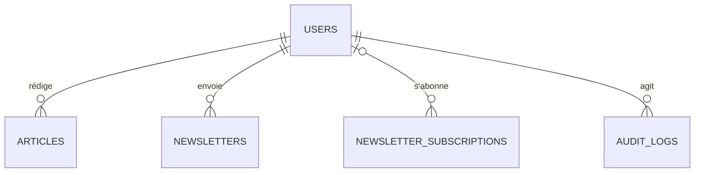
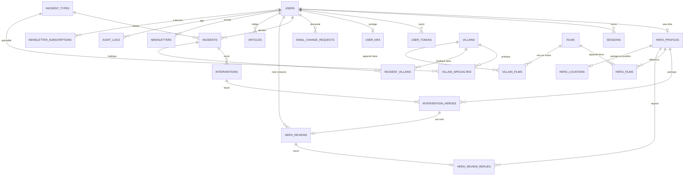

# Tables de la base de données

Schéma PostgreSQL de Heros-SOS, déduit du cahier des charges et des choix de [STACK.md](STACK.md) (GORM, migrations `golang-migrate`, sessions en base, chiffrement des champs sensibles).

## Conventions

- Noms en `snake_case`, tables au pluriel.
- Clés primaires `uuid` (v7) générées côté Go, sauf `incident_types` (`smallint`), `sessions` (hash du jeton), les tables de liaison (clé composite) et les tables dont la clé primaire est aussi une clé étrangère (`hero_profiles`, `user_mfa`, `hero_review_replies`). L'identifiant sert d'AAD au chiffrement des champs.
- Dates en `timestamptz`, avec `created_at` et `updated_at` sur les tables modifiables.
- Valeurs fixes en `text` avec une contrainte `CHECK`, plus simple à faire évoluer qu'un type `ENUM`.
- Emails en `citext` (insensible à la casse).
- 🔒 = champ chiffré par la cascade AES-256-GCM puis XChaCha20-Poly1305, stocké en `bytea`.
- Pas de suppression logique (`deleted_at`) sur les données personnelles : suppression réelle ou anonymisation (droit à l'effacement).

## Vue d'ensemble

Les tables sont rangées en sept domaines, qui sont les sections de ce document. La carte ci-dessous montre comment les domaines se parlent ; les schémas suivants détaillent les relations de chaque domaine, une table de l'extérieur apparaissant quand elle est le point de rattachement.

### Carte des domaines

Lecture des schémas ci-dessous : `||` exactement un, `o|` zéro ou un, `o{` zéro ou plusieurs, `|{` un ou plusieurs.

### Domaine 1 : comptes et accès

### Domaine 2 : incidents et interventions

### Domaine 3 : super-héros et super-vilains

### Domaine 4 : films des héros et des vilains

### Domaine 5 : réputation

### Domaines 6 et 7 : contenu, newsletter et journal d'audit

### Schéma complet

Toutes les relations des schémas ci-dessus en un seul. Dense : utile pour retrouver une relation précise, pas pour comprendre la structure.

## 1. Comptes et accès

### `users`

Tous les utilisateurs : citoyens, héros et modérateurs (le cahier emploie « modérateur » et « administrateur » pour le même rôle).

| Colonne | Type | Contraintes et notes |
|---|---|---|
| `id` | uuid | PK |
| `email` | citext | UNIQUE, NOT NULL. En clair : sert à la connexion (§5.2). |
| `password_hash` | text | NOT NULL, argon2id |
| `role` | text | `citizen`, `hero`, `moderator`. Passe à `hero` seulement après validation (§3.1.2). Défaut `citizen`. |
| `status` | text | `pending_activation`, `active`, `deactivated`. Défaut `pending_activation` (§4.3.1). |
| `civility` | text | NOT NULL, valeurs à fixer avec le formulaire du §5.4 |
| `last_name` | bytea 🔒 | NOT NULL |
| `first_name` | bytea 🔒 | NOT NULL |
| `birth_date` | bytea 🔒 | NOT NULL |
| `phone` | bytea 🔒 | Numéro de portable |
| `street` | bytea 🔒 | Nom de la rue |
| `address_complement` | bytea 🔒 | Complément d'adresse (§5.7) |
| `postal_code` | bytea 🔒 | |
| `city` | bytea 🔒 | |
| `country` | bytea 🔒 | |
| `avatar_path` | text | Photo de profil |
| `activated_at` | timestamptz | Rempli au clic sur le lien d'activation |
| `verified_at` | timestamptz | « Citoyen vérifié » par un modérateur (§4.3.1) : information de confiance, elle ne débloque aucun droit ; « Actif depuis le » (§5.7) |
| `verified_by` | uuid | FK `users`, ON DELETE SET NULL |
| `deactivated_at` | timestamptz | Désactivation par un modérateur (§3.1.3) |
| `failed_login_count` | smallint | Défaut 0, pour le délai croissant après échecs |
| `locked_until` | timestamptz | |
| `last_login_at` | timestamptz | |
| `created_at`, `updated_at` | timestamptz | `created_at` = « Date de création du compte » (§5.7) |

### `hero_profiles`

Complète `users` pour les super-héros. La ligne existe dès la demande, avant validation. Elle est créée par un **formulaire dédié « Devenir super-héros »** dans « Mon compte » (alias, description, message pour les modérateurs), et non à l'inscription : le formulaire du §5.4 ne distingue pas citoyen et héros. Un modérateur accepte ou refuse (§3.1.3). Une demande refusée peut être refaite : la ligne repasse à `pending`.

| Colonne | Type | Contraintes et notes |
|---|---|---|
| `user_id` | uuid | PK, FK `users` ON DELETE CASCADE |
| `alias` | citext | UNIQUE, NOT NULL. Pseudo public, utilisable pour se connecter (§5.2). |
| `bio` | text | Description publique |
| `request_message` | text | Message du demandeur aux modérateurs, non public |
| `verification_status` | text | `pending`, `approved`, `rejected`. Défaut `pending`. |
| `reviewed_by` | uuid | FK `users`, ON DELETE SET NULL |
| `reviewed_at` | timestamptz | |
| `rejection_reason` | text | |
| `created_at` | timestamptz | |

Tout ce qui est propre à un héros s'accroche à cette table plutôt qu'à `users` : `hero_films` (vidéothèque), `intervention_heroes`, `hero_reviews` et `hero_review_replies`. Comme la clé primaire est `user_id`, l'identifiant d'un héros reste celui de son compte. Côté GORM, `HeroProfile` porte les relations (`Films`, `InterventionHeroes`).

**Données publiques d'un héros** (page d'accueil §5.1 et liste §5.5, visibles par tous) : photo de profil (`users.avatar_path`), alias, description (`bio`) et note moyenne (calculée). Le nom civil, l'email et le téléphone ne sont visibles que par le héros lui-même et par les modérateurs.

### `hero_locations` (optionnelle)

À créer seulement si la proximité est retenue avec le client (voir points ouverts). Elle donne **la position actuelle d'un héros, là où il se trouve**, et non son adresse de domicile, qui reste chiffrée dans `users`.

| Colonne | Type | Contraintes et notes |
|---|---|---|
| `hero_id` | uuid | PK, FK `hero_profiles(user_id)` ON DELETE CASCADE : une seule ligne par héros |
| `latitude`, `longitude` | numeric(9,6) | NOT NULL. En clair, car nécessaires aux calculs de distance. |
| `accuracy_m` | integer | Précision de la mesure en mètres, facultatif |
| `updated_at` | timestamptz | NOT NULL. Une position plus ancienne que le délai de péremption (à fixer, par exemple 30 min) est ignorée et supprimée par une tâche de nettoyage. |

Règles :
- **Consentement :** le héros active lui-même « Partager ma position » dans son espace professionnel et peut la couper à tout moment : la ligne est alors supprimée.
- **Pas d'historique :** chaque mise à jour remplace la précédente, on ne garde aucune trace des déplacements.
- **Qui voit quoi :** les modérateurs (tableau de bord admin, pour savoir où sont les héros) et le serveur (pour choisir les héros à prévenir). Jamais les citoyens, les autres héros ni le public. Chaque consultation par un modérateur est tracée dans `audit_logs` (`hero.location.view`).
- **Limite du web :** un site ne lit la position qu'au premier plan, donc elle n'est à jour que tant que l'espace héros est ouvert.
- **Alerte de proximité :** à la déclaration d'un incident avec coordonnées, le mail du §4.3.3 part aux héros dont la position est fraîche et à moins du rayon fixé (valeur de configuration, à décider), en plus des modérateurs. Si aucun héros n'est proche, repli sur tous les héros (à confirmer).
- **Requête :** pré-filtre par rectangle sur `(latitude, longitude)`, puis distance de Haversine en SQL. PostGIS ne serait utile qu'avec beaucoup de héros.

### `sessions`

Voir « Sessions » dans STACK.md.

| Colonne | Type | Contraintes et notes |
|---|---|---|
| `token_hash` | bytea | PK, SHA-256 du jeton (le jeton brut n'est que dans le cookie) |
| `user_id` | uuid | FK `users` ON DELETE CASCADE, indexé |
| `created_at` | timestamptz | |
| `last_seen_at` | timestamptz | Sert au délai d'inactivité |
| `expires_at` | timestamptz | Durée maximale, indexée pour le nettoyage |
| `mfa_verified_at` | timestamptz | NULL = en attente de 2FA |
| `revoked_at` | timestamptz | |
| `ip_address` | inet | Donnée personnelle : durée de conservation limitée |
| `device_label` | text | Résumé de l'appareil (« Chrome · macOS »), calculé à la création à partir du User-Agent. La chaîne brute n'est pas conservée. Supprimé avec la session. |

### `user_tokens`

Activation de compte et mot de passe oublié (§4.3.1, §4.3.4) : token aléatoire, stocké haché, à usage unique.

| Colonne | Type | Contraintes et notes |
|---|---|---|
| `id` | uuid | PK |
| `user_id` | uuid | FK `users` ON DELETE CASCADE |
| `type` | text | `activation`, `password_reset` |
| `token_hash` | bytea | UNIQUE |
| `expires_at` | timestamptz | NOT NULL |
| `used_at` | timestamptz | NULL = pas encore utilisé |
| `created_at` | timestamptz | |

### `email_change_requests`

Changement d'adresse email soumis à confirmation d'un modérateur (§5.8.3, §6.1.1).

| Colonne | Type | Contraintes et notes |
|---|---|---|
| `id` | uuid | PK |
| `user_id` | uuid | FK `users` ON DELETE CASCADE |
| `new_email` | citext | NOT NULL |
| `status` | text | `pending`, `approved`, `rejected` |
| `reviewed_by` | uuid | FK `users`, ON DELETE SET NULL |
| `reviewed_at`, `created_at` | timestamptz | |

### `user_mfa` et `mfa_recovery_codes`

Double authentification par TOTP, obligatoire pour modérateurs et héros. Des passkeys pourraient s'ajouter plus tard avec une table `webauthn_credentials`.

| Table | Colonne | Type | Contraintes et notes |
|---|---|---|---|
| `user_mfa` | `user_id` | uuid | PK, FK `users` ON DELETE CASCADE |
| | `totp_secret` | bytea 🔒 | |
| | `confirmed_at`, `created_at` | timestamptz | `confirmed_at` NULL tant que le code n'est pas validé |
| `mfa_recovery_codes` | `id` | uuid | PK |
| | `user_id` | uuid | FK `users` ON DELETE CASCADE |
| | `code_hash` | bytea | |
| | `used_at` | timestamptz | |

## 2. Incidents

### `incident_types`

Table de référence (§1.3, §5.8.1).

| Colonne | Type | Contraintes et notes |
|---|---|---|
| `id` | smallint | PK, identité |
| `code` | text | UNIQUE (`theft`, `murder`, `terror_attack`, `burglary`, `hostage_taking`…) |
| `label` | text | Libellé affiché (Vol, Meurtre, Attentat, Cambriolage, Prise d'otages…) |
| `endangers_life` | boolean | Compte dans « citoyens en danger secourus » : faux pour un vol, vrai pour une tentative de meurtre ou une séquestration (§5.8.1) |

### `incidents`

| Colonne | Type | Contraintes et notes |
|---|---|---|
| `id` | uuid | PK |
| `reporter_id` | uuid | FK `users` ON DELETE SET NULL : si le déclarant efface son compte, l'incident reste, anonymisé. Le déclarant (témoin) peut être un héros, qui peut aussi intervenir sur le même incident. |
| `type_id` | smallint | FK `incident_types`, NOT NULL |
| `description` | text | NOT NULL |
| `status` | text | `reported` (« Signalé à l'instant »), `in_progress` (« Intervention en cours »), `succeeded`, `failed`. Défaut `reported`. |
| `priority` | text | `high`, `normal`, `low`. Défaut `normal`. Modifiable par modérateurs et héros (§4.1.1). |
| `citizens_rescued` | smallint | Défaut 0. Renseigné par le témoin qui a déclaré l'incident (citoyen ou héros), corrigeable par un modérateur. Porté par l'incident et non par chaque intervention, pour ne pas compter deux fois les mêmes citoyens quand plusieurs héros interviennent. |
| `street`, `postal_code`, `city`, `country` | text | Lieu en clair : sert à repérer les doublons (§4.1.1) |
| `address_complement` | text | Facultatif : bâtiment, étage, repère, comme dans `users` |
| `latitude`, `longitude` | numeric(9,6) | Facultatifs, pour une éventuelle recherche de proximité |
| `occurred_at` | timestamptz | |
| `created_at`, `updated_at` | timestamptz | |

Index : `(status, priority, created_at DESC)` pour les listes, et `(lower(city), postal_code, lower(street))` pour les doublons. Un doublon se supprime réellement (§4.1.1) et l'action est tracée dans `audit_logs`.

### `interventions`

Une intervention est l'engagement d'une équipe de héros sur un incident : elle réunit **un ou plusieurs héros** (table `intervention_heroes`). Un incident n'a qu'une intervention en cours à la fois : les autres héros la rejoignent. Après un échec, une nouvelle intervention peut démarrer.

| Colonne | Type | Contraintes et notes |
|---|---|---|
| `id` | uuid | PK |
| `incident_id` | uuid | FK `incidents` ON DELETE CASCADE |
| `status` | text | `in_progress`, `succeeded`, `failed`. Défaut `in_progress`. |
| `proposed_status` | text | `succeeded` ou `failed`. NULL tant qu'aucun résultat n'est proposé. Résultat en attente de validation par les héros. |
| `proposed_by` | uuid | FK `hero_profiles(user_id)` ON DELETE SET NULL |
| `decided_by` | uuid | FK `users` ON DELETE SET NULL. Renseigné quand un modérateur tranche un désaccord entre héros. |
| `notes` | text | |
| `started_at`, `ended_at` | timestamptz | |

Index unique partiel : `UNIQUE (incident_id) WHERE status = 'in_progress'`.

### `intervention_heroes`

Les héros d'une intervention : c'est ici que plusieurs héros peuvent intervenir sur le même incident.

| Colonne | Type | Contraintes et notes |
|---|---|---|
| `intervention_id` | uuid | FK `interventions` ON DELETE CASCADE |
| `hero_id` | uuid | FK `hero_profiles(user_id)`. Le service vérifie en plus que le héros est `approved`. |
| `role` | text | `lead` (celui qui a démarré l'intervention), `member` |
| `participation` | text | `invited` (ajouté par un autre héros, en attente de sa confirmation), `confirmed` |
| `invited_by` | uuid | FK `hero_profiles(user_id)`. NULL pour le lead ou pour un héros qui rejoint de lui-même. |
| `outcome_validation` | text | `pending`, `approved`, `rejected`. Défaut `pending`. |
| `is_active` | boolean | Vrai tant que le héros est `confirmed` sur une intervention `in_progress`. Tenu à jour par le service dans la même transaction. |
| `invited_at`, `joined_at` | timestamptz | |
| | | PK `(intervention_id, hero_id)` |

Index uniques partiels :
- `UNIQUE (hero_id) WHERE is_active` : un héros n'a qu'une intervention à la fois (§3.1.2).
- `UNIQUE (intervention_id) WHERE role = 'lead'` : un seul lead par intervention.

Règles appliquées par le service :
- **Démarrer :** un héros qui décide d'intervenir (§4.1.1) crée l'intervention, devient `lead` et `confirmed`. L'incident passe à `in_progress`.
- **Rejoindre :** un autre héros peut rejoindre l'intervention en cours de lui-même (`confirmed` directement).
- **Ajouter des collègues :** un héros de l'intervention ajoute ceux qui sont venus avec lui. Chacun reçoit une demande de confirmation (`invited`). Il confirme (`confirmed`), ou répond qu'il n'est pas sur les lieux : sa ligne est alors **supprimée**.
- **Résultat avec un seul héros :** c'est lui qui le définit, `interventions.status` passe directement à `succeeded` ou `failed`.
- **Résultat avec plusieurs héros :** un héros propose le résultat (`proposed_status`), puis chaque héros `confirmed` le valide (`outcome_validation`). Quand tous ont validé, `status` prend la valeur proposée, `ended_at` est renseigné et `is_active` repasse à faux. Si l'un refuse, la proposition est annulée (`proposed_status` à NULL, validations remises à `pending`) et l'intervention reste en cours. Les héros encore `invited` ne comptent pas dans la validation.
- **Désaccord :** quand un héros refuse le résultat, les modérateurs sont prévenus (mail `outcome_disputed`). Un modérateur peut trancher : il fixe lui-même `status` et `ended_at`, `decided_by` garde son identifiant et l'action est tracée dans `audit_logs`.
- **Statut de l'incident :** `in_progress` tant que l'intervention est en cours, puis `succeeded` ou `failed` à sa clôture.
- **Témoin et héros :** un héros peut être le déclarant (`incidents.reporter_id`) et intervenir sur le même incident.

## 3. Super-héros et super-vilains

### `villains`

Encyclopédie (§5.6, §6.1.4), alimentée par les déclarations et les modérateurs.

| Colonne | Type | Contraintes et notes |
|---|---|---|
| `id` | uuid | PK |
| `alias` | text | UNIQUE, NOT NULL (pseudo) |
| `last_name`, `first_name` | text | NULL : « si connu » |
| `main_sector` | text | Secteur principal |
| `description` | text | |
| `created_by` | uuid | FK `users` ON DELETE SET NULL |
| `created_at`, `updated_at` | timestamptz | |

### `villain_specialties`

Un vilain peut avoir **plusieurs spécialités illicites** (vol, cambriolage, meurtre…).

| Colonne | Type | Contraintes et notes |
|---|---|---|
| `villain_id` | uuid | FK `villains` ON DELETE CASCADE |
| `type_id` | smallint | FK `incident_types` |
| | | PK `(villain_id, type_id)` |

### `incident_villains`

Table de liaison : **un vilain peut être lié à plusieurs incidents, et un incident peut impliquer plusieurs vilains**.

| Colonne | Type | Contraintes et notes |
|---|---|---|
| `incident_id` | uuid | FK `incidents` ON DELETE CASCADE |
| `villain_id` | uuid | FK `villains` |
| `arrested` | boolean | Défaut faux. Alimente « mis en prison » (§5.8.1, §5.8.2). |
| | | PK `(incident_id, villain_id)` |

## 4. Films des héros et des vilains

### `films`

Cache des réponses OMDb : le film est stocké à l'ajout, ce qui économise le quota.

| Colonne | Type | Contraintes et notes |
|---|---|---|
| `id` | uuid | PK |
| `imdb_id` | text | UNIQUE (`tt…`) |
| `title` | text | NOT NULL |
| `release_year` | smallint | |
| `poster_url` | text | |
| `plot` | text | |
| `raw` | jsonb | Réponse OMDb brute |
| `fetched_at`, `created_at` | timestamptz | |

### `hero_films`

Vidéothèque d'un héros (§5.8.4). Un modérateur valide chaque film avant affichage.

| Colonne | Type | Contraintes et notes |
|---|---|---|
| `hero_id` | uuid | FK `hero_profiles(user_id)` ON DELETE CASCADE : seul un héros a une vidéothèque |
| `film_id` | uuid | FK `films` |
| `status` | text | `pending`, `approved`, `rejected`. Défaut `pending`. |
| `reviewed_by` | uuid | FK `users`, ON DELETE SET NULL |
| `reviewed_at`, `created_at` | timestamptz | |
| | | PK `(hero_id, film_id)`. Le héros peut retirer un film : suppression de la ligne. |

### `villain_films`

Films dans lesquels apparaît un vilain, pour l'encyclopédie (§6.1.4). Renseignée par les modérateurs, donc sans statut de validation.

| Colonne | Type | Contraintes et notes |
|---|---|---|
| `villain_id` | uuid | FK `villains` ON DELETE CASCADE |
| `film_id` | uuid | FK `films` |
| `created_by` | uuid | FK `users` ON DELETE SET NULL |
| `created_at` | timestamptz | |
| | | PK `(villain_id, film_id)` |

## 5. Réputation

### `hero_reviews`

Note d'un citoyen après une intervention (§6.1.3), une note par héros participant.

| Colonne | Type | Contraintes et notes |
|---|---|---|
| `id` | uuid | PK |
| `intervention_id` | uuid | NOT NULL |
| `hero_id` | uuid | NOT NULL. FK composite `(intervention_id, hero_id)` vers `intervention_heroes` : on ne note qu'un héros qui a participé. `UNIQUE (intervention_id, hero_id)` : chaque héros d'un même incident est noté séparément. |
| `citizen_id` | uuid | FK `users` ON DELETE SET NULL. Le service vérifie que c'est le déclarant de l'incident et qu'il n'est pas le héros noté (un héros témoin ne peut pas se noter lui-même). Le mail du §4.3.3 contient un lien de notation par héros. |
| `rating` | smallint | NOT NULL, `CHECK (rating BETWEEN 1 AND 5)` |
| `comment` | text | Facultatif |
| `status` | text | `published`, `hidden` (modération, §8). Défaut `published`. |
| `moderated_by` | uuid | FK `users`, ON DELETE SET NULL |
| `moderated_at`, `created_at` | timestamptz | |

### `hero_review_replies`

Réponse du héros à un commentaire (§5.8.5).

| Colonne | Type | Contraintes et notes |
|---|---|---|
| `review_id` | uuid | PK, FK `hero_reviews` ON DELETE CASCADE |
| `hero_id` | uuid | FK `hero_profiles(user_id)`. Doit être égal à `hero_reviews.hero_id` (vérifié par le service). |
| `content` | text | NOT NULL |
| `status` | text | `published`, `pending`, `hidden`. Défaut `published` (modération a posteriori, comme les notes). |
| `moderated_by` | uuid | FK `users`, ON DELETE SET NULL |
| `moderated_at` | timestamptz | |
| `created_at` | timestamptz | |
| `edited_at` | timestamptz | NULL tant que la réponse n'a jamais été modifiée |

Le héros peut modifier sa réponse. À chaque modification, `edited_at` est mis à jour et `status` repasse à `pending` : la réponse revient en modération et n'est plus affichée tant qu'un modérateur ne l'a pas republiée (`published`) ou masquée (`hidden`).

## 6. Contenu et newsletter

### `articles`

Blog géré depuis le dashboard modérateur (§8). Le HTML venant de TinyMCE est nettoyé avant enregistrement.

| Colonne | Type | Contraintes et notes |
|---|---|---|
| `id` | uuid | PK |
| `author_id` | uuid | FK `users` ON DELETE SET NULL |
| `title` | text | NOT NULL |
| `slug` | text | UNIQUE |
| `content_html` | text | HTML nettoyé |
| `cover_path` | text | |
| `status` | text | `draft`, `published` |
| `published_at`, `created_at`, `updated_at` | timestamptz | |

### `newsletter_subscriptions`

Abonnés, avec ou sans compte (§4.2). Le désabonnement passe par un lien signé (Ed25519), sans colonne de token.

| Colonne | Type | Contraintes et notes |
|---|---|---|
| `id` | uuid | PK |
| `email` | citext | UNIQUE, NOT NULL |
| `user_id` | uuid | FK `users` ON DELETE SET NULL. Rattaché quand un compte existe avec le même email. |
| `status` | text | `pending`, `subscribed`, `unsubscribed`. Double opt-in : un abonnement depuis le footer (visiteur anonyme) reste `pending` jusqu'au clic sur un lien de confirmation signé en Ed25519, sans colonne de token. Depuis « Mon compte » (email déjà vérifié), il est directement `subscribed`. |
| `source` | text | `footer`, `account` |
| `confirmed_at` | timestamptz | Preuve de consentement : date de confirmation |
| `unsubscribed_at`, `created_at` | timestamptz | |

### `newsletters`

| Colonne | Type | Contraintes et notes |
|---|---|---|
| `id` | uuid | PK |
| `subject` | text | NOT NULL |
| `body_html` | text | NOT NULL |
| `recipient_user_id` | uuid | FK `users`. NULL = tous les abonnés ; renseigné = un seul utilisateur (§4.3.2). |
| `created_by` | uuid | FK `users` ON DELETE SET NULL |
| `created_at`, `sent_at` | timestamptz | |

## 7. Technique

### `mail_outbox`

**Repli** si l'hébergeur ne supporte pas Docker : RabbitMQ est retenu pour les mails (voir STACK.md) et, avec lui, cette table n'existe pas (les reprises et la dead-letter queue sont dans RabbitMQ). Sans RabbitMQ, elle est lue par un worker avec `SKIP LOCKED`.

| Colonne | Type | Contraintes et notes |
|---|---|---|
| `id` | uuid | PK |
| `user_id` | uuid | FK `users` ON DELETE SET NULL |
| `recipient_email` | citext | Donnée personnelle : à purger après envoi |
| `template` | text | `activation`, `password_reset`, `incident_created`, `incident_taken`, `incident_closed`, `intervention_invited`, `outcome_validation`, `outcome_disputed`, `newsletter_confirm`, `newsletter`… (§4.3). Ce sont aussi les types de messages de la file `mail.send`. |
| `payload` | jsonb | Références seulement (identifiants), jamais de donnée personnelle |
| `status` | text | `pending`, `sending`, `sent`, `failed` |
| `attempts` | smallint | Défaut 0 |
| `next_attempt_at` | timestamptz | Indexé avec `status` |
| `last_error` | text | |
| `created_at`, `sent_at` | timestamptz | |

### `audit_logs`

Journal des actions de modération : validation d'un héros, suppression d'un incident, désactivation d'un compte, changement de priorité. L'utilisateur applicatif n'a que `INSERT` et `SELECT`, jamais `UPDATE` ni `DELETE`.

| Colonne | Type | Contraintes et notes |
|---|---|---|
| `id` | uuid | PK |
| `actor_id` | uuid | FK `users` ON DELETE SET NULL |
| `action` | text | Ex. `hero.approve`, `incident.delete`, `user.deactivate` |
| `entity_type` | text | |
| `entity_id` | uuid | |
| `details` | jsonb | Sans donnée personnelle |
| `ip_address` | inet | Durée de conservation limitée |
| `created_at` | timestamptz | |

## Champs chiffrés

| Table | Colonnes 🔒 |
|---|---|
| `users` | `last_name`, `first_name`, `birth_date`, `phone`, `street`, `address_complement`, `postal_code`, `city`, `country` |
| `user_mfa` | `totp_secret` |

Restent en clair : `users.email` (connexion), `hero_profiles.alias` (public), le lieu des incidents (détection des doublons), la position actuelle des héros (`hero_locations`, si la proximité est retenue), tout ce qui doit être filtré ou trié en SQL. Chaque champ chiffré porte son propre nonce et ses tags (environ 68 octets de plus).

## Statistiques (calculées à la demande en SQL)

| Statistique (§5.8) | Source |
|---|---|
| Nombre total d'interventions | `interventions` terminées (une par équipe, pas par héros) |
| Pourcentage des types d'incidents | `incidents` groupés par `type_id` |
| Citoyens secourus | `SUM(incidents.citizens_rescued)` pour `status = 'succeeded'` (une seule fois par incident, même avec plusieurs héros) |
| Citoyens en danger secourus | idem, avec `incident_types.endangers_life = true` |
| Citoyens secourus par un héros | même somme, limitée aux incidents où il est `confirmed` dans une intervention `succeeded` : chaque héros de l'incident est crédité |
| Super-vilains identifiés | `villains` |
| Super-vilains mis en prison | `incident_villains` avec `arrested = true` (vilains distincts) |
| Interventions et vilains emprisonnés d'un héros | `intervention_heroes` (`confirmed`) filtrées sur `hero_id`, jointes à `interventions` puis `incident_villains` (vilains distincts) |
| Note d'un héros | moyenne de `hero_reviews.rating` (`published`) pour son `hero_id` |
| Films d'un héros | `hero_films` avec `status = 'approved'` |
| Pire ennemi | vilain le plus fréquent dans `incident_villains` pour les interventions du héros (via `intervention_heroes`) |

## Points ouverts

1. **Proximité :** à décider avec le client. `latitude` et `longitude` des incidents sont facultatives d'ici là. Si elle est retenue, on crée `hero_locations` : la position **actuelle** du héros (là où il est, pas son domicile), partagée volontairement, visible des modérateurs et du serveur. Elle est en clair, ce qui fait exception au chiffrement, d'où le consentement, l'absence d'historique et la traçabilité des consultations. À fixer avec le client : délai de péremption, rayon d'alerte, repli si aucun héros n'est proche.
2. **Encyclopédie Marvel (§6.1.4) :** la source des données est à vérifier, l'API Marvel semble fermée.
