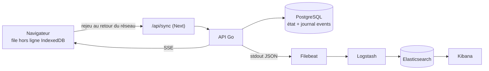

# Performance, synchronisation hors ligne et journalisation

**Statut : implémenté et mesuré, sauf ce qui est listé dans [Ce qui n'a pas été vérifié](#4-ce-qui-na-pas-été-vérifié).** Établi le 22/10/2026 sur `develop` (commit `e9292b4`), avec une base PostgreSQL 18 de 5 millions d'incidents. Remis à niveau le même jour sur `develop` après la modération des incidents et le tableau de bord des héros (commit `0dbabc0`), puis après le tri par date de résolution de la page d'accueil et le passage des tests du frontend à Vitest (commit `034afef`) : voir [Mise à jour après la modération des incidents](#mise-à-jour-après-la-modération-des-incidents). **Remesuré à 5 millions d'incidents sur ce code (commit `f5a69b2`)** : tout est sous 30 ms au p95. Le premier appel du tableau de bord d'un héros, qui calculait en direct (environ 11 s), est préchauffé au démarrage (voir plus bas).

## Le défi

Avec **5 millions d'incidents** en base :

- les requêtes, qui mettaient plusieurs secondes, doivent répondre en **moins de 350 ms** (p95, mesuré côté API) ;
- une action faite **hors ligne** par un citoyen ou un super-héros est synchronisée quand il retrouve la connexion ;
- les actions sont tracées par **event sourcing** et journalisées dans un monitoring **ELK** (obligatoire) ;
- tout cela doit pouvoir être **démontré** pendant la présentation.

## Résultats

Mesurés avec `make perf` (commande `cmd/loadtest`) sur la même base de 5 millions d'incidents, p95 par scénario. « Avant » : le code de `develop`, sans les index de lecture, avec 4 clients en parallèle. « Après » : le code de ce document, avec 16 clients en parallèle. Aucune erreur dans les deux cas.

| Scénario | Avant (p95) | Après (p95) |
|---|---|---|
| Liste des incidents, sans filtre | 5,71 s | 3,7 ms |
| Liste des incidents ouverts | 11,6 ms | 3,8 ms |
| Mes incidents (citoyen) | 2,07 s | 4,2 ms |
| Historique d'un héros | 7,76 s | 4,7 ms |
| Fiche d'un héros | 1,64 s | 0,9 ms |
| Historique d'un vilain | 8,98 s | 4,1 ms |
| Fiche d'un vilain | 138,5 ms | 1,1 ms |
| Liste des héros | 6,12 s | 3,3 ms |
| Liste des vilains | 710,7 ms | 2,9 ms |

Ces mesures à 5 millions datent d'avant la modération des incidents : celles du code actuel, à 1 puis à 5 millions d'incidents, sont dans la section suivante.

Le « 12 s » du sujet n'est pas reproduit à l'identique : la base de mesure est locale, sur un disque rapide et avec un cache chaud. Les ordres de grandeur sont les mêmes (jusqu'à 9 s au p95), et c'est le rapport avant/après qui compte. Un clone neuf avec `make up` donnera des temps plus élevés des deux côtés (PostgreSQL non réglé, disque de la machine virtuelle de Docker).

Ce que `pg_stat_statements` a désigné avant correction, une requête à froid (cette extension de PostgreSQL classe les requêtes par temps total, nombre d'appels, durée moyenne et maximale ; la pile de développement la charge depuis le 23/10/2026, voir `make slow-queries` dans [P0](#p0--données-et-mesures)) :

| Requête | Durée |
|---|---|
| Statistiques de la liste des héros (`COUNT` des interventions de la page) | 4,6 s |
| Historique d'un vilain (tri de 125 000 incidents, puis jointure latérale sur toutes les interventions) | 3,6 s |
| `ORDER BY created_at DESC LIMIT 20` sans index | 762 ms |
| Total de l'historique d'un héros | 675 ms |
| Liste des vilains (agrégat sur `incident_villains`) | 501 ms |
| `COUNT(*)` des incidents, sans filtre | 230 ms |

## Mise à jour après la modération des incidents

`develop` a ajouté, après la première version de ce travail, la **modération des incidents** (`incidents.moderation` : `pending`, `approved`, `rejected`, `pending` par défaut ; le public et les héros ne voient que les incidents `approved`) et le **tableau de bord des héros** (`GET /hero/dashboard`). Les deux touchent à ce qui est décrit ici ; la fusion a demandé plus que résoudre des conflits.

| Point | Ce qui a changé |
|---|---|
| Numéros de migration | `develop` a pris, pendant ce travail, les numéros `20261022130000` (modération des incidents), `140000` et `150000` (position des héros). **golang-migrate n'applique que les versions supérieures à la version courante de la base** : une base qui a déjà appliqué `150000` ignorerait en silence une migration numérotée en dessous. Les sept migrations de ce travail sont donc renumérotées `20261022160000` à `166000`, après toutes celles de `develop` ; à refaire si `develop` en ajoute d'autres avant la fusion |
| Compteurs | `incident_stats` garde la **modération** comme dimension (listes publiques : ligne `approved` ; modérateur : toutes ; « mes incidents » : `reporter_stats`, tous états). `villain_stats` ne compte que les liens vers un incident approuvé, et `hero_stats.resolved` que les interventions réussies d'un incident approuvé, comme leurs historiques publics |
| Colonnes dénormalisées | Nouvelle `incident_villains.incident_approved`. `intervention_heroes.resolved_at` n'est renseignée que pour un incident approuvé. Un trigger (`incidents_sync_moderation`) répercute une décision de modération sur ces colonnes, donc sur les compteurs, **dans les deux sens** (rejet d'un incident déjà résolu, puis ré-approbation) |
| Index | Index **partiels** `WHERE moderation = 'approved'` pour les listes publiques, et `incident_villains_villain_idx` partiel sur `incident_approved`. Ils ne servent que si la requête écrit `'approved'` en toutes lettres (un paramètre l'en empêcherait) |
| Journal d'événements | Les trois routes ajoutées par `develop` écrivent leur événement dans la même transaction : `incident.moderated`, `incident.corrected` (le résultat d'une correction de statut, que `cmd/replay` relit comme dernier statut de l'incident) et `incident.priority_changed` |
| Flux temps réel | Un incident non approuvé **ne se devinait pas** dans `GET /incidents`, mais sa déclaration (ville, vilains liés) passait dans le flux d'un héros. Corrigé : un héros ne reçoit que les événements d'un incident **actuellement approuvé** ; l'auteur et les modérateurs voient tout |
| Tableau de bord | Ses agrégats parcouraient toute la table des incidents : **p95 de 7,4 s** sur 1 million d'incidents avant correction. Les incidents par type et les citoyens secourus se lisent maintenant dans `incident_stats` ; les statistiques (globales et par héros) passent par un cache qui ne fait jamais attendre un recalcul (voir ci-dessous) |
| Tri par résolution (page d'accueil) | `GET /incidents?status=succeeded&sort=-resolvedAt&limit=6`, appelé sans session par la page d'accueil, calculait la date de résolution de **chaque incident de la table** (jointure sur sa dernière intervention) avant de trier : de 0,9 à 1,4 s sur 1 million d'incidents, proportionnel à la taille de la table. La date est maintenant la colonne `incidents.resolved_at`, tenue par trigger (migration `add_incident_resolved_at`) et lue dans l'ordre d'un index partiel (`add_incident_resolved_index`) : **1,5 ms** pour la même requête. Le curseur est celui de l'ordre par date de déclaration : ce tri se pagine par `offset`, et un `cursor` avec lui est refusé (422) |
| Hors ligne et formulaire | `develop` demande désormais « témoin ou victime » à la déclaration : la commande mise en file le transporte (`reporterRole`), sinon la réponse de l'utilisateur serait perdue au retour du réseau |
| Tests du frontend | `develop` a adopté Vitest (et Playwright pour les parcours) : les tests de la file hors ligne sont convertis, 22 avant et 22 après (un changement volontaire du relais est toujours détecté), et il n'y a plus qu'un lanceur de tests (`npm test`) |
| Jeux de données | `cmd/seed` écrit `moderation = 'approved'` (sans cela, après le seed, aucun incident n'était visible des héros). `cmd/seedperf` aussi, avec un peu d'incidents « signalés » en attente ou rejetés pour exercer les filtres |

**Cache des statistiques du tableau de bord** (`herodashboard/cache.go`, `HEROS_DASHBOARD_STATS_TTL`, 30 s par défaut, 0 désactive). Une valeur plus jeune que le délai est servie telle quelle ; une valeur plus vieille est **servie quand même, tout de suite**, pendant qu'une nouvelle se calcule en arrière-plan (un calcul à la fois par clé) ; seul le premier appel d'une clé calcule en direct, et les appels simultanés partagent ce calcul. Les deux listes (incident en cours du héros, derniers incidents non résolus) ne sont **pas** mises en cache : elles se lisent dans des index et restent à jour. Au démarrage, `Service.Warm` calcule d'avance les statistiques globales puis celles de chaque héros approuvé et actif, en arrière-plan (deux héros à la fois, `HEROS_DASHBOARD_WARMUP=false` pour le désactiver) : le serveur répond pendant ce temps, et une requête qui arrive partage le calcul en cours. Conséquence assumée : une statistique peut retarder de plus que le délai, puisqu'une valeur périmée est servie d'abord : de 30 s pour un héros qui consulte régulièrement, davantage au premier affichage après une longue absence (la valeur date alors de sa dernière consultation, et se rafraîchit aussitôt). Un compteur exact par trigger aurait demandé, pour les « principaux ennemis » (comptage distinct par héros et par vilain, qui dépend de la modération et des vilains liés), une mécanique disproportionnée pour une page de statistiques.

Mesures sur le code actuel, p95 en ms (16 clients en parallèle pendant 10 s par scénario, aucune erreur, PostgreSQL 18 local, `shared_buffers` à 512 Mo, `fsync` désactivé, machine de 16 Go) :

| Scénario | 1 M, p95 | 5 M, p50 | 5 M, p95 |
|---|---|---|---|
| Liste des incidents (public, approuvés) | 5,8 | 3,1 | 7,2 |
| Liste des incidents ouverts | 5,7 | 3,3 | 8,1 |
| **Derniers incidents résolus (page d'accueil)** | 4,6 | 2,1 | 5,5 |
| Mes incidents (compte héros) | 2,6 | 0,8 | 3,2 |
| **Tableau de bord d'un héros (valeur en cache)** | 7,3 | 4,0 | 16,1 |
| Historique d'un héros | 7,6 | 2,5 | 8,9 |
| Fiche d'un héros | 1,1 | 0,5 | 1,1 |
| Historique d'un vilain | 5,2 | 2,3 | 6,9 |
| Fiche d'un vilain | 1,3 | 0,6 | 1,5 |
| Liste des héros | 2,6 | 0,9 | 3,5 |
| Liste des vilains | 3,3 | 1,7 | 3,6 |

Jeux de données : 1 000 038 incidents (1,7 Go) et 5 000 038 incidents (4 998 014 approuvés, 982 en attente, 1 042 rejetés ; **8,2 Go** : `incidents` 4,7 Go, `intervention_heroes` 1,9 Go, `interventions` 0,9 Go, `incident_villains` 0,7 Go ; 22 héros). Les deux lignes en gras sont celles que `develop` a ajoutées sans que le volume ait été pris en compte. Avant correction : la requête de la page d'accueil, chronométrée seule, prenait **0,9 à 1,4 s à 1 million et 6,5 s à 5 millions** (14 ms après, sans charge) ; le tableau de bord (8 clients, 16 réponses) était à **3,96 s** de p50 et **7,44 s** de p95 à 1 million. Les compteurs et les colonnes dénormalisées (dont `incidents.resolved_at`, cohérent sur 4 589 865 incidents réussis), recomptés sur 1 puis 5 millions de lignes, égalent un comptage complet des tables (0 écart).

**Limite constatée à 5 millions, corrigée par le préchauffage : le premier appel du tableau de bord d'un héros calculait en direct, environ 11 s.** Mesuré avant correction : 11,4 s pour le premier appel après un démarrage, 10,8 s pour le premier appel d'un second héros (les statistiques globales étaient déjà en cache), puis 25 ms et 1,6 ms. La cause est le volume de chaque héros : 22 héros pour 5 millions d'incidents, soit environ 295 000 participations chacun (un jeu de données très concentré). Requêtes chronométrées seules, cache chaud : statistiques personnelles d'un héros 9,3 s, principaux ennemis 7,3 s (en parallèle), nombre d'interventions terminées 2,0 s ; tout le reste est sous 25 ms.

Avec `Service.Warm` (mesuré à 5 millions, 22 héros) : le préchauffage prend **133 s** en arrière-plan (`failed=0`), et le premier appel de trois héros ensuite est de **49, 13 et 13 ms**. Le préchauffage ne dégrade pas les autres routes : pendant qu'il tourne, `list` est à 7,6 ms de p95, `latest-resolved` à 5,3 ms, `mine` à 2,2 ms et `hero-incidents` à 5,5 ms. Limites restantes : un héros qui arrive **pendant** le préchauffage, avant que son tour soit venu, calcule en direct (15,0 s mesurés, car il concurrence le préchauffage) ; un héros approuvé après le démarrage, ou tous si le préchauffage est désactivé, calculent à leur première requête ; et chaque rafraîchissement en arrière-plan d'un héros qui consulte son tableau de bord coûte toujours environ 10 s de calcul toutes les 30 s. Si beaucoup de héros consultent en même temps, il reste à allonger `HEROS_DASHBOARD_STATS_TTL` ou à passer aux compteurs pour les statistiques personnelles (`hero_stats` donne déjà les interventions et les résolutions d'un héros ; il manque les échecs et les principaux ennemis).

**Variance des mesures.** Le tableau ci-dessus vient d'un passage sur une machine tranquille. Trois autres passages, sur une machine chargée (charge moyenne de 14 à 21 : navigateur et autres applications ouverts), donnent des p95 plus hauts et plus dispersés (liste de 7 à 18 ms, tableau de bord de 10 à 22 ms, historique d'un héros de 19 à 27 ms, un pic isolé à 316 ms) : toujours très en dessous de 350 ms.

## Décisions retenues

| Sujet | Choix | Pourquoi |
|---|---|---|
| Lenteur des listes | Index ciblés, pagination par curseur, compteurs pour les totaux et les statistiques | 5 M de lignes, c'est peu pour PostgreSQL : le partitionnement n'est pas nécessaire |
| Compteurs | **Triggers de niveau instruction**, pas du code dans les services | Le statut d'un incident change à plusieurs endroits du code (déclaration, démarrage d'une intervention, clôture), et le seed écrit en SQL. Un trigger n'oublie aucun chemin d'écriture, et traite 100 000 lignes insérées d'un coup en une seule mise à jour par compteur |
| Historiques | Deux colonnes dénormalisées (`incident_villains.incident_created_at`, `intervention_heroes.resolved_at`), remplies par trigger | C'est le seul moyen qu'un index donne la page d'un vilain ou d'un héros déjà triée, quel que soit le nombre de ses incidents |
| Mesure de charge | Commande Go `cmd/loadtest` (bibliothèque standard) | Aucun outil à installer, même langage que le reste, dans la convention `cmd/` |
| Event sourcing | Limité aux incidents et aux interventions, écrit dans la **même transaction** que les tables d'état | Garde `Controller → Service → Repository` et les lectures actuelles ; pas de réécriture |
| Hors ligne | File de commandes dans le navigateur, rejouée avec une clé d'idempotence | Le serveur reste l'autorité : pas de moteur de synchronisation à héberger |
| Temps réel | SSE (flux du serveur vers le navigateur), repris avec `Last-Event-ID` | Natif en Go, et la reprise après coupure ne demande pas de code en plus |
| Monitoring | ELK : Filebeat, Logstash, Elasticsearch, Kibana, dans un profil Compose séparé | Imposé par le sujet. Gratuit en auto-hébergement (offre Basic) ; images officielles sur `docker.elastic.co` |

## Vue d'ensemble



Le front fait tout côté serveur (Server Actions, puis `lib/api`, puis l'API Go) : une Server Action ne peut pas attendre le retour du réseau. Le navigateur appelle donc une route Next `/api/sync`, qui relaie vers Go avec le cookie de session (toujours `httpOnly`) et le jeton CSRF. Le flux temps réel, lui, est une lecture : le navigateur le ouvre directement sur `/api/v1/events/stream`, que le reverse proxy envoie à l'API.

## 1. Les causes de la lenteur

Depuis la fusion de la PR #37, `GET /incidents` renvoie **tous les statuts** sauf filtre explicite (`status`, `reporterId`, `heroId`, `villainId`). Les index d'origine de `incidents` étaient `(status, priority, created_at DESC)` et `(lower(city), postal_code, lower(street))` (voir [tables/incidents.md](../tables/incidents.md)). Les `EXPLAIN` ont confirmé ces causes :

| Requête | Cause | Correction |
|---|---|---|
| `GET /incidents` sans filtre | Tri `ORDER BY created_at DESC, id DESC` sans index sur ces colonnes, et `COUNT(*)` sur toute la table | Index `(created_at DESC, id DESC)` ; total lu dans `incident_stats` |
| `GET /incidents?status=…` | L'index d'origine ne sert pas un tri par date : `priority` s'intercale | Index `(status, created_at DESC, id DESC)` ; total lu dans `incident_stats` |
| `?reporterId=…` (mes incidents, réputation) | Aucun index sur `reporter_id` (une clé étrangère n'en crée pas), donc la suppression d'un compte parcourait elle aussi toute la table. Un citoyen très actif a des centaines de milliers d'incidents : même un index ne rend pas leur `COUNT` instantané | Index `(reporter_id, created_at DESC, id DESC)` ; total lu dans `reporter_stats` |
| `?heroId=…` et `?villainId=…` | Sous-requêtes `EXISTS`. `incident_villains` n'avait que la clé `(incident_id, villain_id)`, et `interventions` aucun index complet sur `incident_id` | Index sur les deux ; un vilain seul : total dans `villain_stats` |
| Historique d'un héros ou d'un vilain | Tri de tous ses incidents avant de garder 20 lignes, et jointure latérale évaluée avant le `LIMIT` | Colonnes dénormalisées + index qui donnent la page déjà triée ; la page est choisie **avant** les jointures ; totaux dans `hero_stats` et `villain_stats` |
| Fiche et liste des héros et des vilains | `COUNT` des interventions d'un héros et agrégat sur `incident_villains`, recalculés à chaque affichage | `hero_stats` et `villain_stats` |

## 2. Les phases

### P0 : données et mesures

- **`cmd/seedperf`** (`make seed-perf`) : `cmd/seed` existe déjà (données Marvel, `make seed`), le générateur de volume a un autre nom. **Ne jamais lancer `make seed RESET=1` sur la base de performance** : `-reset` vide toutes les tables.
  - Prérequis : `make perf-prepare`, qui migre la base `herossos_perf` et y charge les données Marvel (citoyens, héros, vilains, aux champs chiffrés).
  - Il ajoute les incidents par `INSERT … SELECT generate_series`, lot par lot, avec leurs interventions, leurs héros et leurs vilains dans des proportions réalistes : 92 % des incidents clos réussissent, les plus récents seulement sont ouverts, et les interventions en cours se répartissent sur les héros qui n'en ont aucune. Les lignes sont reproductibles : aucun tirage aléatoire.
  - Il refuse la production, comme `cmd/seed`, refuse une base qui contient déjà beaucoup d'incidents (`-append` pour passer outre), et s'arrête entre deux lots quand la base dépasse `PERF_MAX_SIZE_GB`.
  - Il termine par `VACUUM ANALYZE` : statistiques à jour et carte de visibilité renseignée, comme une base installée depuis longtemps.
- **Place disque : 8,2 Go pour 5 M d'incidents** (tables et index : `incidents` 4,7 Go, `intervention_heroes` 1,9 Go, `interventions` 0,9 Go, `incident_villains` 0,7 Go ; les index partiels et les colonnes dénormalisées ajoutés avec la modération ont fait grossir `incidents`), et le chargement dure environ 7 minutes. Avec le journal de transactions, compter **11 Go libres** : un portable à 8 Go libres ne suffit pas. Garder `PERF_MAX_SIZE_GB` renseigné, **à 10** (à 8, le chargement s'arrêterait à quelques Mo de la fin).
- **`cmd/loadtest`** (`make perf`) : se connecte avec un cookie de session (le mot de passe est lu dans `LOADTEST_PASSWORD`, jamais dans un argument), joue neuf scénarios en parallèle, affiche p50, p95, p99, les erreurs, et sort en erreur si le p95 dépasse `-p95 350ms`. Le scénario « mes incidents » utilise un client **connecté** et tous les autres un client **anonyme** : l'API ne montre à un citoyen connecté que ses propres incidents, même sur la liste publique.
- **`make slow-queries`** (`DB_NAME=herossos_perf` pour la base des mesures) : les 15 requêtes les plus coûteuses de la base de développement (temps total, appels, durée moyenne et maximale), lues dans `pg_stat_statements`. C'est l'outil du diagnostic : on lance la charge, puis on regarde ce qui a coûté le plus. `docker-compose.dev.yml` charge l'extension au démarrage de PostgreSQL (`shared_preload_libraries=pg_stat_statements`), la cible la crée dans la base (`CREATE EXTENSION IF NOT EXISTS`, idempotent) : il faut donc la relancer après `make reset`, qui efface la base. Limites : développement seulement (rien n'est activé en production : l'extension garde le texte des requêtes et ajoute une légère surcharge, à décider), et seulement avec la base du Compose, pas celle de `make db-start`, qui ne charge pas la bibliothèque. Les compteurs sont cumulatifs : pour repartir de zéro avant une mesure, `SELECT pg_stat_statements_reset();`.
- Limite connue : `loadtest` envoie les requêtes avec un nombre fixe de clients. Sous forte surcharge, il sous-estime un peu les pires latences ; c'est suffisant pour comparer un avant et un après. La mesure côté serveur (P6) complète.

### P1 : performance

Cinq migrations de lecture, dans l'ordre (`20261022160000`, `161000`, `162000`, `165000` et `166000`, après toutes celles de `develop` ; `163000` et `164000` sont celles du journal et des commandes, plus bas) :

1. `denormalize_history_columns` : `incident_villains.incident_created_at` et `incident_approved`, et `intervention_heroes.resolved_at` (date de la résolution réussie d'un incident approuvé, pour un héros confirmé). Des triggers les remplissent à l'insertion, suivent le changement de statut d'une intervention et répercutent une décision de modération : aucun chemin d'écriture ne peut les oublier.
2. `create_read_counters` : `incident_stats` (par modération, statut et type), `reporter_stats` (par déclarant et statut), `villain_stats` (incidents approuvés) et `hero_stats` (interventions et résolutions de chaque héros). Tenus à jour par des **triggers de niveau instruction** (`REFERENCING … TABLE`), et recalculables par `rebuild_read_counters()`, qui sert aussi au rattrapage initial. `TRUNCATE` les vide avec les tables.
3. `add_incident_perf_indexes` : **que des index**, sans toucher aux données. `make perf-indexes-off` les retire et `make perf-indexes-on` les recrée : c'est ce qui rend la lenteur d'origine rejouable en direct. Sur une base de production volumineuse, `CREATE INDEX` bloque les écritures pendant sa construction : à lancer en période creuse.
4. `add_incident_resolved_at` (`165000`) : la colonne `incidents.resolved_at`, la fin de la dernière intervention d'un incident réussi, avec son rattrapage et ses triggers (un incident change de statut ; une intervention est créée ou modifiée). Placée après les index : le rattrapage cherche la dernière intervention de chaque incident avec `interventions_incident_idx`. Un trigger de niveau instruction se déclenche **même quand l'`UPDATE` ne touche aucune ligne** : celui qui écrit dans `incidents` a une garde en tête de fonction, sans quoi son propre `UPDATE` le redéclencherait à l'infini (`stack depth limit exceeded`).
5. `add_incident_resolved_index` (`166000`) : l'index des derniers incidents résolus, lui aussi **que des index**, retiré et recréé par `make perf-indexes-off` et `make perf-indexes-on` avec les précédents.

**Les index ajoutés.** Douze index : neuf de lecture (migrations `…162000` et `…166000`, ceux de `make perf-indexes-off`) et trois pour le journal et les commandes (`…163000` et `…164000`). Définitions lues dans `pg_indexes` d'une base de développement migrée le 23/10/2026.

| Index | Table | Colonnes | Partiel | À quoi il sert |
|---|---|---|---|---|
| `incidents_created_idx` | `incidents` | `created_at DESC, id DESC` | non | Liste sans filtre, du plus récent au plus ancien |
| `incidents_status_created_idx` | `incidents` | `status, created_at DESC, id DESC` | non | Liste filtrée par statut (l'index d'origine `(status, priority, created_at)` ne sert pas ce tri) |
| `incidents_approved_created_idx` | `incidents` | `created_at DESC, id DESC` | `moderation = 'approved'` | Liste publique et liste des héros (incidents approuvés) |
| `incidents_approved_status_created_idx` | `incidents` | `status, created_at DESC, id DESC` | `moderation = 'approved'` | Même liste, avec un filtre de statut |
| `incidents_reporter_created_idx` | `incidents` | `reporter_id, created_at DESC, id DESC` | non | « Mes incidents » et réputation ; aucun index n'existait sur `reporter_id` (une clé étrangère n'en crée pas), la suppression d'un compte parcourait toute la table |
| `incidents_approved_resolved_idx` | `incidents` | `resolved_at DESC NULLS LAST, created_at DESC, id DESC` | `moderation = 'approved'` | Derniers incidents résolus (page d'accueil) |
| `incident_villains_villain_idx` | `incident_villains` | `villain_id, incident_created_at DESC, incident_id DESC` | `incident_approved` | Historique d'un vilain, déjà trié |
| `intervention_heroes_resolved_idx` | `intervention_heroes` | `hero_id, resolved_at DESC, intervention_id DESC` | `resolved_at IS NOT NULL` | Historique d'un héros, déjà trié |
| `interventions_incident_idx` | `interventions` | `incident_id, started_at DESC NULLS LAST, id DESC` | non | Dernière intervention d'un incident (jointure latérale, rattrapage de `resolved_at`) et recherche par incident |
| `events_incident_idx` | `events` | `incident_id, seq` | non | Événements d'un incident, dans l'ordre |
| `events_command_idx` | `events` | `command_id` | `command_id IS NOT NULL` | Retrouver à la main les événements d'une commande (`command_id`, aussi présent dans les journaux ELK) ; aucune requête de l'application ne le lit aujourd'hui |
| `processed_commands_created_idx` | `processed_commands` | `created_at` | non | Purge des commandes anciennes (`DELETE … WHERE created_at < …`, `HEROS_COMMAND_RETENTION`) |

Les clés primaires et contraintes `UNIQUE` des tables de compteurs (`incident_stats`, `reporter_stats`, `villain_stats`, `hero_stats`), de `events` (`seq`, `event_id`, `(aggregate_id, version)`) et de `processed_commands` (`(user_id, command_id)`) créent aussi leurs index, sans être listés ici. Deux index de `incidents` existaient avant ce travail : `incidents_status_priority_created_idx` et `incidents_location_duplicate_idx`. Les index partiels ne servent que si la requête écrit la condition en toutes lettres (`moderation = 'approved'`).

Côté code :

- `incident/repository.go` : le total d'une liste se lit dans les compteurs quand un compteur a exactement la définition du filtre (sans héros ni vilain ; un vilain seul, approuvés) ; les autres combinaisons se comptent directement. `ListFilter.SkipTotal` dispense du total les appelants sans pagination (le tableau de bord).
- **Pagination par curseur** sur `GET /incidents` (`cursor`, et `nextCursor` dans la réponse) : le coût de la millionième page est celui de la première, et un incident déclaré entre deux pages ne décale pas la suite. `offset` reste accepté, mais pas avec `cursor` (422). Le curseur est opaque (date et identifiant, en base64 URL) et refuse toute altération.
- `incident/history.go` : les requêtes de page des historiques sont des constantes, choisies avant les jointures.
- `hero/repository.go` et `villain/repository.go` : leurs statistiques lisent `hero_stats` et `villain_stats`. Seul l'annuaire des modérateurs compte encore les interventions d'un héros, avec la date de la dernière.
- **Pool de connexions** : `HEROS_DATABASE_MAX_IDLE_CONNS` passe de 5 à 25, comme le maximum ouvert. Avec 5, chaque pic de requêtes fermait puis rouvrait des connexions PostgreSQL ; à plusieurs milliers de requêtes par seconde, cela épuisait les ports locaux (`can't assign requested address`).
- **Preuves** : `TestReadQueriesUseTheirIndexes` explique les vraies requêtes et échoue si l'une retombe sur un parcours complet ; `AssertReadCounters` compare chaque compteur à un comptage des tables après toute écriture (cycle de vie complet d'une intervention, arbitrage, suppression d'un compte, `TRUNCATE`).

### P2 : journal d'événements (event sourcing limité)

- **Migration `events`**, en ajout seul (un trigger refuse tout `UPDATE` et `DELETE`) : `seq` (ordre global), `event_id`, `aggregate_type`, `aggregate_id`, `version`, `incident_id`, `type`, `payload`, `actor_id`, `command_id`, `occurred_at` (horloge du client), `recorded_at` (horloge du serveur), avec `UNIQUE (aggregate_id, version)` (concurrence optimiste).
- **Package `internal/events`** : `Append` participe à la transaction du contexte (`ErrNoTransaction` sinon). Il est appelé par `incident.Service` (déclaration, modération, correction, priorité) et par les huit actions de `intervention.Service`, dans la transaction qui écrit déjà l'état. Les tables `incidents` et `interventions` restent la source des lectures. Un événement ne porte que des identifiants et des états (jamais d'adresse ni de description), si bien qu'il peut partir tel quel vers le monitoring.
- **Écritures sérialisées.** Un verrou consultatif pris en début de transaction ordonne les écritures : les numéros `seq` suivent l'ordre des validations, et un lecteur qui a vu le numéro N a vu tous les précédents. Sans lui, une transaction lente pourrait valider le numéro 10 après qu'un lecteur a passé le 11. Le prix : deux transactions qui écrivent des événements ne s'exécutent pas en parallèle (quelques millisecondes chacune), ce qui suffit au rythme des déclarations et des interventions.
- **`Shipper`** : écrit chaque événement dans les logs (une ligne JSON, `event_type`, `command_id`, `sync_delay_ms`…), d'où Filebeat les prend. Son avancement est en base (`event_publication`) ; avec plusieurs serveurs, un seul journalise (verrou consultatif). La journalisation est « au moins une fois » : Logstash donne à chaque document l'identifiant de l'événement, un doublon remplace donc l'original.
- **`cmd/replay`** : rejoue tout le journal et compare, pour chaque incident, le statut obtenu à celui de la table `incidents` (`go run ./cmd/replay` ; code 1 en cas d'écart). Un statut changé sans passer par l'application, donc sans événement, y apparaît. `-rebuild-counters` recalcule les compteurs de lecture. Les incidents sans événement (les 5 M du seed) ne sont pas vérifiés : le journal commence avec la fonctionnalité.
- `audit_logs` ne change pas : c'est le journal de sécurité (qui a fait quoi). `events` porte les faits métier.

### P3 : commandes idempotentes

- **Migration `processed_commands`** : la clé d'idempotence d'une requête et la réponse qu'elle a reçue, **propre à son auteur**. Purge périodique (`HEROS_COMMAND_RETENTION`, 30 jours par défaut : un appareil resté hors ligne moins longtemps synchronise sans doublon).
- **En-tête `Idempotency-Key`** sur `POST /incidents` et les huit routes d'intervention (`internal/idempotency`). Toute la requête s'exécute dans une transaction : la clé est réservée d'abord (un doublon simultané attend la fin du premier), le handler s'exécute, et la réponse n'est conservée que si elle réussit. Un échec annule l'état **et** la clé : la même clé se rejoue après une erreur. La même clé avec une autre requête est refusée (422, `idempotency_key_reused`). Sans en-tête, la requête s'exécute comme avant.
- **`X-Client-Created-At`** : date de création de l'action sur l'appareil. Elle est conservée dans l'événement : `recorded_at - occurred_at` est le délai de synchronisation (`sync_delay_ms`).
- **`id` d'incident choisi par le client** (UUID) : l'appareil reconnaît son incident une fois synchronisé, et un envoi rejoué ne crée pas deux incidents (409 `incident_already_exists`, que le client tient pour livré).
- **`expectedVersion`** sur « proposer un résultat » et « valider un résultat », avec `version` dans la réponse d'une intervention : une action faite sur une lecture périmée est refusée (409 `intervention_version_conflict`) et ne change rien. L'interface n'envoie pas encore ce champ ; il est disponible pour tout client qui lit `version`.
- **Preuves** : rejeu appliqué une fois et réponse identique, huit doublons simultanés pour une seule exécution, clé propre à son auteur, échec rejouable, action sur une version périmée sans événement ni changement d'état.

### P4 : front hors ligne

- **File IndexedDB** (`src/lib/offline/`) : chaque action est rangée avec son identifiant et la date de sa création, **le corps chiffré** (AES-GCM, clé non exportable), puis envoyée une à une, dans l'ordre. Le module est indépendant du navigateur (stockage, chiffrement et envoi sont des paramètres) et testé avec `npm test` (Vitest, comme le reste du frontend) : ordre de rejeu, arrêt sur coupure réseau puis reprise sans doublon, refus du serveur conservé avec sa raison, session expirée, isolation entre comptes, un seul envoi à la fois.
- **Route `/api/sync`** : relaie une commande vers l'API avec la session, le jeton CSRF, `Idempotency-Key` et `X-Client-Created-At`. Elle n'accepte que les huit écritures de `lib/offline/commands.ts` (jamais un relais vers n'importe quelle écriture), vérifie l'origine, et plafonne la taille.
- **Actions couvertes** : déclarer un incident (citoyen, héros, modérateur) ; prendre en charge, rejoindre, inviter, répondre à une invitation, proposer et voter un résultat (héros). Hors ligne, ou si l'envoi échoue faute de réseau, l'action est rangée et le formulaire le confirme ; sans file disponible, la Server Action s'exécute comme avant.
- **Refus** : une action refusée (un autre héros est déjà sur place…) est conservée avec sa raison, affichée en bas de l'écran, et fermée par l'utilisateur. Les dépendances sont rejouées dans l'ordre ; si la première est refusée, les suivantes le sont à leur tour par le serveur.
- **Service worker** (`public/sw.js`) : garde les fichiers de l'application et les pages `/profil` et `/heros` visitées, pour les rouvrir sans réseau ; une page de repli (`/hors-ligne`) sinon. Il ne touche jamais à `/api/` (API, relais, flux temps réel). Il réveille les pages ouvertes au retour du réseau (Background Sync, quand le navigateur le gère) ; sinon l'envoi part à l'événement `online`, quand l'onglet redevient visible, ou à la prochaine ouverture.
- **Sécurité de la file** : le chiffrement protège contre la lecture directe du stockage du navigateur, pas contre du code qui tournerait sur ce site (la clé est dans le même stockage, non exportable mais utilisable). Les commandes ne partent que sous le compte qui les a créées ; la déconnexion efface les pages gardées pour la lecture, mais pas la file, qui attend la prochaine connexion de son auteur.
- **Limites** : l'incident déclaré hors ligne arrive sans coordonnées (le géocodage demande le réseau). Safari sur iOS n'a pas Background Sync. Les pages jamais visitées ne s'ouvrent pas hors ligne.

### P5 : temps réel

- **`GET /events/stream`** (`internal/realtime`) : une réponse `text/event-stream` qui reste ouverte. Chaque message porte `id` (le numéro de l'événement), `event` (son type) et `data` (JSON). Un lecteur trop lent est déconnecté plutôt que de ralentir les autres ; chaque flux est fermé au bout de `HEROS_EVENTS_STREAM_MAX_AGE` (le navigateur se reconnecte et la session est revérifiée) ; un signal de vie part régulièrement ; un utilisateur ne peut ouvrir que `HEROS_EVENTS_MAX_STREAMS_PER_USER` flux.
- **Reprise** : à la reconnexion, `EventSource` renvoie `Last-Event-ID`. Le serveur rejoue d'abord ce qui a été manqué depuis le journal, puis continue en direct, sans doublon. À la première connexion, seuls les événements qui suivent arrivent.
- **Qui voit quoi** : un modérateur reçoit tous les événements ; un héros, ceux des incidents **approuvés** par la modération (comme `GET /incidents`) ; un citoyen, ceux des incidents qu'il a déclarés, quel que soit leur état. L'auteur d'une déclaration n'est jamais révélé qu'à lui et aux modérateurs : l'identité du déclarant n'est pas publique.
- **Front** : `LiveEvents` rafraîchit la page (`router.refresh()`) à chaque événement, au plus une fois par rafale. Il passe par le reverse proxy (`/api/v1/*` va à l'API) ; front lancé seul sur le port 3000, la connexion échoue sans bruit et la page reste simplement non rafraîchie.
- **Arrêt** : l'arrêt du serveur ferme d'abord les flux, que l'arrêt HTTP attendrait sinon.

### P6 : ELK

> Le guide d'utilisation (démarrer, vérifier, dépanner) est dans [Monitoring ELK](elk.md) ; cette section en donne la conception.

- **Profil Compose `elk`** et `make elk`, sur le modèle de `--profile tools` (Adminer) : `make up` ne démarre rien de plus. Quatre services (`elasticsearch`, `logstash`, `kibana`, `filebeat`) et une tâche unique (`elk-setup`), avec leurs fichiers dans `backend/docker/elk/`. Les images sont `docker.elastic.co/elasticsearch/elasticsearch`, `…/kibana/kibana`, `…/logstash/logstash` et `…/beats/filebeat`, **à la même version**, fixée par `ELASTIC_VERSION` (9.3.1 par défaut ; jamais `latest`).
- **L'API écrit en JSON** (`HEROS_LOG_FORMAT=json`, que `make elk` règle ; défaut : JSON en production, texte ailleurs), avec `service=api` sur chaque ligne et, pour chaque requête, `route` (le motif, par exemple `GET /api/v1/incidents/{id}`, et non l'URL avec l'identifiant), `status`, `duration_ms` et `request_id`.
- **Filebeat** lit les journaux JSON des conteneurs (`/var/lib/docker/containers`, en lecture seule, déjà alimenté par le driver `json-file`) et ne garde que ceux de l'API. Il n'a pas besoin de `docker.sock`.
- **Logstash** reconnaît le type de ligne (événement, requête, autre), supprime les champs personnels (dont l'adresse IP), date l'événement à son enregistrement, et écrit dans `herossos-logs-*` ou `herossos-events-*`. Le document d'un événement a pour identifiant celui de l'événement.
- **Elasticsearch** en `single-node`, 1 Go de mémoire Java, avec des modèles d'index à types explicites (`duration_ms` numérique, `route` et `command_id` en mot-clé : sans eux, le p95 peut se calculer sur un champ deviné comme du texte) et une rétention de 7 jours.
- **Kibana** : vues de données et dashboard « Heros-SOS : performance et synchronisation » (`kibana/dashboards.ndjson`), importés par `elk-setup` :
  1. p95 de `duration_ms` par route (les cinq plus lentes), p95 global et nombre de requêtes ;
  2. erreurs et conflits (statut ≥ 400) ;
  3. événements métier par minute ;
  4. délai de synchronisation des actions faites hors ligne ;
  5. chronologie des événements (recherche enregistrée).
  Le flux temps réel dure jusqu'à 10 minutes : il est écarté des durées.
- **Poids** (mesuré sur Docker Desktop, macOS) : l'ELK prend 3,3 Go de mémoire (5,7 Go avec toute la pile), donc 8 Go alloués à Docker Desktop ; les images pèsent environ 6 Go sur le disque de Docker. Sur Linux, Elasticsearch exige `vm.max_map_count=262144`. Pas d'ELK dans la CI.

## 3. Utiliser et démontrer

```bash
# Mesures sur 5 millions d'incidents (une base dédiée : jamais celle du développement quotidien)
make db-start                  # ou la pile Docker : make perf-db crée alors herossos_perf dedans
make env
make perf-prepare              # migre herossos_perf et y charge les données Marvel
make seed-perf PERF_MAX_SIZE_GB=10
make perf-run                  # API sur :8090, à laisser tourner
LOADTEST_PASSWORD='Avengers2026!' make perf   # p95 ≤ 350 ms, scénario « mes incidents » compris
make perf-indexes-off          # retire les index de lecture : la lenteur d'origine revient
make perf                      # …et la mesure le montre
make perf-indexes-on
make slow-queries DB_NAME=herossos_perf   # les requêtes les plus coûteuses (pg_stat_statements), base de la pile Docker
# Tableau de bord des héros : il demande un compte héros (le scénario « mine » utilise PERF_USER, un citoyen)
cd backend && LOADTEST_PASSWORD='Avengers2026!' go run ./cmd/loadtest -base-url http://127.0.0.1:8090/api/v1 \
    -identifier tony.stark@heros-sos.local -dashboard -scenarios dashboard

# Journal et compteurs
cd backend && go run ./cmd/replay                    # le journal et la base racontent-ils la même histoire ?
cd backend && go run ./cmd/replay -rebuild-counters  # recalcule les compteurs de lecture

# Monitoring
make elk                       # Kibana : http://localhost:5601
```

Scénario de démonstration :

1. `make perf` sans les index : plusieurs secondes, visible dans le dashboard (p95 par route).
2. `make perf-indexes-on`, puis `make perf` : quelques millisecondes, la courbe du p95 redescend.
3. Mode hors ligne (DevTools, onglet Network) : un citoyen déclare un incident, le badge affiche « 1 action en attente ».
4. Le réseau revient : l'action part, l'écran du modérateur se met à jour sans recharger (flux temps réel).
5. Un envoi rejoué à la main avec la même `Idempotency-Key` (`curl`, ou « renvoyer » dans l'onglet Network) : réponse identique, `Idempotent-Replayed: true`, aucun doublon.
6. Dans Kibana : la chronologie des événements et le délai de synchronisation de l'action faite hors ligne.

Prévoir une vidéo de secours, et démarrer la pile ELK avant d'entrer en salle.

## 4. Ce qui n'a pas été vérifié

Ce document décrit ce qui a été **exécuté**. Le reste est écrit mais n'a pas tourné :

- **La pile ELK a été démarrée une fois** (22/10/2026, Docker Desktop sur macOS, 7,5 Go, Elastic 9.3.1) : les cinq services démarrent, `elk-setup` importe le dashboard, les journaux et les événements arrivent dans Elasticsearch, le p95 par route se calcule et les sept graphiques du dashboard s'affichent avec des données (déclaration d'un incident avec `X-Client-Created-At` deux minutes dans le passé : `sync_delay_ms` = 120 496 ms). Ce démarrage a révélé un défaut, corrigé : l'adresse IP restait dans `event.original`. **Non vérifié** : Linux (`vm.max_map_count`), Windows, une autre version d'Elastic, et le monitoring sous plusieurs instances de l'API (Filebeat lit tous les conteneurs `api`, mais un seul a été lancé).
- **Le parcours dans un vrai navigateur** : service worker, IndexedDB et `EventSource` n'ont pas été exercés dans un navigateur. Ce qui l'a été : la logique de la file (22 tests, avec le vrai chiffrement), la route `/api/sync` contre la vraie API (envoi, rejeu, refus, chemin interdit, session absente, mauvaise origine), et le flux SSE contre la vraie API avec trois comptes. Les formulaires compilent, passent ESLint et le build.
- **Le comportement d'un navigateur coupé du réseau** : une Server Action qui échoue hors ligne lève une `TypeError` (comportement de `fetch`), c'est ce que le code intercepte. À confirmer dans chaque navigateur visé.
- **Plusieurs instances de l'API** : les verrous consultatifs (écriture des événements, journalisation) sont prévus pour, mais seul un serveur a été lancé.
- **`make seed-perf` dans la base de la pile Docker** : exécuté avec une base PostgreSQL 18 locale (même version majeure que `postgres:18-alpine`), pas dans le conteneur.

## 5. Risques et points d'attention

- **Sécurité d'ELK.** Elasticsearch démarre avec la sécurité désactivée (`xpack.security.enabled=false`) : acceptable **uniquement** pour la démonstration locale, avec tous les ports liés à `127.0.0.1`, dans le profil `elk`. En production : sécurité activée, mots de passe en fichiers de secrets, TLS. Filebeat tourne en root pour lire les journaux. Le seuil de remplissage du disque d'Elasticsearch est désactivé pour la démonstration : sans cela, un disque presque plein met les index en lecture seule.
- **Données personnelles.** Les adresses et descriptions d'incidents n'entrent jamais dans le journal d'événements ni dans ELK ; l'adresse IP est retirée par Logstash. Un journal immuable pose la question de l'effacement RGPD ; piste : chiffrer les champs sensibles du contenu avec `crypto/sealer` et détruire la clé.
- **Compteurs.** Ils sont écrits par des triggers sur des lignes partagées : deux transactions qui touchent le même héros, vilain, déclarant ou statut se suivent. Sans objet à ce rythme d'écriture ; à mesurer si les écritures montent. `rebuild_read_counters()` les recalcule en cas de dérive, et `AssertReadCounters` les contrôle dans les tests. La suppression d'un incident (non implémentée aujourd'hui) est déjà couverte par les triggers.
- **Commandes en transaction.** Une route idempotente exécute son handler dans la transaction de la clé : les mails qu'un handler met en file partent donc avant la validation finale. Une panne entre les deux est rare ; un rejeu ne renvoie aucun mail.
- **Tableau de bord.** Ses statistiques retardent d'environ `HEROS_DASHBOARD_STATS_TTL` (30 s) pour un héros qui consulte régulièrement, et davantage au premier affichage après une longue absence (voir le cache plus haut). Le cache est propre à chaque instance de l'API (pas de partage entre instances) et en mémoire : un redémarrage le vide, puis `Service.Warm` le remplit en arrière-plan (133 s à 5 millions d'incidents pour 22 héros ; un héros qui arrive avant son tour calcule en direct, environ 15 s). `HEROS_DASHBOARD_WARMUP=false` désactive le préchauffage, `HEROS_DASHBOARD_STATS_TTL=0` le cache.
- **Compatibilité d'API.** Le curseur s'ajoute à `offset`, et tous les champs ajoutés sont facultatifs : le front actuel et `api:types:check` ne cassent pas.
- **Répartition du travail.** Les incidents, interventions et l'infrastructure (P1, P2, P5, P6) relèvent de Dev B ; les sessions, le CSRF et le chiffrement de la file hors ligne (P3, P4) touchent à Dev A (voir `CONTRAT-MAXIME.md`). Les migrations et les tests de cette branche modifient des fichiers des deux côtés : une relecture croisée est nécessaire.
- **Documents mis à jour avec ce travail** : [tables/incidents.md](../tables/incidents.md), [tables/technique.md](../tables/technique.md), [tables/statistiques.md](../tables/statistiques.md), [Docker](./docker.md).

## 6. Points à confirmer

1. **Cible des 350 ms :** p95 côté API (retenu). Le rendu Next ajoute sa part ; à préciser si la cible est celle de la page.
2. **Sécurité d'Elasticsearch** désactivée pour la démonstration locale : à valider avec l'équipe.
3. **Version d'Elastic** (`ELASTIC_VERSION`) : 9.3.1 par défaut, à ajuster à la version installée par l'équipe.
4. **`expectedVersion` dans l'interface** : l'API le gère, l'interface ne l'envoie pas encore (il faudrait faire remonter `version` jusqu'aux formulaires de résultat).
