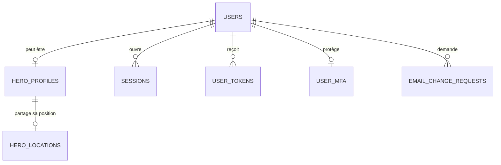

# 1. Comptes et accès

Les utilisateurs et tout ce qui touche à l'accès : profils de héros, sessions, jetons à usage unique, changements d'email et double authentification.

Légende des cardinalités : voir la [vue d'ensemble](../TABLES.md#légende-des-schémas).

## `users`

Tous les utilisateurs : citoyens, héros et modérateurs (le cahier emploie « modérateur » et « administrateur » pour le même rôle).

| Colonne | Type | Contraintes et notes |
|---|---|---|
| `id` | uuid | PK |
| `email` | citext | UNIQUE, NOT NULL. En clair : sert à la connexion (§5.2). |
| `password_hash` | text | NOT NULL, argon2id |
| `role` | text | `citizen`, `hero`, `moderator`. Passe à `hero` seulement après validation (§3.1.2). Défaut `citizen`. |
| `status` | text | `pending_activation`, `active`, `deactivated`. Défaut `pending_activation` (§4.3.1). |
| `civility` | text | NOT NULL, valeurs à fixer avec le formulaire du §5.4 |
| `last_name` | bytea 🔒 | NOT NULL |
| `first_name` | bytea 🔒 | NOT NULL |
| `birth_date` | bytea 🔒 | NOT NULL |
| `phone` | bytea 🔒 | Numéro de portable |
| `street` | bytea 🔒 | Nom de la rue |
| `address_complement` | bytea 🔒 | Complément d'adresse (§5.7) |
| `postal_code` | bytea 🔒 | |
| `city` | bytea 🔒 | |
| `country` | bytea 🔒 | |
| `avatar_path` | text | Photo de profil |
| `activated_at` | timestamptz | Rempli au clic sur le lien d'activation |
| `verified_at` | timestamptz | « Citoyen vérifié » par un modérateur (§4.3.1) : information de confiance, elle ne débloque aucun droit ; « Actif depuis le » (§5.7) |
| `verified_by` | uuid | FK `users`, ON DELETE SET NULL |
| `deactivated_at` | timestamptz | Désactivation par un modérateur (§3.1.3) |
| `failed_login_count` | smallint | Défaut 0, pour le délai croissant après échecs |
| `locked_until` | timestamptz | |
| `last_login_at` | timestamptz | |
| `created_at`, `updated_at` | timestamptz | `created_at` = « Date de création du compte » (§5.7) |

## `hero_profiles`

Complète `users` pour les super-héros. La ligne existe dès la demande, avant validation. Elle est créée par un **formulaire dédié « Devenir super-héros »** dans « Mon compte » (alias, description, message pour les modérateurs), et non à l'inscription : le formulaire du §5.4 ne distingue pas citoyen et héros. Un modérateur accepte ou refuse (§3.1.3). Une demande refusée peut être refaite : la ligne repasse à `pending`.

| Colonne | Type | Contraintes et notes |
|---|---|---|
| `user_id` | uuid | PK, FK `users` ON DELETE CASCADE |
| `alias` | citext | UNIQUE, NOT NULL. Pseudo public, utilisable pour se connecter (§5.2). |
| `bio` | text | Description publique |
| `request_message` | text | Message du demandeur aux modérateurs, non public |
| `verification_status` | text | `pending`, `approved`, `rejected`. Défaut `pending`. |
| `reviewed_by` | uuid | FK `users`, ON DELETE SET NULL |
| `reviewed_at` | timestamptz | |
| `rejection_reason` | text | |
| `location_consent_at` | timestamptz | Date du consentement au partage de position, NULL = pas de consentement (voir [`hero_locations`](#hero_locations)) |
| `created_at` | timestamptz | |

Tout ce qui est propre à un héros s'accroche à cette table plutôt qu'à `users` : `hero_films` (vidéothèque), `intervention_heroes`, `hero_reviews` et `hero_review_replies`. Comme la clé primaire est `user_id`, l'identifiant d'un héros reste celui de son compte. Côté GORM, `HeroProfile` porte les relations (`Films`, `InterventionHeroes`).

**Données publiques d'un héros** (page d'accueil §5.1 et liste §5.5, visibles par tous) : photo de profil (`users.avatar_path`), alias, description (`bio`) et note moyenne (calculée). Le nom civil, l'email et le téléphone ne sont visibles que par le héros lui-même et par les modérateurs.

## `hero_locations`

Elle donne **la position actuelle d'un héros, là où il se trouve**, et non son adresse de domicile, qui reste chiffrée dans `users`.

| Colonne | Type | Contraintes et notes |
|---|---|---|
| `hero_id` | uuid | PK, FK `hero_profiles(user_id)` ON DELETE CASCADE : une seule ligne par héros |
| `latitude`, `longitude` | numeric(9,6) | NOT NULL. En clair, car nécessaires aux calculs de distance. |
| `accuracy_m` | integer | Précision de la mesure en mètres, facultatif |
| `updated_at` | timestamptz | NOT NULL. Une position plus ancienne que le délai de péremption (30 min, `HEROS_LOCATION_TTL`) est ignorée et supprimée par la tâche de nettoyage. |

Règles :
- **Consentement :** stocké sur `hero_profiles.location_consent_at` (timestamptz, NULL = pas de consentement). Le héros le donne par `PUT /hero/location/consent` (bouton « Partager ma position ») et le retire par `DELETE /hero/location/consent`, ce qui remet la colonne à NULL et supprime la position dans la même transaction. `PUT /hero/location` répond 409 (`hero_location_consent_required`) sans consentement : le contrôle et l'écriture sont une seule requête verrouillée, donc un envoi tardif après un retrait ne recrée jamais de position. `DELETE /hero/location` ne supprime que la position. L'alerte ne retient que les héros ayant consenti.
- **Pas d'historique :** chaque mise à jour remplace la précédente (upsert sur `hero_id`), on ne garde aucune trace des déplacements. Les coordonnées sont arrondies à 3 décimales (~110 m) avant stockage.
- **Qui voit quoi :** seul le serveur lit la position (pour choisir les héros à prévenir). Aucune route ne la renvoie, ni aux citoyens, ni aux autres héros, ni aux modérateurs.
- **Limite du web :** un site ne lit la position qu'au premier plan, donc elle n'est à jour que tant que l'espace héros est ouvert.
- **Alerte de proximité :** à la déclaration d'un incident, le mail du §4.3.3 part aux modérateurs, plus aux héros dont la position est fraîche et à moins de 10 km (`HEROS_ALERT_RADIUS_KM`) si l'incident a des coordonnées. Sans héros proche, ou sans coordonnées, tous les héros actifs sont prévenus.
- **Requête :** pré-filtre par rectangle sur `(latitude, longitude)`, puis distance de Haversine en SQL. PostGIS ne serait utile qu'avec beaucoup de héros.

## `sessions`

Voir [Sessions](../stack/sessions.md).

| Colonne | Type | Contraintes et notes |
|---|---|---|
| `token_hash` | bytea | PK, SHA-256 du jeton (le jeton brut n'est que dans le cookie) |
| `user_id` | uuid | FK `users` ON DELETE CASCADE, indexé |
| `created_at` | timestamptz | |
| `last_seen_at` | timestamptz | Sert au délai d'inactivité |
| `expires_at` | timestamptz | Durée maximale, indexée pour le nettoyage |
| `mfa_verified_at` | timestamptz | NULL = en attente de 2FA |
| `revoked_at` | timestamptz | Index partiel (sessions révoquées seulement) : le nettoyage supprime les sessions expirées ou révoquées |
| `ip_address` | inet | Donnée personnelle : durée de conservation limitée |
| `device_label` | text | Résumé de l'appareil (« Chrome · macOS »), calculé à la création à partir du User-Agent. La chaîne brute n'est pas conservée. Supprimé avec la session. |

## `user_tokens`

Activation de compte et mot de passe oublié (§4.3.1, §4.3.4) : token aléatoire, stocké haché, à usage unique.

| Colonne | Type | Contraintes et notes |
|---|---|---|
| `id` | uuid | PK |
| `user_id` | uuid | FK `users` ON DELETE CASCADE |
| `type` | text | `activation`, `password_reset` |
| `token_hash` | bytea | UNIQUE |
| `expires_at` | timestamptz | NOT NULL |
| `used_at` | timestamptz | NULL = pas encore utilisé |
| `created_at` | timestamptz | |

## `email_change_requests`

Changement d'adresse email, en deux temps : le titulaire de la **nouvelle** adresse la confirme par un lien (§5.8.3), puis un modérateur l'accepte (§6.1.1). Un modérateur ne peut accepter qu'une demande confirmée.

| Colonne | Type | Contraintes et notes |
|---|---|---|
| `id` | uuid | PK. Il change quand le titulaire remplace sa demande : l'ancien lien de confirmation et l'ancienne page d'un modérateur cessent de valoir. |
| `user_id` | uuid | FK `users` ON DELETE CASCADE |
| `new_email` | citext | NOT NULL |
| `status` | text | `pending`, `approved`, `rejected` |
| `confirmed_at` | timestamptz | Date à laquelle le titulaire de `new_email` a cliqué sur le lien reçu ; NULL tant que ce n'est pas fait. Le lien est un lien signé (`internal/signedlink`) : aucun jeton n'est stocké. |
| `reviewed_by` | uuid | FK `users`, ON DELETE SET NULL |
| `reviewed_at`, `created_at` | timestamptz | |

Règles :
- Une seule demande `pending` par compte (index unique partiel) : une nouvelle demande remplace la précédente et remet `confirmed_at` à NULL.
- Une demande `pending` jamais confirmée est supprimée par la tâche de nettoyage une fois la durée de conservation des jetons passée : son lien a expiré.
- Une décision (acceptée ou refusée) est communiquée par mail au titulaire ; l'ancienne adresse est aussi prévenue d'un changement accepté.

## `user_mfa` et `mfa_recovery_codes`

Double authentification par TOTP (RFC 6238 : SHA-1, 6 chiffres, pas de 30 s). **Obligatoire pour les modérateurs** (en production, le backend refuse de démarrer sans cette obligation) ; elle s'étendra aux héros quand le besoin sera confirmé. Des passkeys pourraient s'ajouter plus tard avec une table `webauthn_credentials`.

| Table | Colonne | Type | Contraintes et notes |
|---|---|---|---|
| `user_mfa` | `user_id` | uuid | PK, FK `users` ON DELETE CASCADE |
| | `totp_secret` | bytea 🔒 | Secret de 160 bits, chiffré avec le contexte (table, colonne, `user_id`) comme les données personnelles. |
| | `confirmed_at`, `created_at` | timestamptz | `confirmed_at` NULL tant qu'un premier code n'a pas prouvé que l'application est configurée : une activation abandonnée ne protège ni ne bloque personne. |
| | `last_used_step` | bigint | NOT NULL, défaut 0. Dernier pas de 30 s accepté : un code ne sert qu'une fois, même dans sa fenêtre de validité (anti-rejeu, mis à jour par une instruction atomique). |
| `mfa_recovery_codes` | `id` | uuid | PK |
| | `user_id` | uuid | FK `users` ON DELETE CASCADE, UNIQUE avec `code_hash` |
| | `code_hash` | bytea | SHA-256 d'un code de 80 bits aléatoires (inutile de le saler) ; le code n'est montré qu'une fois. |
| | `used_at` | timestamptz | NULL = pas encore utilisé. Chaque code ne sert qu'une fois. |

Règles :
- Une session de modérateur est **limitée** (`sessions.mfa_verified_at` NULL) tant que le code n'est pas saisi, ou que la 2FA n'est pas activée alors qu'elle est obligatoire : elle ne donne accès qu'à la 2FA, à son état et à la déconnexion. Le jeton change à la validation et à l'activation, qui ferme aussi les autres sessions.
- Une 2FA qui n'est plus activée (réinitialisée par l'exploitation) limite aussitôt toutes les sessions du compte, sans attendre leur expiration.
- Un code faux compte comme un échec de connexion (verrouillage progressif, `users.failed_login_count`) ; le mot de passe seul ne remet pas ce compteur à zéro pour un compte qui a la 2FA.
- Aucune route de l'API ne désactive ni ne réinitialise la 2FA : un compte piraté ne doit pas pouvoir retirer sa propre protection. L'exploitation la réinitialise avec la commande `resetmfa` (journalisée dans `audit_logs`, action `auth.mfa_reset`).
