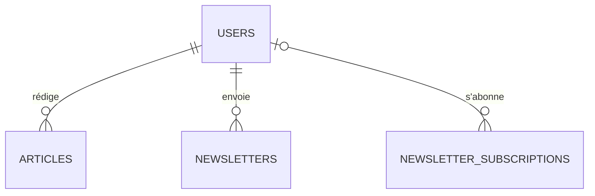

# 6. Contenu et newsletter

Les articles du blog, les abonnements à la newsletter et les newsletters envoyées.

Légende des cardinalités : voir la [vue d'ensemble](../TABLES.md#légende-des-schémas).

## `articles`

Blog géré depuis le dashboard modérateur (§8). Le HTML venant de TinyMCE est nettoyé avant enregistrement.

| Colonne | Type | Contraintes et notes |
|---|---|---|
| `id` | uuid | PK |
| `author_id` | uuid | FK `users` ON DELETE SET NULL |
| `title` | text | NOT NULL |
| `slug` | text | UNIQUE |
| `content_html` | text | HTML nettoyé |
| `cover_path` | text | |
| `status` | text | `draft`, `published` |
| `published_at`, `created_at`, `updated_at` | timestamptz | |

## `newsletter_subscriptions`

Abonnés, avec ou sans compte (§4.2). Le désabonnement passe par un lien signé (Ed25519), sans colonne de token : le lien porte l'identifiant de la ligne (jamais l'adresse), **n'expire pas** (celui d'une ancienne newsletter doit rester utilisable) et s'ouvre sans connexion. Chaque numéro de la newsletter doit le porter : l'envoi passe par `mail.Service.SendNewsletter`, qui ajoute le lien au corps et l'en-tête `List-Unsubscribe`, et refuse tout numéro qui n'en a pas. La ligne est gardée après un désabonnement : elle empêche de réabonner la personne sans nouveau consentement.

| Colonne | Type | Contraintes et notes |
|---|---|---|
| `id` | uuid | PK |
| `email` | citext | UNIQUE, NOT NULL |
| `user_id` | uuid | FK `users` ON DELETE SET NULL. Rattaché quand un compte existe avec le même email. |
| `status` | text | `pending`, `subscribed`, `unsubscribed`. Double opt-in : un abonnement depuis le footer (visiteur anonyme) reste `pending` jusqu'au clic sur un lien de confirmation signé en Ed25519, sans colonne de token. Depuis « Mon compte » (email déjà vérifié), il est directement `subscribed`. |
| `source` | text | `footer`, `account` |
| `confirmed_at` | timestamptz | Preuve de consentement : date de confirmation |
| `unsubscribed_at`, `created_at` | timestamptz | |

## `newsletters`

| Colonne | Type | Contraintes et notes |
|---|---|---|
| `id` | uuid | PK |
| `subject` | text | NOT NULL |
| `body_html` | text | NOT NULL |
| `recipient_user_id` | uuid | FK `users` ON DELETE CASCADE. NULL = tous les abonnés confirmés ; renseigné = un seul utilisateur, s'il est abonné (§4.3.2). |
| `created_by` | uuid | FK `users` ON DELETE SET NULL |
| `created_at`, `sent_at` | timestamptz | Brouillon tant que `sent_at` est NULL ; un numéro envoyé est en lecture seule. |
