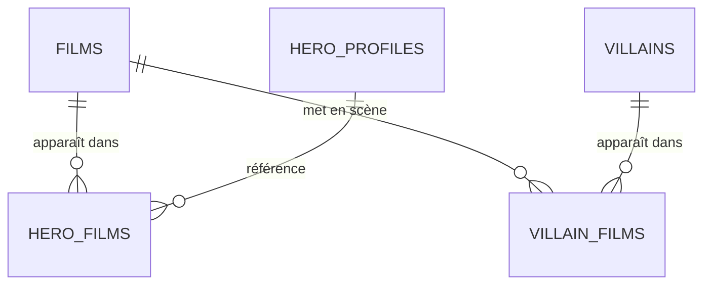

# 4. Films des héros et des vilains

Le cache des films OMDb, la vidéothèque des héros et les films des vilains.

Légende des cardinalités : voir la [vue d'ensemble](../TABLES.md#légende-des-schémas).

## `films`

Cache des réponses OMDb : le film est stocké à l'ajout, ce qui économise le quota.

| Colonne | Type | Contraintes et notes |
|---|---|---|
| `id` | uuid | PK |
| `imdb_id` | text | UNIQUE (`tt…`) |
| `title` | text | NOT NULL |
| `release_year` | smallint | |
| `poster_url` | text | |
| `plot` | text | |
| `raw` | jsonb | Réponse OMDb brute |
| `fetched_at`, `created_at` | timestamptz | |

## `hero_films`

Vidéothèque d'un héros (§5.8.4). Un modérateur valide chaque film avant affichage.

| Colonne | Type | Contraintes et notes |
|---|---|---|
| `hero_id` | uuid | FK `hero_profiles(user_id)` ON DELETE CASCADE : seul un héros a une vidéothèque |
| `film_id` | uuid | FK `films` |
| `status` | text | `pending`, `approved`, `rejected`. Défaut `pending`. |
| `reviewed_by` | uuid | FK `users`, ON DELETE SET NULL |
| `reviewed_at`, `created_at` | timestamptz | |
| | | PK `(hero_id, film_id)`. Le héros peut retirer un film : suppression de la ligne. |

## `villain_films`

Films dans lesquels apparaît un vilain, pour l'encyclopédie (§6.1.4). Renseignée par les modérateurs, donc sans statut de validation.

| Colonne | Type | Contraintes et notes |
|---|---|---|
| `villain_id` | uuid | FK `villains` ON DELETE CASCADE |
| `film_id` | uuid | FK `films` |
| `created_by` | uuid | FK `users` ON DELETE SET NULL |
| `created_at` | timestamptz | |
| | | PK `(villain_id, film_id)` |
