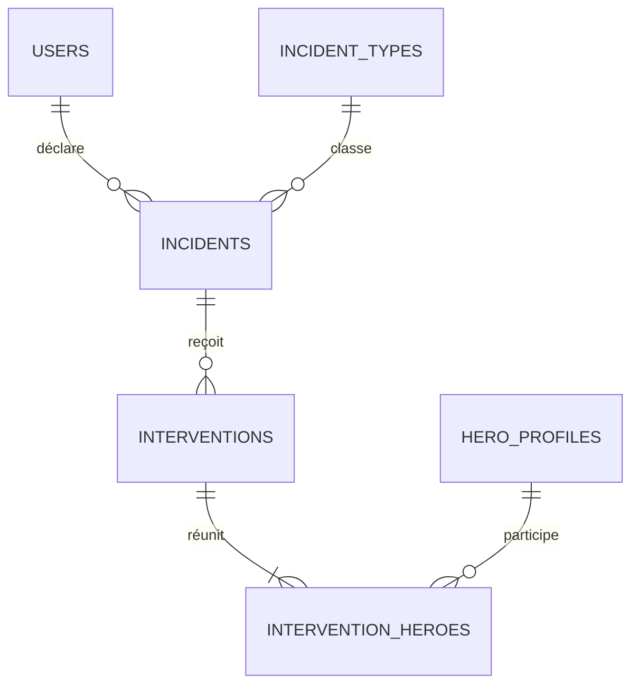

# 2. Incidents

Les incidents signalés par les citoyens, leurs types et les interventions des héros.

Légende des cardinalités : voir la [vue d'ensemble](../TABLES.md#légende-des-schémas).

## `incident_types`

Table de référence (§1.3, §5.8.1).

| Colonne | Type | Contraintes et notes |
|---|---|---|
| `id` | smallint | PK, identité |
| `code` | text | UNIQUE (`theft`, `murder`, `terror_attack`, `burglary`, `hostage_taking`…) |
| `label` | text | Libellé affiché (Vol, Meurtre, Attentat, Cambriolage, Prise d'otages…) |
| `endangers_life` | boolean | Compte dans « citoyens en danger secourus » : faux pour un vol, vrai pour une tentative de meurtre ou une séquestration (§5.8.1) |

## `incidents`

| Colonne | Type | Contraintes et notes |
|---|---|---|
| `id` | uuid | PK |
| `reporter_id` | uuid | FK `users` ON DELETE SET NULL : si le déclarant efface son compte, l'incident reste, anonymisé. Le déclarant (témoin) peut être un héros, qui peut aussi intervenir sur le même incident. |
| `type_id` | smallint | FK `incident_types`, NOT NULL |
| `description` | text | NOT NULL |
| `status` | text | `reported` (« Signalé à l'instant »), `in_progress` (« Intervention en cours »), `succeeded`, `failed`. Défaut `reported`. |
| `priority` | text | `high`, `normal`, `low`. Défaut `normal`. Modifiable par modérateurs et héros (§4.1.1). |
| `citizens_rescued` | smallint | Défaut 0. Renseigné par le témoin qui a déclaré l'incident (citoyen ou héros), corrigeable par un modérateur. Porté par l'incident et non par chaque intervention, pour ne pas compter deux fois les mêmes citoyens quand plusieurs héros interviennent. |
| `street`, `postal_code`, `city`, `country` | text | Lieu en clair : sert à repérer les doublons (§4.1.1) |
| `address_complement` | text | Facultatif : bâtiment, étage, repère, comme dans `users` |
| `latitude`, `longitude` | numeric(9,6) | Facultatifs, pour une éventuelle recherche de proximité |
| `occurred_at` | timestamptz | |
| `created_at`, `updated_at` | timestamptz | |

Index : `(status, priority, created_at DESC)` pour les listes, et `(lower(city), postal_code, lower(street))` pour les doublons. Un doublon se supprime réellement (§4.1.1) et l'action est tracée dans `audit_logs`.

## `interventions`

Une intervention est l'engagement d'une équipe de héros sur un incident : elle réunit **un ou plusieurs héros** (table `intervention_heroes`). Un incident n'a qu'une intervention en cours à la fois : les autres héros la rejoignent. Après un échec, une nouvelle intervention peut démarrer.

| Colonne | Type | Contraintes et notes |
|---|---|---|
| `id` | uuid | PK |
| `incident_id` | uuid | FK `incidents` ON DELETE CASCADE |
| `status` | text | `in_progress`, `succeeded`, `failed`. Défaut `in_progress`. |
| `proposed_status` | text | `succeeded` ou `failed`. NULL tant qu'aucun résultat n'est proposé. Résultat en attente de validation par les héros. |
| `proposed_by` | uuid | FK `hero_profiles(user_id)` ON DELETE SET NULL |
| `decided_by` | uuid | FK `users` ON DELETE SET NULL. Renseigné quand un modérateur tranche un désaccord entre héros. |
| `notes` | text | |
| `started_at`, `ended_at` | timestamptz | |

Index unique partiel : `UNIQUE (incident_id) WHERE status = 'in_progress'`.

## `intervention_heroes`

Les héros d'une intervention : c'est ici que plusieurs héros peuvent intervenir sur le même incident.

| Colonne | Type | Contraintes et notes |
|---|---|---|
| `intervention_id` | uuid | FK `interventions` ON DELETE CASCADE |
| `hero_id` | uuid | FK `hero_profiles(user_id)`. Le service vérifie en plus que le héros est `approved`. |
| `role` | text | `lead` (celui qui a démarré l'intervention), `member` |
| `participation` | text | `invited` (ajouté par un autre héros, en attente de sa confirmation), `confirmed` |
| `invited_by` | uuid | FK `hero_profiles(user_id)`. NULL pour le lead ou pour un héros qui rejoint de lui-même. |
| `outcome_validation` | text | `pending`, `approved`, `rejected`. Défaut `pending`. |
| `is_active` | boolean | Vrai tant que le héros est `confirmed` sur une intervention `in_progress`. Tenu à jour par le service dans la même transaction. |
| `invited_at`, `joined_at` | timestamptz | |
| | | PK `(intervention_id, hero_id)` |

Index `(hero_id)` : les listes de héros comptent les interventions confirmées de quelques héros seulement (la clé primaire commence par `intervention_id` et n'y sert pas).

Index uniques partiels :
- `UNIQUE (hero_id) WHERE is_active` : un héros n'a qu'une intervention à la fois (§3.1.2).
- `UNIQUE (intervention_id) WHERE role = 'lead'` : un seul lead par intervention.

Règles appliquées par le service :
- **Démarrer :** un héros qui décide d'intervenir (§4.1.1) crée l'intervention, devient `lead` et `confirmed`. L'incident passe à `in_progress`.
- **Rejoindre :** un autre héros peut rejoindre l'intervention en cours de lui-même (`confirmed` directement).
- **Ajouter des collègues :** un héros de l'intervention ajoute ceux qui sont venus avec lui. Chacun reçoit une demande de confirmation (`invited`). Il confirme (`confirmed`), ou répond qu'il n'est pas sur les lieux : sa ligne est alors **supprimée**.
- **Résultat avec un seul héros :** c'est lui qui le définit, `interventions.status` passe directement à `succeeded` ou `failed`.
- **Résultat avec plusieurs héros :** un héros propose le résultat (`proposed_status`), puis chaque héros `confirmed` le valide (`outcome_validation`). Quand tous ont validé, `status` prend la valeur proposée, `ended_at` est renseigné et `is_active` repasse à faux. Si l'un refuse, la proposition est annulée (`proposed_status` à NULL, validations remises à `pending`) et l'intervention reste en cours. Les héros encore `invited` ne comptent pas dans la validation.
- **Désaccord :** quand un héros refuse le résultat, les modérateurs sont prévenus (mail `outcome_disputed`). Un modérateur peut trancher : il fixe lui-même `status` et `ended_at`, `decided_by` garde son identifiant et l'action est tracée dans `audit_logs`.
- **Statut de l'incident :** `in_progress` tant que l'intervention est en cours, puis `succeeded` ou `failed` à sa clôture.
- **Témoin et héros :** un héros peut être le déclarant (`incidents.reporter_id`) et intervenir sur le même incident.
