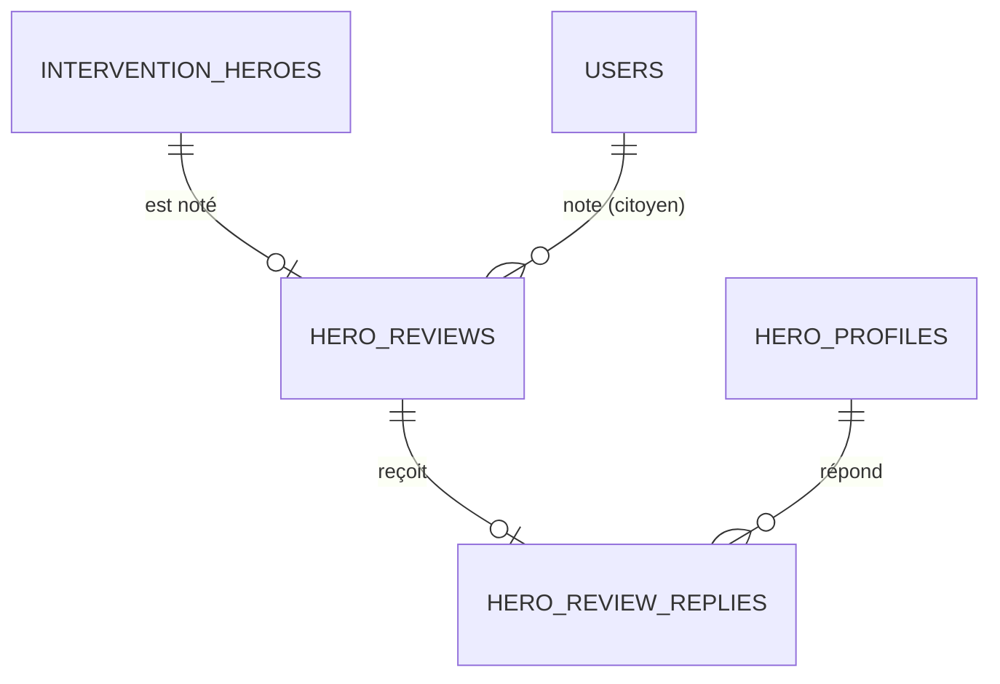

# 5. Réputation

Les notes laissées par les citoyens après une intervention et les réponses des héros.

Légende des cardinalités : voir la [vue d'ensemble](../TABLES.md#légende-des-schémas).

## `hero_reviews`

Note d'un citoyen après une intervention (§6.1.3), une note par héros participant.

| Colonne | Type | Contraintes et notes |
|---|---|---|
| `id` | uuid | PK |
| `intervention_id` | uuid | NOT NULL |
| `hero_id` | uuid | NOT NULL. FK composite `(intervention_id, hero_id)` vers `intervention_heroes` : on ne note qu'un héros qui a participé. `UNIQUE (intervention_id, hero_id)` : chaque héros d'un même incident est noté séparément. |
| `citizen_id` | uuid | FK `users` ON DELETE SET NULL. Le service vérifie que c'est le déclarant de l'incident et qu'il n'est pas le héros noté (un héros témoin ne peut pas se noter lui-même). Le mail du §4.3.3 contient un lien de notation par héros. |
| `rating` | smallint | NOT NULL, `CHECK (rating BETWEEN 1 AND 5)` |
| `comment` | text | Facultatif |
| `status` | text | `published`, `hidden` (modération, §8). Défaut `published`. |
| `moderated_by` | uuid | FK `users`, ON DELETE SET NULL |
| `moderated_at`, `created_at` | timestamptz | |

## `hero_review_replies`

Réponse du héros à un commentaire (§5.8.5).

| Colonne | Type | Contraintes et notes |
|---|---|---|
| `review_id` | uuid | PK, FK `hero_reviews` ON DELETE CASCADE |
| `hero_id` | uuid | FK `hero_profiles(user_id)`. Doit être égal à `hero_reviews.hero_id` (vérifié par le service). |
| `content` | text | NOT NULL |
| `status` | text | `published`, `pending`, `hidden`. Défaut `published` (modération a posteriori, comme les notes). |
| `moderated_by` | uuid | FK `users`, ON DELETE SET NULL |
| `moderated_at` | timestamptz | |
| `created_at` | timestamptz | |
| `edited_at` | timestamptz | NULL tant que la réponse n'a jamais été modifiée |

Le héros peut modifier sa réponse. À chaque modification, `edited_at` est mis à jour et `status` repasse à `pending` : la réponse revient en modération et n'est plus affichée tant qu'un modérateur ne l'a pas republiée (`published`) ou masquée (`hidden`).
