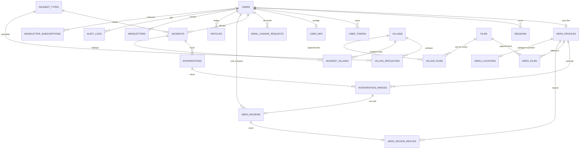

# Schéma complet

Toutes les relations des schémas par domaine en un seul. Dense : utile pour retrouver une relation précise, pas pour comprendre la structure.

Légende des cardinalités : voir la [vue d'ensemble](../TABLES.md#légende-des-schémas).

