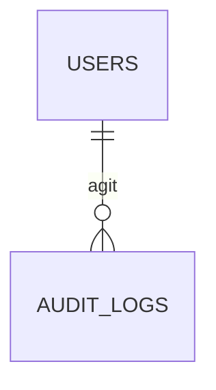

# 7. Technique

La file d'envoi des mails (repli), le journal d'audit des actions de modération, le journal des événements métier et les clés d'idempotence des actions rejouées.

Légende des cardinalités : voir la [vue d'ensemble](../TABLES.md#légende-des-schémas).

## `mail_outbox`

**Repli** si l'hébergeur ne supporte pas Docker : RabbitMQ est retenu pour les mails (voir [RabbitMQ](../stack/rabbitmq.md)) et, avec lui, cette table n'existe pas (les reprises et la dead-letter queue sont dans RabbitMQ). Sans RabbitMQ, elle est lue par un worker avec `SKIP LOCKED`.

| Colonne | Type | Contraintes et notes |
|---|---|---|
| `id` | uuid | PK |
| `user_id` | uuid | FK `users` ON DELETE SET NULL |
| `recipient_email` | citext | Donnée personnelle : à purger après envoi |
| `template` | text | `activation`, `password_reset`, `incident_created`, `incident_taken`, `incident_closed`, `intervention_invited`, `outcome_validation`, `outcome_disputed`, `newsletter_confirm`, `newsletter`… (§4.3). Ce sont aussi les types de messages de la file `mail.send`. |
| `payload` | jsonb | Références seulement (identifiants), jamais de donnée personnelle |
| `status` | text | `pending`, `sending`, `sent`, `failed` |
| `attempts` | smallint | Défaut 0 |
| `next_attempt_at` | timestamptz | Indexé avec `status` |
| `last_error` | text | |
| `created_at`, `sent_at` | timestamptz | |

## `events`

Journal des événements métier des incidents et des interventions (event sourcing limité à ces deux agrégats ; voir [Performance et synchronisation](../stack/performance-et-synchronisation.md)). **En ajout seul** : un trigger refuse tout `UPDATE` et `DELETE` ligne à ligne. Chaque action y laisse une ligne, écrite dans la **même transaction** que la mise à jour de l'état : l'une ne survit jamais sans l'autre. Les tables d'état restent la source des lectures.

| Colonne | Type | Contraintes et notes |
|---|---|---|
| `seq` | bigint | PK, identité. Ordre global : les écritures d'événements sont sérialisées par un verrou consultatif, l'ordre des numéros est donc celui des validations |
| `event_id` | uuid | UNIQUE. Identifiant de l'événement (aussi celui du document dans Elasticsearch) |
| `aggregate_type` | text | `incident` ou `intervention` |
| `aggregate_id` | uuid | L'incident, ou l'intervention |
| `version` | integer | Rang dans l'agrégat (1, 2, 3…). `UNIQUE (aggregate_id, version)` : la concurrence optimiste |
| `incident_id` | uuid | L'incident concerné, pour filtrer les flux et les historiques. Pas de clé étrangère : l'histoire survit à l'incident |
| `type` | text | `incident.declared`, `.moderated`, `.corrected`, `.priority_changed`, `intervention.started`, `.joined`, `.invited`, `.invitation_confirmed`, `.invitation_declined`, `.outcome_proposed`, `.outcome_validated`, `.outcome_disputed`, `.closed`, `.arbitrated` |
| `payload` | jsonb | Identifiants et états seulement, jamais d'adresse ni de texte libre |
| `actor_id` | uuid | Qui a agi |
| `command_id` | uuid | Clé d'idempotence de la commande à l'origine de l'événement (NULL hors commande rejouable) |
| `occurred_at` | timestamptz | Horloge du client qui a créé la commande (action faite hors ligne) |
| `recorded_at` | timestamptz | Horloge du serveur. `recorded_at - occurred_at` : le délai de synchronisation |

Index `(incident_id, seq)` et `(command_id) WHERE command_id IS NOT NULL`.

## `event_publication`

Avancement de la journalisation : le dernier événement déjà écrit dans les logs (`name`, `last_seq`), pour qu'un redémarrage ne perde ni ne répète rien.

## `processed_commands`

Commandes déjà traitées : la clé d'idempotence d'une requête (en-tête `Idempotency-Key`) et la réponse qu'elle a reçue. Un rejeu (connexion coupée pendant l'envoi, action faite hors ligne puis synchronisée) reçoit la même réponse sans rien refaire.

| Colonne | Type | Contraintes et notes |
|---|---|---|
| `user_id`, `command_id` | uuid | PK. La clé est propre à son auteur : un utilisateur ne peut ni rejouer, ni deviner, ni bloquer la clé d'un autre |
| `method`, `path` | text | La requête d'origine |
| `request_hash` | text | Empreinte de la requête (méthode, chemin, corps) : la même clé avec une autre requête est refusée (422) |
| `status_code`, `content_type`, `response` | | La réponse du premier passage. Seules les réussites sont conservées : un échec annule tout, y compris la clé |
| `created_at` | timestamptz | Purge périodique au-delà de `HEROS_COMMAND_RETENTION` (30 jours) |

## `audit_logs`

Journal des actions de modération : validation d'un héros, suppression d'un incident, désactivation d'un compte, changement de priorité. L'utilisateur applicatif n'a que `INSERT` et `SELECT`, jamais `UPDATE` ni `DELETE`.

| Colonne | Type | Contraintes et notes |
|---|---|---|
| `id` | uuid | PK |
| `actor_id` | uuid | FK `users` ON DELETE SET NULL |
| `action` | text | Ex. `hero.approve`, `incident.delete`, `user.deactivate` |
| `entity_type` | text | |
| `entity_id` | uuid | |
| `details` | jsonb | Sans donnée personnelle |
| `ip_address` | inet | Durée de conservation limitée |
| `created_at` | timestamptz | |
