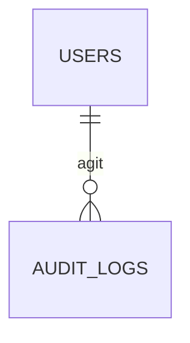

# 7. Technique

La file d'envoi des mails (repli) et le journal d'audit des actions de modération.

Légende des cardinalités : voir la [vue d'ensemble](../TABLES.md#légende-des-schémas).

## `mail_outbox`

**Repli** si l'hébergeur ne supporte pas Docker : RabbitMQ est retenu pour les mails (voir [RabbitMQ](../stack/rabbitmq.md)) et, avec lui, cette table n'existe pas (les reprises et la dead-letter queue sont dans RabbitMQ). Sans RabbitMQ, elle est lue par un worker avec `SKIP LOCKED`.

| Colonne | Type | Contraintes et notes |
|---|---|---|
| `id` | uuid | PK |
| `user_id` | uuid | FK `users` ON DELETE SET NULL |
| `recipient_email` | citext | Donnée personnelle : à purger après envoi |
| `template` | text | `activation`, `password_reset`, `incident_created`, `incident_taken`, `incident_closed`, `intervention_invited`, `outcome_validation`, `outcome_disputed`, `newsletter_confirm`, `newsletter`… (§4.3). Ce sont aussi les types de messages de la file `mail.send`. |
| `payload` | jsonb | Références seulement (identifiants), jamais de donnée personnelle |
| `status` | text | `pending`, `sending`, `sent`, `failed` |
| `attempts` | smallint | Défaut 0 |
| `next_attempt_at` | timestamptz | Indexé avec `status` |
| `last_error` | text | |
| `created_at`, `sent_at` | timestamptz | |

## `audit_logs`

Journal des actions de modération : validation d'un héros, suppression d'un incident, désactivation d'un compte, changement de priorité. L'utilisateur applicatif n'a que `INSERT` et `SELECT`, jamais `UPDATE` ni `DELETE`.

| Colonne | Type | Contraintes et notes |
|---|---|---|
| `id` | uuid | PK |
| `actor_id` | uuid | FK `users` ON DELETE SET NULL |
| `action` | text | Ex. `hero.approve`, `incident.delete`, `user.deactivate` |
| `entity_type` | text | |
| `entity_id` | uuid | |
| `details` | jsonb | Sans donnée personnelle |
| `ip_address` | inet | Durée de conservation limitée |
| `created_at` | timestamptz | |
