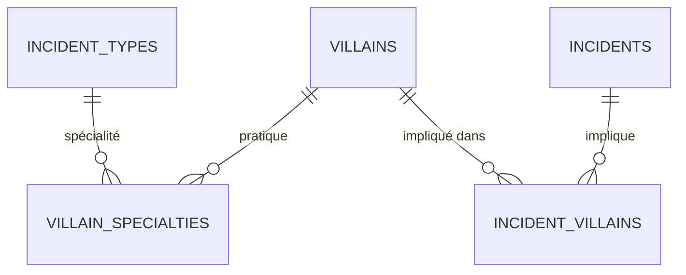

# 3. Super-héros et super-vilains

L'encyclopédie des super-vilains, leurs spécialités et leur lien avec les incidents.

Légende des cardinalités : voir la [vue d'ensemble](../TABLES.md#légende-des-schémas).

## `villains`

Encyclopédie (§5.6, §6.1.4), alimentée par les déclarations et les modérateurs.

| Colonne | Type | Contraintes et notes |
|---|---|---|
| `id` | uuid | PK |
| `alias` | text | UNIQUE, NOT NULL (pseudo) |
| `last_name`, `first_name` | text | NULL : « si connu » |
| `main_sector` | text | Secteur principal |
| `description` | text | |
| `created_by` | uuid | FK `users` ON DELETE SET NULL |
| `created_at`, `updated_at` | timestamptz | |

## `villain_specialties`

Un vilain peut avoir **plusieurs spécialités illicites** (vol, cambriolage, meurtre…).

| Colonne | Type | Contraintes et notes |
|---|---|---|
| `villain_id` | uuid | FK `villains` ON DELETE CASCADE |
| `type_id` | smallint | FK `incident_types` |
| | | PK `(villain_id, type_id)` |

## `incident_villains`

Table de liaison : **un vilain peut être lié à plusieurs incidents, et un incident peut impliquer plusieurs vilains**.

| Colonne | Type | Contraintes et notes |
|---|---|---|
| `incident_id` | uuid | FK `incidents` ON DELETE CASCADE |
| `villain_id` | uuid | FK `villains` |
| `arrested` | boolean | Défaut faux. Alimente « mis en prison » (§5.8.1, §5.8.2). |
| `incident_created_at` | timestamptz | Date de création de l'incident lié (elle ne change jamais). **Dénormalisée** : remplie par un trigger à l'insertion, jamais par le service. Elle permet à l'index `(villain_id, incident_created_at DESC, incident_id DESC)` de donner l'historique d'un vilain déjà trié, quel que soit son nombre d'incidents. |
| | | PK `(incident_id, villain_id)` |
