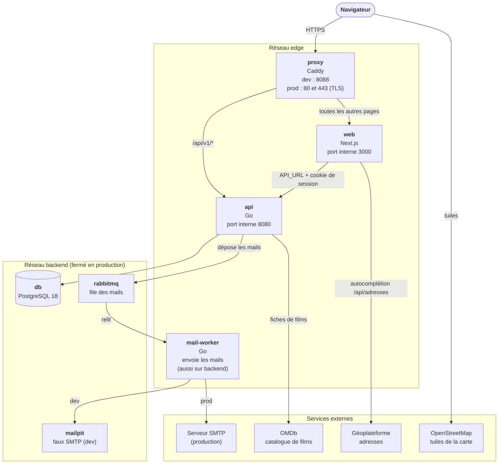

Heros-SOS tourne dans quatre conteneurs Docker : `proxy`, `web`, `api` et `db`. En développement s'y ajoutent
Mailpit (les mails), RabbitMQ et ce site de documentation. Cette page montre qui parle à qui ; la page suivante, [Une connexion de bout en bout](architecture/connexion.md), suit une connexion.

## Vue d'ensemble

À retenir :

- **Un seul point d'entrée.** Le navigateur ne voit que le proxy Caddy : **http://localhost:8088** en
  développement, 80 et 443 en production. Il sert le front Next.js et route `/api/v1/*` vers l'API : une seule
  origine, donc un cookie de session sans CORS.
- **Les ports 3000 (front) et 8080 (API) sont internes** au réseau Docker : ils ne sont pas publiés, donc
  inutilisables depuis la machine de développement. Le message `Local: http://localhost:3000` des journaux du conteneur `web`
  est celui de Next.js lui-même : ce lien ne mène nulle part, il faut passer par le proxy. (En développement,
  l'API est aussi joignable directement sur `localhost:8081`, pour `curl` et les outils.)
- **Le front appelle l'API depuis son serveur**, pas depuis le navigateur (Server Actions, rendu serveur),
  directement sur le réseau `edge`, sans repasser par le proxy.
- **La base n'est jamais exposée.** Elle est sur le réseau `backend`, fermé en production : ni la base ni l'API
  n'ont de port publié (seul le proxy en a), et la base n'a aucun accès à Internet.
- **Les mails passent par une file.** L'API dépose chaque mail dans RabbitMQ (elle n'attend que la confirmation du
  courtier) ; le service `mail-worker` le relit et l'envoie : vers Mailpit (http://localhost:8025) en développement,
  vers un vrai serveur SMTP chiffré en production. Un mail accepté survit à l'arrêt de l'API ; en cas d'échec définitif
  il part dans la file morte. Sans RabbitMQ (`HEROS_MAIL_QUEUE=memory`), l'API envoie elle-même, depuis une file en
  mémoire.
- **Deux volumes à sauvegarder** : `pgdata` (la base) et `avatars` (les photos de profil).
