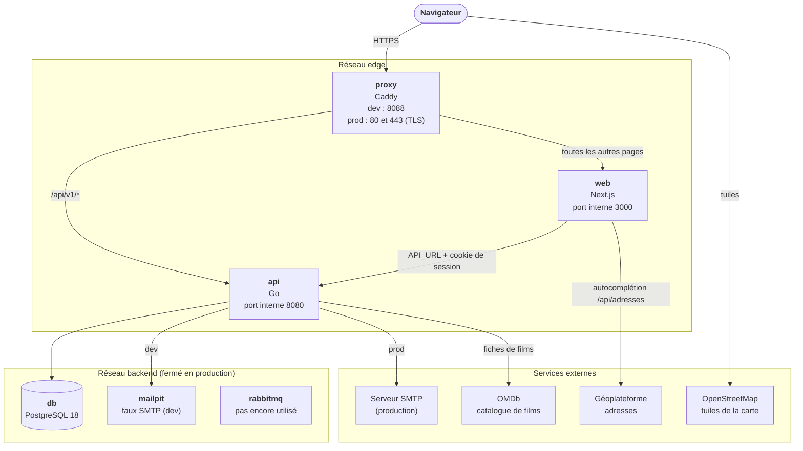
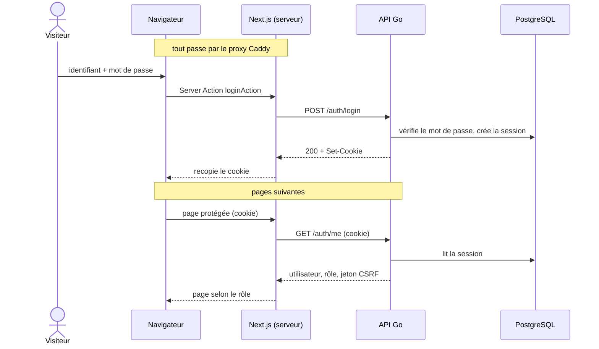

Heros-SOS tourne dans quatre conteneurs Docker : `proxy`, `web`, `api` et `db`. En développement s'y ajoutent
Mailpit (les mails), RabbitMQ et ce site de documentation. Cette page montre qui parle à qui, puis suit une connexion de bout en bout.

## Vue d'ensemble

À retenir :

- **Un seul point d'entrée.** Le navigateur ne voit que le proxy Caddy : **http://localhost:8088** en
  développement, 80 et 443 en production. Il sert le front Next.js et route `/api/v1/*` vers l'API : une seule
  origine, donc un cookie de session sans CORS.
- **Les ports 3000 (front) et 8080 (API) sont internes** au réseau Docker : ils ne sont pas publiés, donc
  inutilisables depuis la machine de développement. Le message `Local: http://localhost:3000` des journaux du conteneur `web`
  est celui de Next.js lui-même : ce lien ne mène nulle part, il faut passer par le proxy. (En développement,
  l'API est aussi joignable directement sur `localhost:8081`, pour `curl` et les outils.)
- **Le front appelle l'API depuis son serveur**, pas depuis le navigateur (Server Actions, rendu serveur),
  directement sur le réseau `edge`, sans repasser par le proxy.
- **La base n'est jamais exposée.** Elle est sur le réseau `backend`, fermé en production : ni la base ni l'API
  n'ont de port publié (seul le proxy en a), et la base n'a aucun accès à Internet.
- **Les mails passent par l'API.** En développement ils partent vers Mailpit (http://localhost:8025) ; en
  production vers un vrai serveur SMTP chiffré. La file d'envoi est dans le processus de l'API : RabbitMQ est
  démarré mais aucun code ne l'utilise encore.
- **Deux volumes à sauvegarder** : `pgdata` (la base) et `avatars` (les photos de profil).

## Une connexion de bout en bout

Le cookie de session est posé par l'API, puis recopié par le serveur Next dans le navigateur (`HttpOnly`,
`SameSite=Lax`). Le navigateur ne présente ensuite que ce cookie, à chaque page. À la connexion, le serveur Next
transmet aussi à l'API l'adresse IP du visiteur (`X-Forwarded-For`) et son `User-Agent` : l'API limite les
tentatives par IP et enregistre l'appareil de la session. Le mot de passe est vérifié avec argon2id.

Les écritures authentifiées envoient en plus le jeton CSRF reçu de `GET /auth/me` dans l'en-tête
`X-CSRF-Token`. Le détail (durées de session, codes d'erreur, noms du cookie) est dans le
[contrat avec le backend](https://github.com/ashandcompany/heros-sos/blob/develop/frontend/docs/backend-contract.md)
et les choix de sécurité dans [Stack](/backend/STACK).
