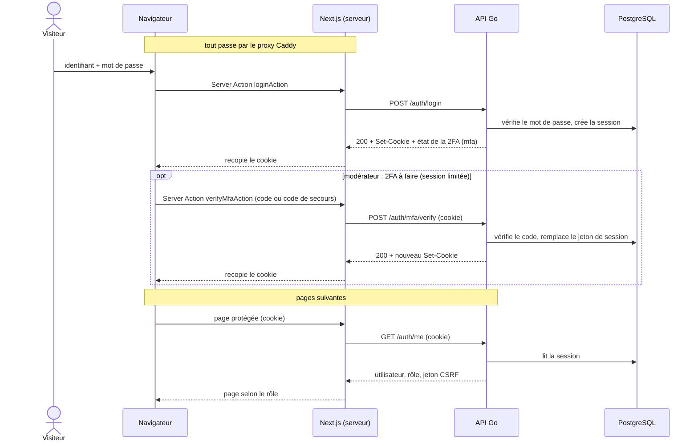

Le cookie de session est posé par l'API, puis recopié par le serveur Next dans le navigateur (`HttpOnly`,
`SameSite=Lax`). Le navigateur ne présente ensuite que ce cookie, à chaque page. À la connexion, le serveur Next
transmet aussi à l'API l'adresse IP du visiteur (`X-Forwarded-For`) et son `User-Agent` : l'API limite les
tentatives par IP et enregistre l'appareil de la session. Le mot de passe est vérifié avec argon2id.

**Double authentification des modérateurs.** Quand elle est obligatoire (toujours en production), `POST
/auth/login` ouvre une session *limitée* : l'API ne lui accepte que la 2FA, `GET /auth/me` et la déconnexion, et
répond `403 mfa_required` partout ailleurs. Le front la traite comme un visiteur et envoie le modérateur saisir
son code (`/connexion/verification`), ou activer sa 2FA la première fois (`/connexion/double-authentification`).
Un code juste remplace le jeton de session par un nouveau (contre la fixation de session) et la rend complète.
Il n'existe aucune route pour désactiver la 2FA : un appareil perdu se traite côté exploitation (`make
resetmfa`).

« Me déconnecter partout » (`POST /auth/logout-all`) ferme toutes les sessions du compte, celle-ci comprise.

Les écritures authentifiées envoient en plus le jeton CSRF reçu de `GET /auth/me` dans l'en-tête
`X-CSRF-Token`. Le détail (durées de session, codes d'erreur, noms du cookie) est dans le
[contrat avec le backend](https://github.com/ashandcompany/heros-sos/blob/develop/frontend/docs/backend-contract.md)
et les choix de sécurité dans [Sessions](/backend/stack/sessions).
