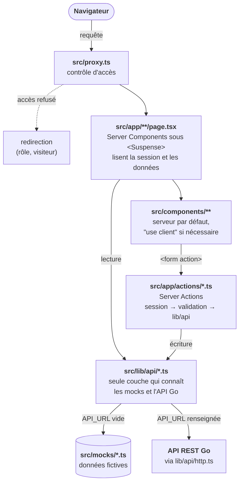
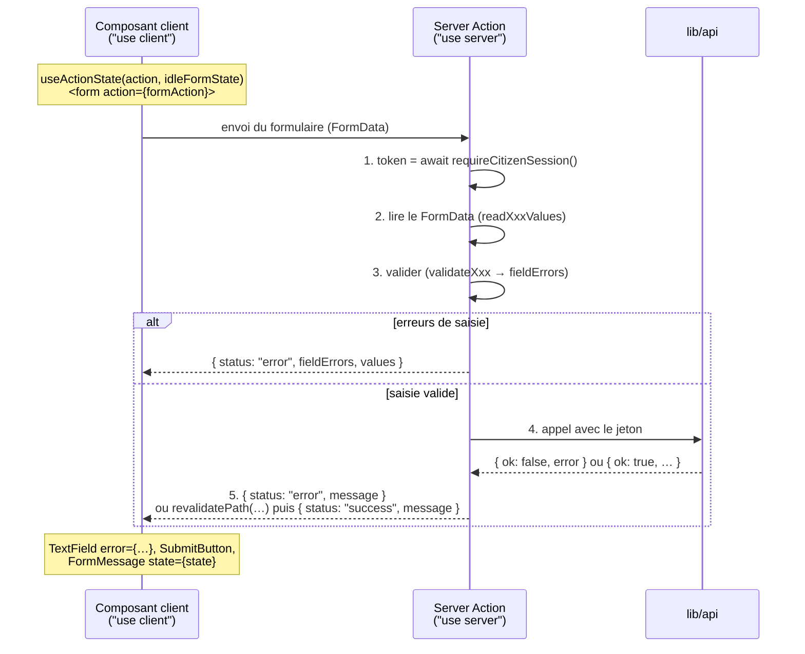

# Architecture du frontend

Ce document explique **comment les pièces s'articulent**. Pour démarrer le projet, voir le
[README](../README.md) ; pour les composants d'interface, voir [ui.md](./ui.md).

## Vue d'ensemble

Tout le code qui touche aux données ou à la session s'exécute **côté serveur**. Les composants
clients (`"use client"`) ne gèrent que l'interaction (état local, clavier, `useActionState`).

## Rôles et espaces

Trois rôles (`UserRole`, dans [src/types/auth.ts](../src/types/auth.ts)) :

| Rôle          | Espace personnel                | Layout                      | Création du compte                       |
| ------------- | ------------------------------- | --------------------------- | ---------------------------------------- |
| `citoyen`     | `/profil`                       | `app/profil` (`citizenNav`) | Inscription libre                        |
| `super-heros` | `/heros` (→ `/heros/dashboard`) | `app/heros` (`heroNav`)     | Après validation de la demande par admin |
| `admin`       | `/admin`                        | `app/admin` (`adminNav`)    | Hors inscription publique                |

- La page d'accueil de chaque rôle est dans `accountHomeByRole` ([src/lib/routes.ts](../src/lib/routes.ts)).
- Les sous-navigations (`citizenNav`, `heroNav`, `adminNav`) sont aussi dans `routes.ts` et
  affichées par `components/layout/SpaceNav`.
- Les layouts d'espace posent `robots: { index: false }` : ces pages ne sont jamais indexées.
- Un compte `super-heros` n'existe qu'une fois sa demande validée (`reviewHeroApplication`) :
  avoir le rôle suffit donc à garantir un compte validé.

### Routes

**Ne jamais écrire un chemin en dur.** Tout passe par `routes` et les fonctions dérivées
(`heroIncidentRoute(id)`, `blogArticleRoute(slug)`, `heroSheetRoute(id)`…). Les URL sont en
français (`/encyclopedie`, `/connexion`, `/mot-de-passe-oublie`). Ajouter une page = ajouter
sa route dans `routes.ts` (et dans la sous-navigation si elle doit y figurer).

## Authentification et session

### Fichiers

| Fichier                                                   | Rôle                                                                                                                                                               |
| --------------------------------------------------------- | ------------------------------------------------------------------------------------------------------------------------------------------------------------------ |
| [src/lib/cookies.ts](../src/lib/cookies.ts)               | Nom du cookie (`__Host-session` en production, `session` sinon, comme l'API) et attributs : `httpOnly`, `sameSite: lax`, `secure` en prod                          |
| [src/lib/session.ts](../src/lib/session.ts)               | `getUserFromToken(token)` : jeton → `AuthUser \| null`. Utilisable partout (pas de `next/headers`)                                                                 |
| [src/lib/server-session.ts](../src/lib/server-session.ts) | Helpers qui lisent le cookie : `getCurrentUser()`, `requireRole()`, `requireAdminSession()`, `requireCitizenSession()`, `requireHeroSession()`                     |
| [src/proxy.ts](../src/proxy.ts)                           | Contrôle d'accès avant le rendu                                                                                                                                    |
| [src/app/actions/auth.ts](../src/app/actions/auth.ts)     | `loginAction` (pose le cookie), `logoutAction` (révoque la session puis efface le cookie) et `logoutAllAction` (ferme toutes les sessions du compte)               |
| [src/lib/api/auth.ts](../src/lib/api/auth.ts)             | `login`, `getSessionUser`, `logout`, `logoutAll`, `register`, `activateAccount`, `resendActivation`, `requestPasswordReset`, `confirmPasswordReset` (API ou mocks) |
| [src/app/actions/mfa.ts](../src/app/actions/mfa.ts)       | Double authentification : `verifyMfaAction`, `startMfaSetupAction`, `enableMfaAction`, `regenerateRecoveryCodesAction` (recopient le nouveau jeton de session)     |
| [src/lib/api/mfa.ts](../src/lib/api/mfa.ts)               | `getMfaOverview`, `startMfaSetup`, `enableMfa`, `verifyMfa`, `regenerateMfaRecoveryCodes` (`/auth/mfa/*`, sans mock)                                               |

Le mode dépend de `API_URL` ([config.ts](../src/lib/api/config.ts), `isApiEnabled`) :

- **vide** : comptes mock (voir [src/mocks/users.ts](../src/mocks/users.ts)), jeton `mock-token-<id>`,
  session de 7 jours ;
- **renseignée** : comptes réels de l'API Go, jeton opaque posé par l'API, durée fixée par l'API.
  Le détail (cookie recopié, CSRF, adresse IP, erreurs) est dans
  [backend-contract.md](./backend-contract.md#2-ce-qui-est-branché--la-session).

### Connexion

1. `LoginForm` appelle `loginAction` (via `useActionState`).
2. L'action valide l'identifiant (email, ou pseudo pour un super-héros) puis appelle `login()`.
3. En cas de succès, le jeton est écrit dans le cookie `SESSION_COOKIE`, qui expire avec la
   session (`expiresAt` : 30 jours si « Rester connecté » est coché, sauf pour un modérateur dont la session reste courte ; sinon la durée de l'API).
4. Si l'API annonce une double authentification à faire (`mfa`), la session est **limitée** : le
   modérateur est envoyé à `/connexion/verification` (saisie du code, ou d'un code de secours) ou à
   `/connexion/double-authentification` (première activation). Sinon, l'utilisateur est redirigé vers
   `accountHomeByRole[role]`. Le détail est dans
   [backend-contract.md](./backend-contract.md#double-authentification-et-session-limitée).
5. En cas d'échec, `loginErrorMessage` traduit l'erreur (`LoginError` : identifiants invalides,
   compte suspendu ou non activé, trop de tentatives, service indisponible) sans dire lequel
   des deux champs est faux.

### Déconnexion

`logoutAction` appelle `logout(token)` (révocation côté API, sans effet avec les mocks), puis
efface le cookie **avec ses attributs** : un cookie `__Host-` ne s'efface que par un `Set-Cookie`
`Secure`. La révocation ne lève jamais d'erreur : le cookie est effacé même si l'API ne répond pas.

« Me déconnecter partout » (`logoutAllAction`, dans « Mon compte », « Mon profil » et `/admin/securite`)
ferme au contraire **toutes** les sessions du compte, et **rapporte l'échec** : si l'API ne répond pas, la
session reste ouverte et l'erreur s'affiche, pour ne pas faire croire que les autres appareils sont déconnectés.

Un `401` de l'API sur un appel authentifié (session expirée ou révoquée) redirige vers `/connexion`
(`apiFetch`) ; les `403`, `413`, `415` et `429` sont traduits par `toApiFailure` puis `apiFailureMessage`.

### Protection des accès : deux niveaux, volontairement redondants

1. **`proxy.ts` (optimiste, rapide)** : il lit le cookie et redirige.
   - visiteur sur `/admin`, `/profil` ou `/heros` → `/connexion` ;
   - utilisateur du mauvais rôle → son propre espace ;
   - utilisateur connecté sur une page réservée aux visiteurs (`/mot-de-passe-oublie`) → son espace.
2. **`requireRole()` (autoritaire)** : chaque Server Action et chaque composant qui lit des
   données protégées revérifie le rôle au plus près des données. Le proxy n'est **pas** une
   barrière de sécurité suffisante à lui seul.

> [!WARNING]
> Le `matcher` de `proxy.ts` doit contenir des **valeurs littérales** (analysées au build) : si
> vous ajoutez un espace protégé, ajoutez-le à la fois dans `protectedAreas` et dans `matcher`.

### Règle d'or

> [!IMPORTANT]
> Une Server Action qui modifie des données **commence par `requireXxxSession()`**. C'est ce qui
> fournit le jeton à transmettre à `lib/api/`, et c'est la vraie vérification d'autorisation.

## Couche de données : `src/lib/api/`

- Chaque domaine a son fichier (`incidents.ts`, `super-heroes.ts`, `videos.ts`…), tous
  réexportés par [src/lib/api/index.ts](../src/lib/api/index.ts). **Importer depuis `@/lib/api`**,
  jamais depuis `@/mocks`.
- Les fonctions sont `async`. Celles qui restent mockées renvoient `mockResponse(donnée)` (une
  copie `structuredClone`, pour ne jamais muter les mocks par accident).
- Les fonctions branchées choisissent selon `isApiEnabled` : `apiFetch()`
  ([http.ts](../src/lib/api/http.ts)) si `API_URL` est renseignée, le mock sinon. L'application
  démarre donc toujours sans backend.
- Chaque fonction mockée documente en commentaire l'endpoint futur
  (« Future implémentation : `GET ${API_URL}/incidents` … »). C'est la spec du branchement.
- Les mutations renvoient un résultat typé plutôt que de lever une exception :
  `{ ok: true, … } | { ok: false, error }` (ex : `LoginResult`). Les actions transforment `error`
  en message affiché.
- Les fonctions qui exigent une identité reçoivent le **jeton en premier argument**
  (`declareIncident(token, …)`).

[http.ts](../src/lib/api/http.ts) est le seul client de l'API :

| Élément             | Rôle                                                                                                                                                                                                           |
| ------------------- | -------------------------------------------------------------------------------------------------------------------------------------------------------------------------------------------------------------- |
| `apiFetch(path, …)` | Appel JSON (ou `file` : corps binaire tel quel, pour la photo) avec `sessionToken` (envoyé dans le cookie attendu par l'API), délai de 10 s, sans cache. Ajoute seul le jeton CSRF aux écritures authentifiées |
| `ApiError`          | Erreur levée pour une réponse non 2xx : `status`, `code` stable de l'API, `retryAfterSeconds`, `fields`                                                                                                        |
| `toApiFailure`      | Dans un `catch`, traduit 403, 413, 415, 429 et API indisponible en `ApiFailure` ; relance la redirection d'une session expirée (401 → `/connexion`)                                                            |
| `getApiSession`     | `GET /auth/me` (compte et jeton CSRF), mémorisé le temps d'un rendu : un seul appel par page ou action, quel que soit le nombre de lectures et d'écritures                                                     |
| `ApiSchema<"Nom">`  | Type d'un schéma de l'OpenAPI, généré dans [schema.d.ts](../src/lib/api/schema.d.ts) par `npm run api:types`                                                                                                   |
| `readSessionCookie` | Extrait le jeton du `Set-Cookie` de l'API (connexion)                                                                                                                                                          |
| `visitorHeaders`    | IP et navigateur du visiteur, à transmettre pour les routes publiques limitées par IP (connexion, inscription, contact, newsletter)                                                                            |
| `fromApiUser`       | Convertit `UserView` vers `AuthUser` : seul endroit où les rôles de l'API (`citizen`, `hero`…) apparaissent                                                                                                    |

Listes paginées : [pagination.ts](../src/lib/api/pagination.ts) (`pageQuery`, `fromApiPage`,
`toMockPage` pour les mocks, `pagePosition` pour l'affichage), type `Page<T>` dans
[src/types/api.ts](../src/types/api.ts).

Le contrat d'API est décrit dans [backend/openapi/openapi.yaml](../../backend/openapi/openapi.yaml) ;
ce qui est branché et ce qui reste à faire, dans [backend-contract.md](./backend-contract.md).

> [!NOTE]
> Avec l'API, les domaines encore mockés reçoivent une session réelle, mais leurs données sont
> indexées par les comptes mock : un vrai compte n'y retrouve rien (listes vides ; voir
> [backend-contract.md](./backend-contract.md#domaines-encore-mockés-avec-une-session-réelle)).

## Formulaires et Server Actions

Le motif utilisé partout :

Côté composant : `useActionState(action, idleFormState)`, un `<form action={formAction}>`, des champs
qui affichent `error`, un `SubmitButton` et un `FormMessage`. Côté action, dans l'ordre :

1. `const token = await requireCitizenSession()` (ou le rôle voulu) ;
2. lire le `FormData` (`readXxxValues`) ;
3. valider (`validateXxx` → `fieldErrors`) ; en cas d'erreur, renvoyer
   `{ status: "error", fieldErrors, values }` ;
4. appeler `lib/api` ; si `!ok`, renvoyer `{ status: "error", message }` ;
5. `revalidatePath(…)`, puis renvoyer `{ status: "success", message }`.

- **`FormState<Field>`** ([form-state.ts](../src/lib/validation/form-state.ts)) est le contrat
  entre action et composant : `status`, `message` global, `fieldErrors` par champ, `values` pour
  **re-remplir le formulaire** après une erreur (ne jamais y renvoyer un mot de passe).
- La validation vit dans `src/lib/validation/` (un fichier par domaine) : constantes de limites,
  `readXxxValues(formData)`, `validateXxx(values)`. Elle est **toujours exécutée côté serveur**,
  même si le navigateur a déjà contrôlé le champ.
- Après une mutation, `revalidatePath()` sur chaque page dont les données changent.
- `loginAction` utilise son propre état (`LoginFormState`) : c'est une exception historique,
  les nouveaux formulaires utilisent `FormState`.
- Les actions sont rangées par domaine dans `src/app/actions/` (`incidents.ts`, `admin.ts`,
  `hero.ts`, `account.ts`…). Plusieurs rôles peuvent partager une même logique via une fonction
  interne (voir `submitDeclaration` dans `incidents.ts`), chaque action publique imposant son rôle.

## Rendu : Server Components et `<Suspense>`

- Les `page.tsx` sont **légères** : métadonnées, en-tête, puis un composant de contenu enveloppé
  dans `<Suspense fallback={<…Skeleton />}>`. C'est le composant de contenu qui lit la session et
  les données (voir `app/heros/dashboard/page.tsx` + `HeroDashboardContent`).
- Lire `cookies()` rend la route dynamique : d'où l'obligation de le faire sous `<Suspense>`
  (voir le commentaire de [server-session.ts](../src/lib/server-session.ts)).
- `"use client"` uniquement pour : état local, événements navigateur, `useActionState`,
  `useFormStatus`, API navigateur. Un composant client ne doit pas importer `lib/api/`.
- Les props `children` des layouts sont typées avec les helpers globaux de Next
  (`LayoutProps<"/heros">`).

## Autres mécanismes à connaître

### Thème clair / sombre

**Où :** [lib/theme.ts](../src/lib/theme.ts), `ThemeToggle`.

Sombre par défaut. Le choix est gardé en `localStorage` et appliqué par un script dans `<head>`
(anti-flash).

### Design tokens

**Où :** bloc `@theme` de [globals.css](../src/app/globals.css). Voir
[ui.md](./ui.md#design-tokens).

### Adresses : autocomplétion et géocodage

**Où :** `app/api/adresses/route.ts`, `lib/geocoding.ts` (`geocodeLocation`).

- **Autocomplétion** : relais vers la Base Adresse Nationale (Géoplateforme IGN), cache de 10 min,
  l'IP des visiteurs n'est pas transmise.
- **Géocodage d'un incident** : à la déclaration et quand la modération change le lieu, adresse +
  ville → `location.coordinates` (BAN). En cas d'échec, l'incident n'a pas de position, mais la
  déclaration est acceptée quand même.

### Carte des incidents

**Où :** `app/carte` (publique), `app/heros/carte`, `components/map/`, `lib/map.ts`.

- Leaflet est chargé côté navigateur uniquement.
- Fond de carte : `MAP_TILE_URL` (OpenStreetMap par défaut, voir la politique d'usage dans
  `lib/map.ts`).
- **Espace pro** : position exacte, adresse, héros en intervention (position = lieu de
  l'intervention, aucun suivi GPS).
- **Carte publique** : incidents validés seulement, position arrondie à ~1 km, ni adresse ni héros.

### Assainissement HTML

**Où :** [lib/sanitize.ts](../src/lib/sanitize.ts).

Les articles de blog (éditeur Tiptap) passent par cette fonction avant tout affichage public.

### Pages ouvertes depuis un mail

**Où :** `app/newsletter/confirmation`, `app/newsletter/desinscription`,
`app/changement-email/confirmation`, `components/ui/TokenConfirmationForm.tsx`.

Le jeton est dans `?token=` et n'est consommé qu'au clic sur un bouton : les scanners de mails ouvrent
les liens sans cliquer. Un lien invalide ou expiré affiche un message d'erreur, jamais le détail.

### Newsletter

**Où :** cookie `newsletter_subscribed`, `app/newsletter/confirmation`.

Double opt-in : le cookie mémorise la confirmation de l'abonnement côté navigateur. Il est posé par la page
de confirmation (pas à la demande) et effacé à la désinscription.

### Pages légales

**Où :** `app/mentions-legales`, `app/confidentialite`, `components/legal/LegalPage`.

`LegalPage` reçoit un titre, la date ISO de mise à jour (`updatedAt`) et des sections (`id`,
`title`, `content`) : il génère le sommaire et les ancres. Mettre `updatedAt` à jour à chaque
modification du texte.

### Formulaire de contact

**Où :** `app/contact`, `actions/contact.ts`, `lib/validation/contact.ts`.

Public (sans session). `sendContactMessage` envoie le message par mail à l'équipe via l'API (limité par IP) ; mocké sans `API_URL`, rien n'est alors envoyé.

## Checklists

### Ajouter une page protégée

1. Créer `src/app/<espace>/<page>/page.tsx` avec `metadata` et un contenu sous `<Suspense>`.
2. Ajouter la route dans `routes.ts` (et dans la sous-navigation du rôle).
3. Dans le composant de contenu, appeler `requireRole(...)` avant de lire des données.

### Ajouter un formulaire

1. Types et limites dans `lib/validation/<domaine>.ts` (`Field`, `readValues`, `validate`).
2. Fonction d'accès dans `lib/api/<domaine>.ts` (avec le commentaire de l'endpoint futur).
3. Server Action dans `app/actions/<domaine>.ts` (voir le schéma ci-dessus).
4. Composant client avec les champs de [ui.md](./ui.md), `SubmitButton` et `FormMessage`.

### Brancher une fonction à l'API Go

1. Garder la signature ; appeler `apiFetch()` si `isApiEnabled`, le mock sinon.
2. Mapper les `ApiError` vers le `{ ok: false, error }` existant.
3. Vérifier que le type de `src/types/` correspond au schéma de `openapi.yaml`.

Détail et modèle à suivre : [backend-contract.md](./backend-contract.md#checklist-de-branchement-dune-fonction).
