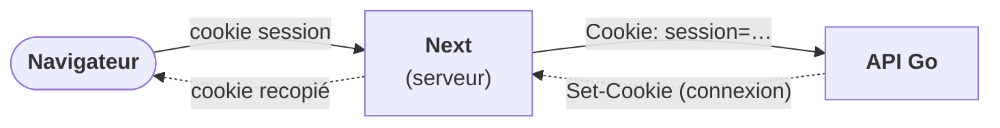

# Contrat avec le backend

Le contrat de l'API Go est [backend/openapi/openapi.yaml](../../backend/openapi/openapi.yaml)
(« spec d'abord » : les tests du backend échouent si une route diverge du fichier). Ce document
dit **où le frontend actuel s'écarte de ce contrat** et ce qu'il faut changer au moment du
branchement. À mettre à jour à chaque fonction branchée.

> [!NOTE]
> État au 21/10/2026 : **identité (inscription, activation, connexion, session, mot de passe),
> demandes de super-héros, fiches publiques des super-héros, modération des comptes, types
> d'incident, incidents et interventions (hors écrans publics), vidéothèque et avis sont branchés**
> sur l'API dès que `API_URL` est renseignée (tableau ci-dessous). Le compte (profil, photo,
> changement d'e-mail), le blog, le contact et la newsletter ont maintenant leurs routes dans le
> contrat mais ne sont **pas encore branchés**. Le reste fonctionne encore sur des mocks, y compris
> avec l'API.

## 1. Couverture : ce qui est dans le contrat, et le reste

Le contrat décrit aujourd'hui **82 opérations** (plus `/health` et `/ready`) : identité et
modération des comptes, profil du compte (`/me`, photo, changements d'e-mail), incidents,
interventions, types d'incident, super-vilains, avis sur les interventions, vidéothèque (films),
blog (articles), contact et newsletter. Les autres domaines du frontend (incidents publics,
tableaux de bord, fiches complètes du back-office) n'ont pas encore de contrat.

### ✅ Branché sur l'API

| Domaine frontend                      | Fichier de `lib/api/`                    | Contrat OpenAPI                                                                                                         |
| ------------------------------------- | ---------------------------------------- | ----------------------------------------------------------------------------------------------------------------------- |
| Connexion, session, déconnexion       | `auth.ts`                                | `/auth/login`, `/auth/me`, `/auth/logout`                                                                               |
| Inscription                           | `auth.ts`                                | `/auth/register`                                                                                                        |
| Activation du compte                  | `auth.ts`                                | `/auth/activate`, `/auth/resend-activation`                                                                             |
| Mot de passe oublié (demande, jeton)  | `auth.ts`                                | `/auth/password-reset`, `/auth/password-reset/confirm`                                                                  |
| Demande de statut super-héros         | `hero-requests.ts`                       | `/heroes/requests`, `/heroes/requests/me`, `/admin/hero-requests/*`                                                     |
| Comptes (désactivation, vérification) | `user-moderation.ts`                     | `/admin/users`, `/admin/users/{id}/deactivate`, `…/reactivate`, `…/verify`                                              |
| Incidents, interventions, équipes     | `incidents.ts`, `interventions.ts` (§ 3) | `/incidents/*`, `/interventions/*`, `/admin/interventions/{id}/decision`                                                |
| Types d'incident                      | `incident-types.ts`                      | `/intervention-types`, `/admin/intervention-types`                                                                      |
| Notes et avis                         | `reviews.ts` (§ 3)                       | `/me/interventions`, `/interventions/{id}/reviews`, `/hero/reviews*`, `/heroes/{heroId}/reviews`, `/admin/hero-review*` |
| Super-vilains                         | `villains.ts`                            | `GET /villains`, `GET /villains/{id}` (publics), `POST /villains`, `PATCH /villains/{id}`                               |
| Fiches publiques super-héros          | `super-heroes.ts` (§ 3)                  | `GET /heroes`, `GET /heroes/{heroId}` (publics)                                                                         |
| Vidéothèque (films)                   | `videos.ts`, `imdb.ts` (§ 3)             | `/films`, `/heroes/{heroId}/films`, `/hero/films*`, `/admin/hero-films*`, `/imdb/titles*`                               |

Fonctions de chaque fichier :

- `auth.ts` : `login`, `getSessionUser`, `logout`, `register`, `activateAccount`,
  `resendActivation`, `requestPasswordReset`, `confirmPasswordReset`.
- `hero-requests.ts` : `requestHeroStatus`, `getMyHeroRequest`, `getHeroApplications`,
  `reviewHeroApplication`.
- `user-moderation.ts` : `getAccounts`, `moderateAccount`.
- `incident-types.ts` : `getIncidentTypes`, `getAllIncidentTypes`, `createIncidentType`.
- `reviews.ts` : `getMyInterventions`, `rateIntervention`, `getMyReputation`, `replyToReview`,
  `getHeroPublicReviews`, `getReviewsForModeration`, `moderateReview`, `getRepliesForModeration`,
  `moderateReply`.
- `villains.ts` : `getVillains`, `getVillainsPage`, `getVillain`, `createVillain`, `updateVillain`.
- `super-heroes.ts` (fiches publiques) : `getSuperHeroes`, `getFeaturedSuperHeroes`, `getSuperHero`.
- `videos.ts` : `getMyVideos`, `addMyVideo`, `deleteMyVideo`, `getHeroVideos`, `moderateVideo`,
  `deleteVideo`, `getPublishedVideos` ; `imdb.ts` : `searchImdbTitles`, `getImdbTitle`.

### ⏳ Encore sur les mocks (ou à faire)

| Domaine frontend                   | Fonctions `lib/api/`                                                                                                                                                                                                                                                                  | Contrat OpenAPI                                                                                                                                                                                              | État    |
| ---------------------------------- | ------------------------------------------------------------------------------------------------------------------------------------------------------------------------------------------------------------------------------------------------------------------------------------- | ------------------------------------------------------------------------------------------------------------------------------------------------------------------------------------------------------------ | ------- |
| Incidents publics (accueil, carte) | `incidents.ts` : `getLatestResolvedIncidents`, `getOngoingIncidents`, `getPublicIncidentMap`, `getResolvedIncidentsByHero`, `getIncidentsByVillain`                                                                                                                                   | ❌ aucun (routes réservées aux comptes connectés)                                                                                                                                                            | mock    |
| Fiches complètes super-héros       | `super-heroes.ts` : `getSuperHeroProfiles` (back-office)                                                                                                                                                                                                                              | ❌ aucun                                                                                                                                                                                                     | mock    |
| Profil, photo, changements d'email | `account.ts` : `getMyAccount`, `updateMyContact`, `updateMyAvatar`, `requestEmailChange`, `updateNewsletterPreference`, `getEmailChangeRequests`, `reviewEmailChange` ; `super-heroes.ts` : `getMyHeroProfile`, `updateMyHeroContact`, `updateMyHeroAvatar`, `requestHeroEmailChange` | `GET /me`, `PATCH /me`, `PUT /me/avatar`, `GET /avatars/{name}`, `POST /me/email-change-requests`, `PUT /me/newsletter`, `/admin/email-change-requests/*` (un héros utilise les mêmes routes que le citoyen) | à faire |
| Tableau de bord héros, modération  | `hero-dashboard.ts`, `moderation.ts`                                                                                                                                                                                                                                                  | ❌ aucun (statistiques)                                                                                                                                                                                      | mock    |
| Blog                               | `blog.ts` : `getPublishedArticles`, `getPublishedArticle`, `getAllArticles`, `getArticle`, `createArticle`, `updateArticle`, `deleteArticle`                                                                                                                                          | `GET /articles`, `GET /articles/{slug}`, `/admin/articles`, `/admin/articles/{id}`                                                                                                                           | à faire |
| Newsletter                         | `newsletter.ts` : `subscribeToNewsletter`                                                                                                                                                                                                                                             | `POST /newsletter/subscriptions`, `POST /newsletter/subscriptions/confirm`                                                                                                                                   | à faire |
| Formulaire de contact              | `contact.ts` : `sendContactMessage`                                                                                                                                                                                                                                                   | `POST /contact/messages`                                                                                                                                                                                     | à faire |
| Déconnexion de tous les appareils  | aucune (pas d'écran)                                                                                                                                                                                                                                                                  | `POST /auth/logout-all`                                                                                                                                                                                      | à faire |
| Films des super-vilains            | aucune (pas d'écran)                                                                                                                                                                                                                                                                  | `GET /villains/{villainId}/films`, `POST /admin/villain-films`, `DELETE /admin/villains/{villainId}/films/{filmId}`                                                                                          | à faire |

> [!WARNING]
> Les « Future implémentation » écrites dans les commentaires de `lib/api/` pour les domaines non
> couverts sont des **hypothèses** du frontend, pas un contrat. Il faudra les faire valider (ou les
> remplacer) quand le backend ajoutera ces routes.

Les deux routes publiques de super-héros sont une exception : `GET /heroes` est paginé et trié par
pseudo par défaut (ou par note moyenne décroissante), et `GET /heroes/{heroId}` retourne la même
fiche. Les profils doivent être approuvés et le compte actif. Pour rester compatible avec les
cartes du frontend, `hero_profiles.bio` est exposé sous le nom `power`; `avatarUrl` n'est renseigné
que si `users.avatar_path` contient une URL ou un chemin relatif publiquement exploitable. Aucune
donnée d'identité civile n'est exposée. Elles sont branchées (voir « Fiches publiques : choix du
branchement », § 3).

## 2. Ce qui est branché : la session

### Principe : le serveur Next sert d'intermédiaire

Le navigateur ne parle **jamais** directement à l'API : tous les appels partent du serveur Next
(Server Actions, Server Components, `proxy.ts`), à travers le client
[src/lib/api/http.ts](../src/lib/api/http.ts) (`apiFetch`).

|               | Fonctionnement                                                                                                                                 |
| ------------- | ---------------------------------------------------------------------------------------------------------------------------------------------- |
| Connexion     | `loginAction` → `login()` → `POST /auth/login`. Le jeton du `Set-Cookie` de l'API est recopié dans le cookie du navigateur (même nom)          |
| Durée         | Celle de la session API : le cookie expire à `expiresAt` (7 j max pour un citoyen ou un héros, 8 h pour un modérateur)                         |
| Lecture       | `getSessionUser(token)` → `GET /auth/me`, le jeton dans l'en-tête `Cookie`. Mémorisé le temps d'un rendu (`cache` de React)                    |
| Déconnexion   | `logoutAction` → `logout()` : `GET /auth/me` (jeton CSRF) puis `POST /auth/logout` avec `X-CSRF-Token`. Le cookie est effacé dans tous les cas |
| Nom du cookie | [cookies.ts](../src/lib/cookies.ts) : `__Host-session` en production, `session` sinon : même règle que l'API (`HEROS_COOKIE_SECURE`)           |
| API en panne  | `getSessionUser` renvoie `null` (visiteur, espaces protégés fermés) et journalise l'erreur ; `login` renvoie `unavailable`                     |
| Adresse IP    | `login` transmet `X-Forwarded-For` et `User-Agent` du visiteur : l'API limite les tentatives par IP et enregistre l'appareil de la session     |

À savoir :

- **Le nom du cookie doit être le même des deux côtés.** Si l'API pose un autre nom (par exemple
  un front lancé avec `next start` en local, donc en mode production, face à une API de
  développement), `login` lève une erreur explicite au lieu d'échouer en silence.
- **`X-Forwarded-For` n'est fiable que derrière le reverse proxy** : Caddy remplace l'en-tête
  envoyé par le client, et l'API ne croit que les adresses fixes du proxy et du front
  (`HEROS_TRUSTED_PROXIES`). Le conteneur `web` ne doit donc jamais être exposé directement.
  Sans proxy (`npm run dev`), l'API ne voit que l'adresse du serveur Next.
- Les appels du serveur Next n'envoient pas d'en-tête `Origin` : l'API les accepte sans
  `HEROS_ALLOWED_ORIGINS`. Cette liste ne sert qu'aux appels directs du navigateur.
- `proxy.ts` appelle `getUserFromToken`, donc `GET /auth/me`, sur chaque page des espaces
  protégés (voir son `matcher`), en plus des vérifications de `requireRole()` pendant le rendu.
- « Rester connecté 30 jours » (case du formulaire) envoie `rememberMe` : session de 30 jours
  au lieu de 7, sans effet pour un modérateur (8 h). Le cookie suit l'`expiresAt` renvoyé ; le
  mock applique les mêmes durées.

### Domaines encore mockés avec une session réelle

Les fonctions mockées reçoivent le vrai jeton et vérifient le rôle avec la vraie session
(`userFromToken`, [session-user.ts](../src/lib/api/session-user.ts)). Leurs données sont indexées
par les identifiants des comptes mock (`user-1`, `hero-1`, `admin-1`) : un vrai compte, avec son
vrai identifiant, n'y retrouve rien de lui. Aucun compte réel n'emprunte l'identité d'un compte
mock, donc personne ne voit les données d'un autre.

> [!WARNING]
> Conséquence, tant que ces domaines ne sont pas branchés : listes vides (tableau de bord héros…),
> et **erreur 404** sur les écrans qui exigent un profil mock : modification du compte citoyen
> (contact, photo, email), « Mon profil » et ses formulaires côté héros (`findMyAccount`,
> `findMyProfile`). La photo de la barre de navigation retombe sur les initiales.

### Rôles : deux vocabulaires

| Frontend (`UserRole`) | API (`UserView.role`) |
| --------------------- | --------------------- |
| `citoyen`             | `citizen`             |
| `super-heros`         | `hero`                |
| `admin`               | `moderator`           |

La traduction se fait **à un seul endroit**, `fromApiUser` dans
[http.ts](../src/lib/api/http.ts) : les composants ne voient jamais `hero` ou `moderator`.

### Erreurs de connexion

| Code API (statut)                           | `LoginError`            | Message affiché                                     |
| ------------------------------------------- | ----------------------- | --------------------------------------------------- |
| `invalid_credentials` (401)                 | `invalid-credentials`   | Identifiant ou mot de passe incorrect               |
| `validation_failed` (422)                   | `invalid-credentials`   | Idem : le formulaire ne dit pas quel champ est faux |
| `account_deactivated` (403)                 | `account-suspended`     | Compte suspendu par la modération                   |
| `account_not_activated` (403)               | `account-not-activated` | Consulter le mail d'activation                      |
| `account_locked`, `rate_limited` (429)      | `too-many-attempts`     | Réessayer dans N minutes (`Retry-After`)            |
| Autre code, API injoignable ou délai (10 s) | `unavailable`           | Connexion momentanément indisponible                |

## 3. Écarts à résoudre avant de brancher le reste

### Erreurs : enveloppe `{ error: { code, message, fields } }`

`apiFetch` lève `ApiError` (`status`, `code`, `retryAfterSeconds`, `fields`) pour toute réponse
non 2xx. Chaque fonction mappe d'abord **ses** codes métier vers son `{ ok: false, error }` typé,
puis délègue le reste à `toApiFailure` ; un code inconnu tombe sur un message générique, jamais sur
le `message` brut de l'API.

Codes de champ de validation (422) : `required`, `invalid`, `too_short`, `too_long`, `weak`, dans
`ApiError.fields` (champ imbriqué : `address.city`). Exemple de table _code → message_ :
`toSignupErrors` dans [actions/signup.ts](../src/app/actions/signup.ts).

Statuts communs, traités une fois pour toutes dans [http.ts](../src/lib/api/http.ts) :

| Statut | Traitement                                                                                        | Message (`apiFailureMessage`)      |
| ------ | ------------------------------------------------------------------------------------------------- | ---------------------------------- |
| 401    | Appel authentifié : `apiFetch` redirige vers `/connexion` (`redirectOnUnauthorized: false` sinon) | aucun                              |
| 403    | `toApiFailure` → `forbidden`, journalisé (signe d'un bug : origine, CSRF ou rôle)                 | Action non autorisée               |
| 413    | `toApiFailure` → `payload-too-large`                                                              | Fichier trop volumineux            |
| 415    | `toApiFailure` → `unsupported-media-type`                                                         | Type de fichier refusé             |
| 429    | `toApiFailure` → `too-many-attempts`, avec `retryAfterSeconds`                                    | Réessayer dans N minutes           |
| autre  | `toApiFailure` → `unavailable`, journalisé                                                        | Service momentanément indisponible |

Les résultats des fonctions incluent `ApiFailure` ([src/types/api.ts](../src/types/api.ts)) ; les
actions affichent `apiFailureMessage(result)` ([form-state.ts](../src/lib/validation/form-state.ts))
pour ces cas.

> [!CAUTION]
> Certains codes métier sont des 403 ou des 429 (`hero_request_not_eligible`, `account_locked`…),
> à traiter **avant** `toApiFailure`. Et comme `redirect()` de Next lève une exception, un `catch`
> qui n'appelle pas `toApiFailure` doit appeler `unstable_rethrow(error)` en premier.

Écritures authentifiées : `apiFetch` ajoute seul le `csrfToken` de `GET /auth/me` dans
`X-CSRF-Token` dès qu'il reçoit un `sessionToken` sur une méthode autre que `GET`. La session est
lue par `getApiSession`, mémorisée le temps d'un rendu : la page et ses écritures ne déclenchent
qu'un seul `GET /auth/me`.

### Inscription et activation de compte

| Sujet                     | Frontend actuel                                                             | Contrat                                                                                      |
| ------------------------- | --------------------------------------------------------------------------- | -------------------------------------------------------------------------------------------- |
| Résultat de l'inscription | `SignupResult` : `{ ok, user }`, écran « vérifiez vos mails », sans session | `{ user, activationRequired: true }` : **pas de session**, un e-mail d'activation est envoyé |
| Activation                | Page `/activation?token=…` : bouton de confirmation, renvoi du lien         | Jeton reçu par e-mail à confirmer (`HEROS_ACTIVATION_PATH` = `routes.activation`)            |
| Adresse                   | `PostalAddress` : rue, code postal, ville, pays                             | Idem + champ `complement` facultatif                                                         |
| Mot de passe              | `lib/validation/signup.ts` : ≥ 10 caractères, majuscule, minuscule, chiffre | Mêmes règles (`weak` sinon) : déjà alignés                                                   |
| Téléphone                 | Règles frontend                                                             | Mobile FR (06/07) ou international (+33…), espaces et tirets ignorés                         |

> [!IMPORTANT]
> Les règles de validation du frontend et du backend doivent rester **identiques** : toute
> divergence se traduit par un formulaire qui accepte une valeur que l'API refuse. À vérifier à
> chaque modification de `lib/validation/`.

### Demandes de super-héros, comptes et types d'incident : choix du branchement

- **Demandes de super-héros** : une demande par compte, identifiée par `userId`. Le statut
  `pending | approved | rejected` correspond à `ModerationStatus` (`en-attente | valide | rejete`).
  Le contrat accepte un motif vide au refus ; **le frontend l'exige** (`validateRejectionReason`),
  car il est affiché au demandeur. Le citoyen dépose sa demande depuis « Mon compte » ; une fois
  acceptée, son rôle change aussitôt (le proxy l'envoie vers l'espace super-héros).
- **Comptes** : le contrat ne connaît pas « à contrôler / validé / rejeté », mais un état
  (`pending_activation | active | deactivated` → `AccountStatus`) et une vérification à part
  (`verifiedAt`, sans route pour l'annuler). Le tableau de bord ne compte donc plus les « comptes à
  contrôler » avec l'API (tuile masquée). Les **changements d'email** ont leurs routes
  (`/admin/email-change-requests/*`) mais ne sont pas encore branchés : la section est masquée
  avec l'API (`getEmailChangeRequests` renvoie `null`).
- **Types d'incident** : plus aucune liste en dur. Un incident embarque son type (`{ code, label }`,
  `typeCode` et `typeLabel` de l'API) ; les formulaires reçoivent la liste du référentiel et envoient
  son `id` (`typeId`). Le référentiel est **vide** dans une base neuve : tant qu'un modérateur n'a
  pas créé de type (`/admin/types-incident`), la déclaration d'incident est indisponible.

### Fiches publiques des super-héros : choix du branchement

- **Écrans** : accueil (`getFeaturedSuperHeroes` → `GET /heroes?sort=-averageRating&limit=8`),
  encyclopédie (`getSuperHeroes` lit toutes les pages, tri par pseudo) et fiche
  `/encyclopedie/super-heros/{id}` (`getSuperHero`, mémorisée le temps d'un rendu). Un héros
  inconnu, non approuvé ou désactivé répond 404 (`null`, page introuvable), y compris pour un
  ancien identifiant mock (`hero-1`).
- **Note et interventions** : `averageRating` et `interventionsCount` viennent de l'API (moyenne des
  avis publiés, interventions confirmées).
- **Fiche publique, sections encore mockées** : « Dernières interventions réussies » et « Vilains
  neutralisés » (`getResolvedIncidentsByHero`) restent vides pour un vrai héros tant que les
  incidents ne sont pas branchés. Avis et films viennent déjà de l'API.
- **Incidents mockés** : la correction d'un incident par la modération (`/admin/incidents/{id}`,
  `updateIncidentAction`) prend ses héros dans `getIncidentHeroes` (mocks), pas dans
  `getSuperHeroes` : les incidents mockés référencent les identifiants mock. À supprimer en
  branchant les incidents.
- **Pas encore branché** : espace héros (`getMyHeroProfile`, coordonnées, photo, changement
  d'email), dont les routes existent (`/me`, `/me/avatar`, `/me/email-change-requests`), et
  fiches complètes du back-office (`getSuperHeroProfiles`), faute de route.

### Vidéothèque : choix du branchement

- **Un film, plusieurs héros** : l'API stocke chaque film une fois et le rattache à un ou
  plusieurs héros. Elle renvoie **une entrée par rattachement** (`Film.hero`) : `HeroVideo.id` est
  l'identifiant du film, et un même `id` peut revenir pour deux héros dans `/films`. Les listes
  prennent donc `hero.id` + `id` comme clé React.
- **Modération par couple (héros, film)** : `POST /admin/hero-films/{heroId}/{filmId}/approve` ou
  `…/reject`, `DELETE /admin/hero-films/{heroId}/{filmId}`. Les formulaires du back-office ne
  transmettant qu'un `id`, ils envoient la clé `heroId/filmId` (`heroVideoKey`), relue par les
  actions avec `parseHeroVideoKey`.
- **Statuts** : `pending | approved | rejected` ↔ `ModerationStatus`. L'API ne sait pas remettre
  un film en attente : `moderateVideo(…, "en-attente")` est refusé (l'écran ne le propose pas).
  Les listes publiques ne renvoient pas `moderation` : leurs films sont considérés `valide`.
- **Conversion** : `plot` → `description`, `releaseYear` → `year`. Sans `videoUrl`, un film du
  catalogue pointe vers sa fiche `https://www.imdb.com/title/{imdbId}/`.
- **Pagination** : les écrans n'étant pas paginés, les fonctions lisent toutes les pages
  (100 films par appel) et renvoient un tableau trié du plus récent au plus ancien.
- **Catalogue IMDb** : la recherche passe par l'API (OMDb), la clé reste côté serveur
  (`HEROS_OMDB_API_KEY` dans `backend/.env`, voir `.env.example`). Sans clé valide, l'API répond
  `502 catalog_unavailable` : `searchImdbTitles` renvoie `{ ok: false, error: "catalog-unavailable" }`
  et l'écran affiche un message au lieu des résultats. Recherche limitée à 100 caractères.
- **Erreurs** :

  | Code API (statut)                   | Message affiché                           |
  | ----------------------------------- | ----------------------------------------- |
  | `film_already_linked` (409)         | Ce film est déjà dans votre vidéothèque   |
  | `film_not_pending` (409)            | Ce film a déjà été modéré                 |
  | `film_not_found`, `not_found` (404) | Film introuvable                          |
  | `catalog_unavailable` (502)         | Catalogue IMDb momentanément indisponible |
  | autre                               | `apiFailureMessage(toApiFailure(…))`      |

- **Ajout par un modérateur** (`/admin/videotheque`, section « Ajouter un film à un
  super-héros ») : `POST /admin/hero-films` avec `{ heroId, imdbId }`, film publié aussitôt
  (`addHeroVideo`). Les fiches complètes des super-héros étant mockées, la liste des héros vient des comptes
  (`GET /admin/users?role=hero&status=active`, `getHeroesForVideos`) : seuls leurs identifiants
  sont valides pour l'API.
- **Pas encore branché** : films des super-vilains (aucun écran), vidéos libres sans IMDb
  (`title`, `description`, `videoUrl` dans `FilmInput`).

### Avis : choix du branchement

Types dans [src/types/review.ts](../src/types/review.ts) (`HeroReview`, `ReviewReply`,
`RateableIntervention`, `HeroReputation`, `ReplyForModeration`), fonctions dans
[reviews.ts](../src/lib/api/reviews.ts).

- **Un avis par (intervention, héros)** : le déclarant note chaque héros confirmé d'une
  intervention terminée, **réussie ou échouée** (`POST /interventions/{interventionId}/reviews`
  avec `heroId`). `GET /me/interventions` renvoie une entrée par héros ; le formulaire envoie
  `interventionId` et `heroId`.
- **Publication immédiate** : un avis est `published` dès son envoi, la modération le masque
  après coup (`hidden`). Un avis masqué **ne compte plus dans la moyenne** (contrairement à
  l'ancien mock, où seule la note restait) et son commentaire n'est plus transmis au héros.
  Statuts : `published` → `valide`, `hidden` → `rejete` (`ReviewStatus`, pas d'`en-attente`).
- **Réponse du héros** : publiée à sa création, remise `pending` (`en-attente`) à chaque
  modification : la même route sert aux deux (`PUT /hero/reviews/{reviewId}/reply`). Dans
  « Ma réputation », « Modifier ma réponse » (`
`, sans JavaScript) rouvre `ReplyForm`
  prérempli (`currentReply`) ; un texte inchangé est refusé avant l'appel, pour ne pas remettre
  la réponse en vérification pour rien. Modification possible tant que l'avis est publié et
  commenté (condition de l'API).
- **Back-office** (`/admin/commentaires`) : deux onglets, « Avis des citoyens »
  (`/admin/hero-reviews`, filtre Publiés / Masqués, seuls les avis commentés sont listés) et
  « Réponses des super-héros » (`?type=reponses`, `/admin/hero-review-replies`, « À vérifier » par
  défaut). La tuile du tableau de bord compte les réponses à vérifier (`total` de
  `?status=pending`), puisqu'aucun avis n'attend de décision.
- **Pas de titre d'incident** : l'API n'en a pas (le schéma `Incident` n'a que type,
  description et lieu) et les avis ne portent que l'intervention. La liste du citoyen lit
  `GET /incidents/{id}` pour afficher « type · ville » (une requête par incident, `null` en cas
  d'échec) ; l'espace héros et le back-office affichent la date de l'avis.
- **Fiche publique** : `GET /heroes/{heroId}/reviews` ne renvoie pas de `total` : les pages sont
  lues jusqu'à une page incomplète. Un héros inconnu de l'API (404, ou identifiant mal formé en 422) n'a aucun avis, comme pour ses films.
- **Héros déclarant** : un héros qui a signalé un incident note les héros intervenus depuis
  `/heros/noter` (même `InterventionsList`, avec `role="super-heros"`). Il ne s'y voit jamais
  lui-même : l'API l'exclut de `/me/interventions`.
- **Erreurs** :

  | Code API (statut)                     | Message affiché                                            |
  | ------------------------------------- | ---------------------------------------------------------- |
  | `hero_already_reviewed` (409)         | Vous avez déjà noté ce super-héros pour cette intervention |
  | `hero_review_not_eligible` (403)      | Cette action n'est pas possible sur cet avis               |
  | `hero_review_reply_unavailable` (409) | Ce commentaire n'accepte pas de réponse                    |
  | `not_found` (404)                     | Avis ou intervention introuvable                           |
  | `validation_failed` (422)             | Certaines informations sont invalides                      |
  | autre                                 | `apiFailureMessage(toApiFailure(…))`                       |

### Incidents et interventions : choix du branchement

Fonctions dans [incidents.ts](../src/lib/api/incidents.ts) (incidents) et
[interventions.ts](../src/lib/api/interventions.ts) (équipes) ; types dans
[src/types/incident.ts](../src/types/incident.ts) (`InterventionTeam`, `TeamMember`,
`InterventionRef`). Toutes les routes demandent une session.

| Écran                                    | Fonction                                                                   | API                                                                                      |
| ---------------------------------------- | -------------------------------------------------------------------------- | ---------------------------------------------------------------------------------------- |
| Déclaration (citoyen, héros, modérateur) | `declareIncident`                                                          | `POST /incidents`, position géocodée par le frontend (`latitude`, `longitude`)           |
| « Mes incidents », « Mes déclarations »  | `getMyIncidents`                                                           | `GET /incidents?reporterId={moi}`                                                        |
| Fiche d'un incident (citoyen)            | `getCitizenIncident`                                                       | Cherchée dans `getMyIncidents` : `GET /incidents/{id}` est fermé aux citoyens            |
| Liste, fiche, carte (héros)              | `getHeroIncidents`, `getHeroIncident`, `getIncidentMap`                    | `GET /incidents`, `GET /incidents/{id}`, puis `GET /interventions/{id}` par équipe       |
| Prise en charge                          | `takeChargeOfIncident`                                                     | `POST /incidents/{incidentId}/interventions` (le héros devient lead)                     |
| Résultat                                 | `finishIntervention` → `proposeOutcome`                                    | `POST /interventions/{id}/outcome`, puis `GET` pour savoir si elle est close             |
| Équipe                                   | `joinIntervention`, `inviteHeroes`, `respondToInvitation`, `voteOnOutcome` | `…/join`, `…/invitations`, `…/invitations/me/confirm` ou `decline`, `…/outcome/validate` |
| Back-office : liste, fiche, arbitrage    | `getAllIncidents`, `getIncident`, `arbitrateIntervention`                  | `GET /incidents`, `GET /incidents/{id}`, `POST /admin/interventions/{id}/decision`       |

- **Titre** : ajouté au contrat (`title`, obligatoire, 80 caractères au plus ; migration
  `20261021130000_add_incident_title`). Un incident plus ancien a un titre vide : le frontend
  affiche « type · ville ».
- **Statuts** : `reported` → `signale`, `in_progress` → `en-cours`, `succeeded` → `resolu`,
  `failed` → `signale` (un incident en échec redevient disponible). Priorités : `high` → `haute`,
  `normal` → `normale`, `low` → `basse` (`critique` n'existe pas dans l'API).
- **Pas de modération des déclarations** : l'API diffuse un incident dès sa déclaration et prévient
  héros et modérateurs. `moderation` vaut `valide` ; le suivi du citoyen n'a pas d'étape « vérification ».
- **Vilains** : l'API en accepte plusieurs ; le formulaire en envoie un (`villainIds: [id]`) et
  l'écran affiche le premier.
- **Équipe** : le héros connecté est reconnu côté serveur (`isMe`, d'après le vrai identifiant de
  `GET /auth/me`). Seul,
  un héros clôt directement ; en équipe, le résultat proposé (proposant compris) doit être validé
  à l'unanimité. Un refus annule la proposition et prévient les modérateurs par mail.
- **Arbitrage** : la réponse de l'API ne dit pas qu'un désaccord a eu lieu (la proposition est
  effacée). Le formulaire d'arbitrage est donc proposé pour toute intervention en cours ; sans
  désaccord, l'API répond `409 intervention_dispute_not_found`, affiché tel quel.
- **Le citoyen ne voit pas l'équipe** : les interventions lui sont fermées. Sa fiche affiche
  « une équipe intervient » et, une fois l'incident résolu, renvoie vers « Mes interventions »
  pour noter.
- **Formulaires d'équipe** : ils transmettent `id` (incident) et `interventionId` (champs cachés,
  `InterventionRef`) : l'API utilise l'intervention, le mock l'incident. Sans API, les actions
  d'équipe répondent qu'elles demandent l'API (le mock n'a qu'un héros par intervention).

**Absent du contrat**, masqué avec l'API (`incidentFeatures` dans `incidents.ts`) :

| Fonction                                        | Frontend (hypothèse)                                                  | Avec l'API                                  |
| ----------------------------------------------- | --------------------------------------------------------------------- | ------------------------------------------- |
| Validation, rejet, correction d'une déclaration | `PUT /admin/incidents/{id}/moderation`, `PATCH /admin/incidents/{id}` | Masquées : fiche en lecture seule           |
| Priorité                                        | `PUT /hero/incidents/{id}/priority`                                   | Masquée (lue, jamais modifiable)            |
| « Témoin » ou « victime »                       | `reporterRole` de la déclaration                                      | Champ retiré du formulaire                  |
| Incidents résolus dans les listes               | `GET /incidents` ne les renvoie qu'à leur déclarant                   | Filtre « Résolus » retiré de l'espace héros |
| Historique des interventions terminées          | `incident.interventionId` ne désigne que l'intervention en cours      | Section « Interventions précédentes » vide  |

**Absent du contrat, encore sur les mocks avec l'API** (aucune route publique) : derniers
incidents résolus de l'accueil (`getLatestResolvedIncidents`), incidents en cours de l'espace
citoyen (`getOngoingIncidents`), carte publique (`getPublicIncidentMap`), interventions d'un héros
et incidents d'un vilain sur les fiches de l'encyclopédie (`getResolvedIncidentsByHero`,
`getIncidentsByVillain` : vides pour un vrai héros ou vilain), tableaux de bord
(`hero-dashboard.ts`, `moderation.ts`).

### Pagination

Les listes du contrat utilisent `limit` (1–100, défaut 20) et `offset`, et renvoient une page
(`HeroApplicantPage`, `UserSummaryPage`, `IncidentPage`…). Les fonctions `getXxx` du frontend
renvoient aujourd'hui des tableaux complets : en les branchant, leur passer un `PageRequest` et
leur faire renvoyer un `Page<T>` ([src/types/api.ts](../src/types/api.ts)), avec les outils de
[pagination.ts](../src/lib/api/pagination.ts) :

| Outil          | Rôle                                                                                          |
| -------------- | --------------------------------------------------------------------------------------------- |
| `pageQuery`    | Chaîne de requête : `limit`, `offset` ramenés dans les bornes de l'API, filtres non vides     |
| `fromApiPage`  | Page de l'API → `Page<T>`, avec la conversion de chaque élément                               |
| `toMockPage`   | Découpe une liste mockée comme l'API, pour garder la même signature avec et sans backend      |
| `pagePosition` | Page courante et nombre de pages, pour le composant de pagination des écrans d'administration |

Exception : quand l'écran affiche toute la liste (formulaires, vidéothèque), la fonction lit
toutes les pages avec `limit: MAX_PAGE_SIZE` et renvoie un tableau (`getIncidentTypes`,
`fetchAllFilms` dans `videos.ts`).

### Variable d'environnement

`API_URL` (lue par le serveur au démarrage, jamais exposée au navigateur) doit pointer vers la
base **avec** le préfixe du contrat (champ `servers` de l'OpenAPI) :

| Contexte                                 | `API_URL`                                                                |
| ---------------------------------------- | ------------------------------------------------------------------------ |
| Pile Docker (`make up`, `make up-prod`)  | `http://api:8080/api/v1` (fixé dans `docker-compose.*.yml`, à la racine) |
| `npm run dev` + API de `make up-dev`     | `http://localhost:8081/api/v1`                                           |
| `npm run dev` + API lancée avec `go run` | `http://localhost:8080/api/v1`                                           |

Voir le [README](../README.md#variables-denvironnement).

## 4. Garder types et contrat synchronisés

Les formes de l'API sont générées depuis l'OpenAPI par
[`openapi-typescript`](https://openapi-ts.dev/) dans
[src/lib/api/schema.d.ts](../src/lib/api/schema.d.ts) (`npm run api:types`). Le fichier est
versionné : l'image Docker du frontend est construite sans le dossier `backend/`.

1. Une réponse brute de l'API se type avec `ApiSchema<"NomDuSchéma">` ([http.ts](../src/lib/api/http.ts)),
   **jamais** avec une interface écrite à la main : le compilateur vérifie alors chaque
   conversion.
2. `src/types/` reste la forme « frontend » (rôles, statuts en français). Les fonctions de
   `lib/api/` branchées convertissent la forme de l'API vers ces types ; **les composants ne
   manipulent jamais la forme brute**.
3. Après toute modification de `backend/openapi/openapi.yaml` : `npm run api:types`, puis
   corriger ce que `tsc` signale. La CI du frontend (lancée aussi quand le contrat change)
   échoue si `schema.d.ts` n'est pas à jour (`npm run api:types:check`).
4. Une route ajoutée au backend sans contrat est refusée par ses propres tests : le frontend
   n'a donc pas à anticiper de route absente de `openapi.yaml`.

## Checklist de branchement d'une fonction

Modèle à suivre : [src/lib/api/auth.ts](../src/lib/api/auth.ts) (`login`, `getSessionUser`,
`logout`).

1. La route existe-t-elle dans `openapi.yaml` ? Sinon, la faire ajouter côté backend d'abord.
2. Garder la signature ; brancher sur `isApiEnabled` : `apiFetch(…)` si l'API est configurée,
   le mock sinon (l'application doit toujours démarrer sans backend).
3. Passer le jeton dans `sessionToken` (le jeton CSRF est ajouté seul aux écritures).
4. Typer la réponse brute avec `ApiSchema<"…">` et la convertir (rôles, statuts, dates) vers les
   types de `src/types/`. Liste : `PageRequest` en entrée, `Page<T>` en sortie (`pageQuery`,
   `fromApiPage`, `toMockPage` pour le mock).
5. Mapper les codes métier (`ApiError.code`) vers le résultat `{ ok: false, error }`, puis
   `return toApiFailure(error, "…")` ; ajouter `ApiFailure` au type du résultat et afficher
   `apiFailureMessage` dans l'action.
6. Mettre à jour le tableau de la section 1.
